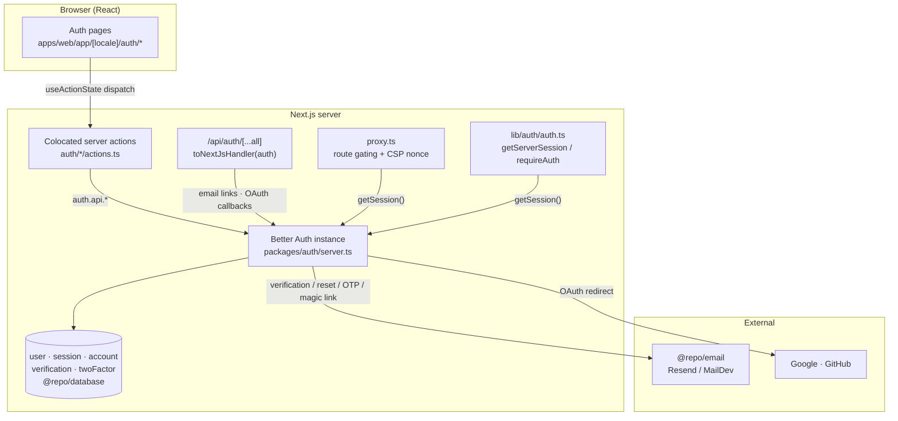

Authentication is built on **[Better Auth](https://www.better-auth.com/)** rather than hand-rolled session logic. A single `auth` instance is configured in `packages/auth/server.ts`, mounted at the catch-all route `/api/auth/[...all]`, and backed by the Prisma/PostgreSQL adapter. Every flow — email/password, social, magic link, email OTP, two-factor, and password reset — runs through that one instance. The auth pages reach it **server-side**: a form dispatches a server action, and the action calls `auth.api.*` directly. The typed `authClient` (`packages/auth/client.ts`) remains for session hooks and browser-side plugin calls, but the auth pages no longer use it.

## Ownership: who owns what

The integration is split between the **`@repo/auth` package** (the Better Auth server + client instances and the RBAC definitions) and the **auth pages** in the web app (`apps/web/app/[locale]/auth/*`), which are thin UIs over colocated server actions.

### `@repo/auth` package (`packages/auth/`)

| File | Responsibility |
| --- | --- |
| `server.ts` | The `betterAuth({...})` instance — providers, plugins, sessions, rate limits, email hooks. The source of truth for what auth can do. |
| `client.ts` | The `createAuthClient({...})` instance and the re-exported method bindings (`signIn`, `signUp`, `useSession`, `twoFactor`, `organization`, `subscription`, `emailOtp`, `admin`). |
| `permissions.ts` | Dual RBAC: platform `admin` roles and organization roles, plus the access-control statements. The role/permission matrix itself is out of scope here — see `packages/auth/permissions.ts`. |
| `keys.ts` | The Zod-validated env schema (`BETTER_AUTH_SECRET`, OAuth keys, Stripe keys, `MAX_ORGS_PER_USER`). Throws on startup if a required var is missing or malformed. |
| `stripe-client.ts`, `plans.ts`, `stripe-hooks.ts`, `billing-authorize.ts` | Billing — see the [Payment](../payment) section. |

Package exports (`package.json`):

| Subpath | What you get |
| --- | --- |
| `@repo/auth` | Permission constants + roles + the `auth` instance re-export |
| `@repo/auth/server` | Server-only `auth` instance and the `Auth` type |
| `@repo/auth/client` | `authClient` and the bound method exports (client-only, `"use client"`) |
| `@repo/auth/permissions` | `ADMIN_ROLES`, `ORG_ROLES`, `ac`/`orgAc`, role definitions, `PERMISSIONS`, `RESOURCES` |
| `@repo/auth/keys` | The env schema (`keys()`) |

### The auth pages (`apps/web/app/[locale]/auth/`)

Most pages follow the same **"thin page, fat client"** shape: a Server Component (`page.tsx`) awaits `params`, loads the localized error dictionary, and renders a `"use client"` form component colocated in a `components/` subdir next to the page. Each form keeps react-hook-form for client-side validation and submits through a **server action** driven by `useActionState`; the action re-validates with `safeParse` and returns field/root errors as state (no design-system split, no `authClient` in the browser).

```tsx
// page.tsx — the pattern, repeated for most flows
export default async function ForgotPasswordPage({ params }: ForgotPasswordPageProps) {
  const { locale } = await params;
  const dict = await getDictionary(locale);
  return <ForgotPasswordForm errors={dict.errors.action} />;
}
```

Sign-in is the one exception: its `page.tsx` is a Server Component that hosts the `<Tabs>` shell directly (reading `?tab=` to pre-select a tab and `?callbackUrl=` for the post-login destination) and renders three per-method client components rather than a single client.

| Route | Page → Client | Flow |
| --- | --- | --- |
| `/auth/sign-in` | `sign-in/page.tsx` → `components/{sign-in-form,magic-link-sign-in,email-otp-sign-in}.tsx` | Password, social, magic link, email OTP (page hosts the tabs) |
| `/auth/sign-up` | `sign-up/page.tsx` → `components/sign-up-form.tsx` | Register with email/password or social |
| `/auth/verify-email` | `verify-email/page.tsx` → `components/verify-email-card.tsx` | "Check your email" + resend |
| `/auth/forgot-password` | `forgot-password/page.tsx` → `components/forgot-password-form.tsx` | Request a reset email |
| `/auth/reset-password` | `reset-password/page.tsx` → `components/reset-password-form.tsx` | Set a new password from a token |
| `/auth/2fa` | `2fa/page.tsx` → `components/two-factor-form.tsx` | Enter the TOTP second factor |

Shared pieces (`AuthCard`, `SocialProviders`, and the zod schemas) live at `auth/components/` and `auth/schemas.ts` — there is no design-system auth-molecule layer.

## Enabled methods & plugins

The `auth` instance enables a wide surface through the plugin array in `server.ts`. Each server plugin has a matching client plugin in `client.ts`.

| Capability | Server config | Client plugin |
| --- | --- | --- |
| Email & password | `emailAndPassword` (verification required) | built-in `signIn.email` / `signUp.email` |
| Social (Google, GitHub) | `socialProviders` | built-in `signIn.social` |
| Magic link | `magicLink()` plugin | `magicLinkClient()` |
| Email OTP | `emailOTP()` plugin | `emailOTPClient()` |
| Two-factor | `twoFactor()` plugin (TOTP + email OTP) | `twoFactorClient({ onTwoFactorRedirect })` |
| Multi-session | `multiSession()` | `multiSessionClient()` |
| Platform admin RBAC | `admin({ ac, roles })` | `adminClient({ ac, roles })` |
| Organizations & teams | `organization({ ac, roles })` | `organizationClient({ ac, roles })` |
| Stripe billing | `stripe({...})` (conditional) | `stripeClient({ subscription: true })` |
| Next.js cookies | `nextCookies()` | — |

See [Configuration](./configuration) for the full breakdown of each option.

## Architecture



Outbound: an auth page dispatches its colocated server action, which calls `auth.api.*` in-process — no browser `fetch` to `/api/auth/*` is involved. That route still matters for traffic the server can't originate: the links in verification, reset and magic-link emails, and OAuth provider callbacks. The Better Auth instance runs the flow, persists via Prisma, and sends transactional email through `@repo/email`. Server Components read the resulting session through the cached helpers in `lib/auth/auth.ts`, and the edge `proxy.ts` gates every page on it.

Because `auth.api.*` bypasses Better Auth's HTTP-path rate limiter (which only runs on `/api/auth/*`), brute-forceable actions re-apply `enforceRateLimit` server-side — see `apps/web/lib/auth/rate-limit.ts`.

## Persistence

Better Auth's Prisma adapter reads and writes a small set of tables (`packages/database/prisma/schema.prisma`):

| Model | Holds |
| --- | --- |
| `User` | Identity + `emailVerified`, `twoFactorEnabled`, `role`, `banned`, profile fields |
| `Session` | Active sessions (`token`, `expiresAt`, `ipAddress`, `userAgent`, `activeOrganizationId`) |
| `Account` | Credentials and linked OAuth accounts (hashed `password`, provider tokens) |
| `Verification` | Short-lived tokens for email verification, magic links, OTP, password reset |
| `TwoFactor` | Per-user TOTP `secret` + `backupCodes` |
| `RateLimit` | Rate-limit counters (storage is set to `database`) |

## Doc pages in this section

| Page | What it covers |
| --- | --- |
| [Configuration](./configuration) | The `betterAuth({...})` instance: providers, plugins, sessions, rate limiting, email hooks, and the env schema. |
| [Sign Up & Email Verification](./sign-up-and-verification) | Registration via email/password or social, and the mandatory email-verification gate. |
| [Sign In](./sign-in) | The tabbed sign-in page: password, social, magic link, and email OTP — plus the 2FA hand-off. |
| [Two-Factor Authentication](./two-factor) | The TOTP/email-OTP second factor, the `onTwoFactorRedirect` hook, and the `/auth/2fa` step. |
| [Password Reset](./password-reset) | Forgot-password → reset-password, token handling, and session revocation. |
| [Sessions & Route Protection](./sessions-and-routing) | Session lifetime, the cookie cache, the `proxy.ts` gate, and the cached server helpers. |

## Source files

- `packages/auth/server.ts` — the `betterAuth({...})` instance and plugin array
- `packages/auth/client.ts` — `authClient` and the bound method exports
- `packages/auth/permissions.ts` — admin + org RBAC (see Authorization)
- `packages/auth/keys.ts` — env schema
- `packages/utils/auth.ts` — timing constants (session/OTP/magic-link expiry)
- `apps/web/app/api/auth/[...all]/route.ts` — the Better Auth Next.js handler
- `apps/web/app/[locale]/auth/*` — the auth pages and their clients
- `apps/web/lib/auth/auth.ts` — `getServerSession`, `requireAuth`, `hasOrgPermission`
- `apps/web/proxy.ts` — edge route gating and CSP nonce
