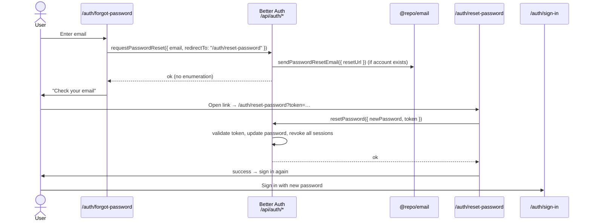

Password reset is a two-page, token-based flow. `/auth/forgot-password` requests a reset email; the emailed link carries a token to `/auth/reset-password`, where the user sets a new password. Resetting **revokes every existing session**, so a leaked session can't survive a reset.

## Requesting a reset

`forgot-password/components/forgot-password-client.tsx` calls `requestPasswordReset` and points the eventual link at the reset page:

```tsx
async function handleSubmit(data: ForgotPasswordFormValues) {
  const { error } = await authClient.requestPasswordReset({
    email: data.email,
    redirectTo: PAGE_ROUTES.RESET_PASSWORD,   // "/auth/reset-password"
  });
  if (error) throw new Error(error.message || errors.sendResetEmail);

  setSuccess(true);
}
```

On the server, `emailAndPassword.sendResetPassword` hands the generated `url` to `@repo/email`:

```ts
sendResetPassword: async ({ user, url }) => {
  await sendPasswordResetEmail({ email: user.email, resetUrl: url });
},
```

Better Auth builds `url` from `redirectTo` plus a one-time token, so the emailed link resolves to `/auth/reset-password?token=<token>`.

<Callout type="info">
`requestPasswordReset` is designed to **not reveal whether an email exists** (anti-enumeration) — it resolves successfully either way, and the UI always shows the same "check your email" confirmation.
</Callout>

## Setting a new password

The reset page is `force-dynamic` and reads the token from the query string:

```tsx
// reset-password/page.tsx
export const dynamic = "force-dynamic";
const [{ locale }, { token }] = await Promise.all([params, searchParams]);
return <ResetPasswordClient errors={dict.errors.action} token={token} />;
```

`reset-password/components/reset-password-client.tsx` guards on the token before doing anything: with no token it renders the `ResetPasswordInvalidLink` component (an "Invalid Reset Link" screen that links back to `/auth/forgot-password`). With a token, it submits the new password:

```tsx
async function handleSubmit(data: ResetPasswordFormValues) {
  if (!token) throw new Error(errors.resetPassword);
  const { error } = await authClient.resetPassword({ newPassword: data.password, token });
  if (error) throw new Error(error.message || errors.resetPassword);
  setSuccess(true);
}
```

### Sessions are revoked on reset

Because `revokeSessionsOnPasswordReset: true` is set on the auth instance, a successful reset invalidates **all** of the user's existing sessions. After resetting, the user must sign in again with the new password — there is no auto-sign-in on this path (unlike email verification).

## End-to-end sequence



## Related: changing a password while signed in

`changePassword` is exported from `@repo/auth/client` and is rate-limited (`/change-password`, 3/min), but it belongs to the **account security** UI (`/account/security`), not the auth pages — a signed-in user changes their password there rather than going through the reset flow.

## Source files

- `apps/web/app/[locale]/auth/forgot-password/page.tsx` — server page
- `apps/web/app/[locale]/auth/forgot-password/components/forgot-password-client.tsx` — `requestPasswordReset`
- `apps/web/app/[locale]/auth/reset-password/page.tsx` — token from `searchParams`, `force-dynamic`
- `apps/web/app/[locale]/auth/reset-password/components/reset-password-client.tsx` — `resetPassword`, token guard
- `apps/web/app/[locale]/auth/reset-password/components/reset-password-invalid-link.tsx` — no-token "Invalid Reset Link" screen
- `packages/auth/server.ts` — `sendResetPassword`, `revokeSessionsOnPasswordReset`
