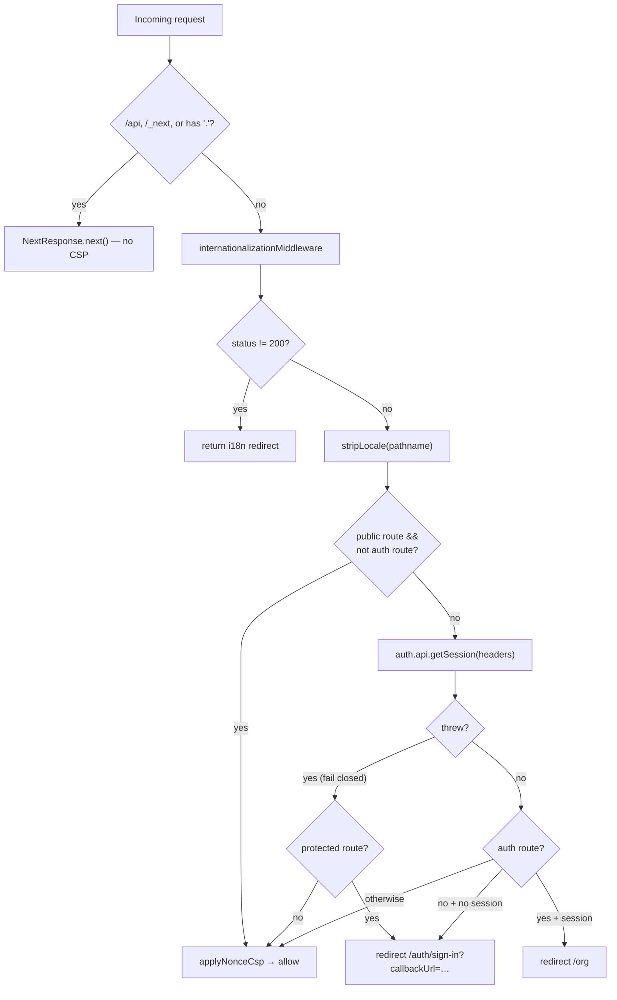

Once a flow mints a session, two layers enforce it: the edge **`proxy.ts`** gate (which page can you even reach) and the cached **server helpers** in `lib/auth/auth.ts` (what does a Server Component or action see). Both read the same Better Auth session.

## Session lifetime & the cookie cache

```ts
session: {
  expiresIn: SESSION_EXPIRES_IN_DAYS * SECONDS_PER_DAY,   // 7 days
  updateAge: SESSION_UPDATE_AGE_DAYS * SECONDS_PER_DAY,   // 1 day — sliding refresh
  cookieCache: { enabled: true, maxAge: COOKIE_CACHE_MAX_AGE_MINUTES * SECONDS_PER_MINUTE }, // 5 min
},
```

- A session lives **7 days** and slides forward when used (`updateAge` of 1 day).
- The **cookie cache** stores a short-lived signed copy of the session in the cookie itself. For up to 5 minutes, `getSession` can be answered from the cookie **without a database round-trip** — important for the proxy, which runs on every navigation, and for serverless cold paths.
- `multiSession()` allows several concurrent device sessions per user. The `Session` row records `ipAddress`, `userAgent`, `activeOrganizationId`, and `activeTeamId`, so the active org/team travels with the session.

## The edge proxy gate

`apps/web/proxy.ts` is the single middleware entry point (Next.js 16 renamed `middleware.ts` → `proxy.ts`). It runs in a fixed order:

1. **Skip** `/api`, `/_next`, and any path containing a `.` (static files) — these bypass the proxy entirely (no CSP, no gating). Auth endpoints under `/api/auth/*` thus enforce their own auth.
2. **i18n first** — run `internationalizationMiddleware`; if it returns a non-200 (locale redirect), return immediately. Route gating only happens once the locale is settled.
3. **Strip locale** — `stripLocale()` normalizes `/vi/org`, `/fr/org`, … to `/org` so the route checks are locale-agnostic.
4. **Gate** — match the normalized path against `AUTH_ROUTE_PREFIXES` (`startsWith`) and `PUBLIC_ROUTE_PREFIXES` (exact `===`).
5. **Fail closed** — if the session check throws, protected routes still redirect to sign-in; only public/auth routes are allowed through.

### Default-deny routing

The allowlists live in `apps/web/lib/routes.ts` and are deliberately tiny:

```ts
export const PUBLIC_ROUTE_PREFIXES = [PAGE_ROUTES.HOME] as const;   // just "/"

export const AUTH_ROUTE_PREFIXES = [
  PAGE_ROUTES.SIGN_IN, PAGE_ROUTES.SIGN_UP, PAGE_ROUTES.FORGOT_PASSWORD,
  PAGE_ROUTES.RESET_PASSWORD, PAGE_ROUTES.MAGIC_LINK, PAGE_ROUTES.VERIFY_EMAIL,
  PAGE_ROUTES.TWO_FACTOR,
] as const;
```

Anything that is **neither public nor an auth route requires a session**. This is a default-deny posture: dynamic routes like `/acme/billing` are protected automatically, without anyone having to enumerate them. Two redirect rules follow:

- **Unauthenticated → protected route**: redirect to `/auth/sign-in?callbackUrl=<original path>`.
- **Authenticated → auth route**: redirect to `/org` (a signed-in user can't see sign-in/sign-up).

<Callout type="warn">
The post-login redirect param is inconsistent: the proxy sets `callbackUrl`, `requireAuth` sets `returnTo`, and the sign-in tab components currently honor **neither** (they always route to `/org`). See [Sign In](./sign-in).
</Callout>

### Decision flow



### CSP nonce

On every gated response the proxy also calls `applyNonceCsp`, which generates a per-request nonce, sets it as the `x-nonce` header (so Server Components can read it via `headers()`), and attaches a `Content-Security-Policy` header. Touch this whenever you add a top-level route group or change the allowlists.

## Cached server helpers

Server Components and server actions should read the session through `apps/web/lib/auth/auth.ts`, not by calling Better Auth directly:

```ts
// Deduplicated across layout + page + helpers within one request
export const getServerSession = cache(async () =>
  auth.api.getSession({ headers: await headers() })
);
```

- **`getServerSession()`** — wrapped in `React.cache`, so the layout, the page, and any helper share a **single** auth round-trip per request.
- **`requireAuth(returnTo?)`** — returns the session or `redirect`s to `/auth/sign-in?returnTo=…`. Use it in protected pages/layouts.
- **`hasOrgPermission(orgId, permissions)`** — reuses `getServerSession`, then calls `auth.api.hasPermission(...)`; returns `{ userId }` or `null`. The org-scoped authorization primitive, backed by the roles in `packages/auth/permissions.ts`.

The proxy is a coarse gate (is there *a* session?); these helpers are the fine-grained check (is *this* user allowed on *this* org/resource?). A protected page typically relies on the proxy for the redirect and `requireAuth`/`validateOrgMembershipBySlug` for the authoritative check.

## Notes

- The proxy uses `auth.api.getSession` directly (it runs at the edge, outside React), while server components use the `React.cache`-wrapped `getServerSession` — same source, different call sites.
- **Fail-closed** means an auth outage degrades to "everyone is logged out of protected routes," never "everyone is let in."

## Source files

- `apps/web/proxy.ts` — edge gate, redirects, CSP nonce
- `apps/web/lib/routes.ts` — `AUTH_ROUTE_PREFIXES`, `PUBLIC_ROUTE_PREFIXES`, `PAGE_ROUTES`
- `apps/web/lib/auth/auth.ts` — `getServerSession`, `requireAuth`, `hasOrgPermission`
- `packages/auth/server.ts` — `session` config, `multiSession()`
- `packages/database/prisma/schema.prisma` — `Session` model
