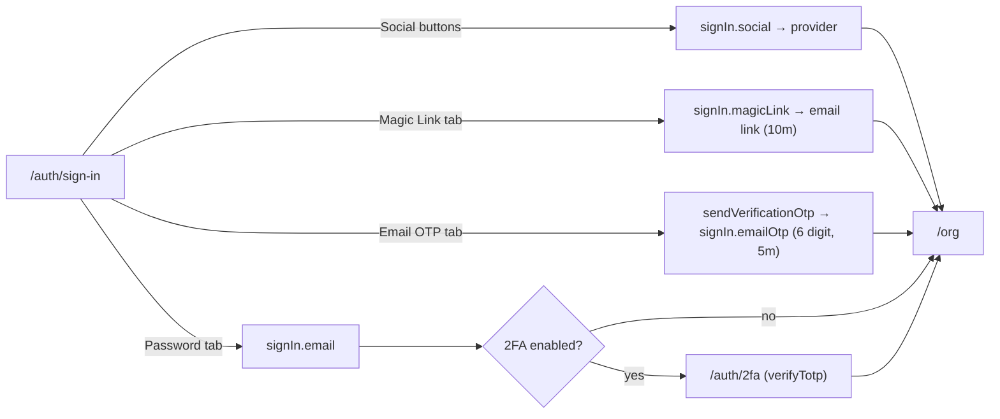

`/auth/sign-in` is the busiest auth page: a single `Tabs` UI hosts **four** ways in. `sign-in-client.tsx` manages all of them in one client component, each calling a different `authClient` method but converging on the same destination — `/org` — once a session exists.

```tsx
<Tabs defaultValue="password">
  <TabsTrigger value="password">…</TabsTrigger>
  <TabsTrigger value="magic-link">…</TabsTrigger>
  <TabsTrigger value="otp">…</TabsTrigger>
</Tabs>
```

## Password (and social)

The password tab renders `SignInForm`, which also carries the Google/GitHub buttons.

```tsx
async function handleSubmit(data: SignInFormValues) {
  const normalizedEmail = data.email.toLowerCase().trim();
  const result = await signIn.email({
    email: normalizedEmail,
    password: data.password,
    rememberMe: data.rememberMe,
  });
  if (result.error) throw new Error(result.error.message || errors.signIn);
  router.push(PAGE_ROUTES.ORG);
  router.refresh();
}

function handleSocialLogin(provider: SocialProvider) {
  signIn.social({ provider, callbackURL: PAGE_ROUTES.ORG });
}
```

- **`rememberMe`** is passed through to Better Auth, which controls whether the session cookie is persistent or session-scoped.
- On success the client calls `router.push("/org")` **and** `router.refresh()` — the refresh re-runs Server Components so the freshly minted session cookie is picked up immediately.
- Social sign-in delegates the redirect to `callbackURL`; control never returns to the form.

<Callout type="warn">
The `proxy.ts` gate appends `?callbackUrl=<original path>` when it bounces an unauthenticated user to sign-in, and `requireAuth` appends `?returnTo=...`. The sign-in client reads **neither** — it always routes to `/org` after a successful sign-in. If you want post-login to return the user to where they were headed, read the `callbackUrl` param in `sign-in-client.tsx` and pass it to `router.push`. See [Sessions & Route Protection](./sessions-and-routing).
</Callout>

## Magic link

The magic-link tab requests a one-time login link by email:

```tsx
const result = await authClient.signIn.magicLink({
  email: normalizedEmail,
  callbackURL: PAGE_ROUTES.ORG,
});
// success → show "Check your email for the magic link!" inline
```

The link is generated server-side by the `magicLink()` plugin and emailed via `sendMagicLinkEmail`. It **expires in 10 minutes** (`MAGIC_LINK_EXPIRES_IN_MINUTES`). Clicking it hits the plugin's verify endpoint, which establishes a session and redirects to `callbackURL` (`/org`).

### The `/auth/magic-link` landing page

`magic-link/page.tsx` is the **failure/landing** surface for the flow, driven entirely by a `?error=` query param:

| `?error=` | Rendered state |
| --- | --- |
| `expired` | "This magic link has expired. Please request a new one." |
| `invalid` | "This magic link is invalid. Please request a new one." |
| _(none)_ | A generic "Check your email" confirmation |

A successful link click redirects to `/org`, not here — so in practice this page is reached when verification fails (the plugin redirects with `?error=…`) or when navigated to directly.

## Email OTP

The OTP tab is a **two-step** flow held in local state (`otpSent`):

```tsx
// Step 1 — send the code
await authClient.emailOtp.sendVerificationOtp({ email: normalizedEmail, type: "sign-in" });
setOtpSent(true);

// Step 2 — verify the code
await authClient.signIn.emailOtp({ email: normalizedEmail, otp: otpCode });
router.push(PAGE_ROUTES.ORG);
router.refresh();
```

The code is **6 digits** (`OTP_LENGTH`) and **expires in 5 minutes** (`OTP_EXPIRES_IN_MINUTES`). On the server, `sendVerificationOTP` switches on `type` — here `"sign-in"` routes to `sendSignInOTPEmail`. A "Use different email" button resets `otpSent` to restart at step 1.

## The two-factor hand-off

When a user with 2FA enabled signs in with a correct password, Better Auth does **not** return a full session — it returns a "two-factor required" result. The client's `twoFactorClient` is configured to intercept this:

```ts
twoFactorClient({
  onTwoFactorRedirect() {
    if (typeof window !== "undefined") window.location.href = "/auth/2fa";
  },
})
```

So the browser is sent to `/auth/2fa` to complete the second factor before any session is granted. See [Two-Factor Authentication](./two-factor).

## Method comparison



## Notes

- **The email-based methods normalize identically** — password, magic link, and email OTP all apply `toLowerCase().trim()` before the call, so casing or whitespace can't fork an account across methods. Social sign-in delegates identity to the provider, so there's no email field to normalize.
- **Tab deep-links don't work yet** — links elsewhere in the app to `/auth/sign-in?tab=magic-link` / `?tab=otp` land on the default password tab because the client ignores the `tab` param (see the [verification page](./sign-up-and-verification) note).
- The `proxy.ts` gate redirects already-signed-in users away from `/auth/sign-in` to `/org`, so a logged-in user can't see this page.

## Source files

- `apps/web/app/[locale]/auth/sign-in/page.tsx` — server page
- `apps/web/app/[locale]/auth/sign-in/sign-in-client.tsx` — tabbed UI, all four methods
- `apps/web/app/[locale]/auth/magic-link/page.tsx` — magic-link landing / error states
- `packages/auth/server.ts` — `magicLink` and `emailOTP` plugin config
- `packages/auth/client.ts` — `magicLinkClient`, `emailOTPClient`, `twoFactorClient`
