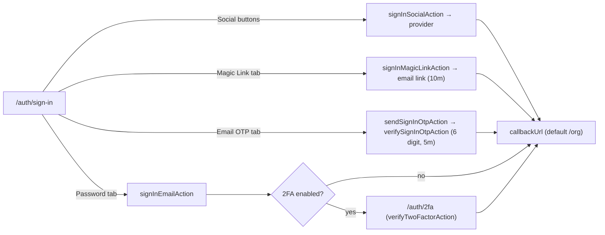

`/auth/sign-in` is the busiest auth page: a single `Tabs` UI hosts **four** ways in. `sign-in/page.tsx` is a Server Component that hosts the `Tabs` shell, and three per-tab client components (`components/{sign-in-form,magic-link-sign-in,email-otp-sign-in}.tsx`) each dispatch a different server action through `useActionState`. The browser never calls Better Auth directly — the actions run `auth.api.*` server-side.

```tsx
// page.tsx reads ?tab= and resolves it to the initial tab
<Tabs defaultValue={resolveTab(tab)}>
  <TabsTrigger value="password">…</TabsTrigger>
  <TabsTrigger value="magic-link">…</TabsTrigger>
  <TabsTrigger value="otp">…</TabsTrigger>
</Tabs>
```

## Password (and social)

The password tab renders `SignInForm`, which also carries the Google/GitHub buttons.

```tsx
// components/sign-in-form.tsx — RHF validates, then dispatches the action
const [state, formAction, isPending] = useActionState(
  signInEmailAction,
  initialFormState
);

onSubmit={form.handleSubmit((values) =>
  startTransition(() => formAction(values))
)}

// on success the effect navigates to the resolved callbackUrl
router.push(callbackUrl);
router.refresh();

// social stays a plain awaited call — it redirects to the provider
async function handleSocialLogin(provider: SocialProvider) {
  const result = await signInSocialAction(provider, callbackUrl);
  if (result.success && result.data?.url) window.location.href = result.data.url;
}
```

- **`rememberMe`** is passed through to Better Auth, which controls whether the session cookie is persistent or session-scoped.
- On success the effect calls `router.push(callbackUrl)` **and** `router.refresh()` — the refresh re-runs Server Components so the freshly minted session cookie is picked up immediately.
- **2FA short-circuits the redirect**: when the action returns `data.twoFactorRequired`, the effect routes to `/auth/2fa` instead and skips the refresh.
- Social sign-in returns a provider URL that the handler assigns to `window.location.href`; control never returns to the form.

<Callout>
`proxy.ts` appends `?callbackUrl=<original path>` when it bounces an unauthenticated user here. `page.tsx` resolves it through `resolveCallbackUrl` and passes the result to all three tabs, so a bounced user lands back where they were headed. The resolver rejects protocol-relative (`//evil.com`) and cross-origin targets, falling back to `/org` — so a crafted `?callbackUrl` cannot turn this page into an open redirect. See [Sessions & Route Protection](./sessions-and-routing).
</Callout>

## Magic link

The magic-link tab requests a one-time login link by email:

```tsx
// components/magic-link-sign-in.tsx
const [state, formAction, isPending] = useActionState(
  signInMagicLinkAction,
  initialFormState
);
// dispatched as formAction({ ...values, callbackUrl })
// success → render <MagicLinkSentCard /> inline
```

The link is generated server-side by the `magicLink()` plugin and emailed via `sendMagicLinkEmail`. It **expires in 10 minutes** (`MAGIC_LINK_EXPIRES_IN_MINUTES`). Clicking it hits the plugin's verify endpoint, which establishes a session and redirects to `callbackURL` (`/org`).

<Callout type="warn">
There used to be a dedicated `/auth/magic-link` landing page for the failure/expired-link state (driven by a `?error=` param), but its `page.tsx` was removed. `PAGE_ROUTES.MAGIC_LINK` still exists in `lib/routes.ts` and is currently unused — the only live magic-link UI is the inline `MagicLinkSentCard` (`sign-in/components/magic-link-sent-card.tsx`) shown on this tab after a successful request.
</Callout>

## Email OTP

The OTP tab is a **two-step** flow. `EmailOtpSignIn` holds the entered address in local state and swaps between two inner components, each with its own `useActionState`:

```tsx
// Step 1 — EmailOtpRequest dispatches sendSignInOtpAction, then lifts the email
onSent(form.getValues("email").toLowerCase().trim());

// Step 2 — EmailOtpVerify dispatches verifySignInOtpAction with the code,
// carrying the lifted email as a ride-along value
formAction({ ...values, email });
// success → router.push(callbackUrl)
```

The code is **6 digits** (`OTP_LENGTH`) and **expires in 5 minutes** (`OTP_EXPIRES_IN_MINUTES`). On the server, `sendVerificationOTP` switches on `type` — here `"sign-in"` routes to `sendSignInOTPEmail`. A "Use different email" button clears the lifted email to restart at step 1.

## The two-factor hand-off

When a user with 2FA enabled signs in with a correct password, Better Auth does **not** return a full session — it returns a "two-factor required" result, and the browser is sent to `/auth/2fa` before any session is granted. See [Two-Factor Authentication](./two-factor) for the redirect hook and the rest of the flow.

## Method comparison



## Notes

- **The email-based methods normalize identically** — password, magic link, and email OTP all apply `toLowerCase().trim()` before the call, so casing or whitespace can't fork an account across methods. Social sign-in delegates identity to the provider, so there's no email field to normalize.
- **Tab deep-links work** — `page.tsx` reads the `?tab=` searchParam through `resolveTab()` and passes it to `<Tabs defaultValue>`, so links to `/auth/sign-in?tab=magic-link` / `?tab=otp` open directly on that tab (an unknown value falls back to `password`). The verify-email page's alternative-method buttons rely on this.
- The `proxy.ts` gate redirects already-signed-in users away from `/auth/sign-in` to `/org`, so a logged-in user can't see this page.

## Source files

- `apps/web/app/[locale]/auth/sign-in/page.tsx` — server page; hosts the Tabs, resolves `?tab=` and `?callbackUrl=`
- `apps/web/app/[locale]/auth/sign-in/components/{sign-in-form,magic-link-sign-in,email-otp-sign-in}.tsx` — the three per-tab client components
- `apps/web/app/[locale]/auth/sign-in/actions.ts` — `signInEmailAction`, `signInMagicLinkAction`, `sendSignInOtpAction`, `verifySignInOtpAction`
- `apps/web/app/[locale]/auth/actions.ts` — `signInSocialAction` (shared by sign-in and sign-up)
- `packages/auth/server.ts` — `magicLink` and `emailOTP` plugin config
- `packages/auth/client.ts` — `magicLinkClient`, `emailOTPClient`, `twoFactorClient`
