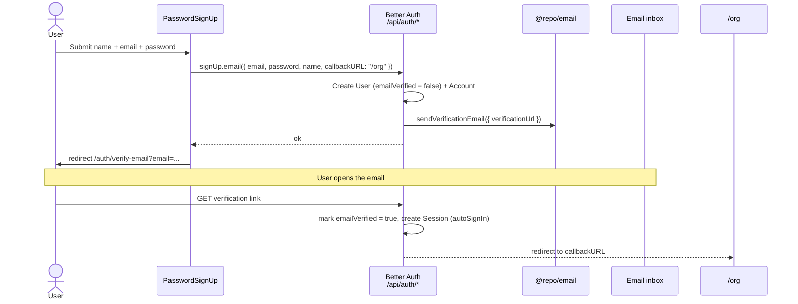

Registration happens at `/auth/sign-up`. A new user can register with **email + password** or with a **social provider** (Google/GitHub). Because the auth instance sets `requireEmailVerification: true`, an email/password user must verify their address before they can sign in — so the sign-up flow ends not at the dashboard but at a "check your email" screen.

## The sign-up client

`apps/web/app/[locale]/auth/sign-up/components/password-sign-up.tsx` (the `PasswordSignUp` component) is a thin wrapper over `signUp.email`:

```tsx
async function handleSubmit(data: SignUpFormValues) {
  const normalizedEmail = data.email.toLowerCase().trim();

  const result = await signUp.email({
    email: normalizedEmail,
    password: data.password,
    name: data.name,
    callbackURL: "/org",
  });

  if (result.error) {
    throw new Error(result.error.message || errors.signUp);
  }

  router.push(`/auth/verify-email?email=${encodeURIComponent(normalizedEmail)}`);
}
```

Two details worth noting:

- **Email is normalized** (`toLowerCase().trim()`) before it ever reaches the server — the same normalization is applied on sign-in, so casing/whitespace can't create a "different" account.
- **`callbackURL: "/org"`** is where the user lands *after they verify*, not after submitting the form. On a successful submit the client redirects to `/auth/verify-email`; the `callbackURL` is stored with the verification token and consumed when the emailed link is clicked.

Social sign-up uses the same `signIn.social` call as sign-in — there is no separate "social sign-up" endpoint:

```tsx
function handleSocialLogin(provider: SocialProvider) {
  signIn.social({ provider, callbackURL: "/org" });
}
```

Social accounts are pre-verified by the provider, so they skip the email-verification gate entirely and go straight to `callbackURL`.

## Why verification is mandatory

The gate is configured in `packages/auth/server.ts`:

```ts
emailAndPassword: {
  enabled: true,
  requireEmailVerification: true,   // can't sign in until verified
  // ...
},
emailVerification: {
  sendVerificationEmail: async ({ user, url }) => {
    await sendEmailVerificationEmail({ email: user.email, userName: user.name, verificationUrl: url });
  },
  sendOnSignUp: true,                 // fire the email automatically on registration
  autoSignInAfterVerification: true,  // clicking the link signs them in
},
```

- **`sendOnSignUp: true`** — the verification email is sent automatically as part of `signUp.email`; the client does not send it explicitly.
- **`autoSignInAfterVerification: true`** — when the user clicks the link, Better Auth verifies the token, sets `User.emailVerified = true`, establishes a session, and redirects to the stored `callbackURL` (`/org`). The user does not have to return to the sign-in page.

## The verify-email page

`/auth/verify-email` is the screen the user lands on after registering. `verify-email/page.tsx` reads the `?email=` query param **server-side** and passes it as a prop, so `VerifyEmailClient` (`components/verify-email-client.tsx`) shows *which* address the link went to without a client `useSearchParams` round-trip. The client renders the presentational `VerifyEmailCard` and offers a **resend** with a 60-second cooldown:

```tsx
// verify-email/page.tsx — read the address server-side
const [{ locale }, { email }] = await Promise.all([params, searchParams]);
return <VerifyEmailClient email={email ?? null} errors={dict.errors.action} />;

// components/verify-email-client.tsx — resend with cooldown
const handleResend = useCallback(() => {
  if (!email || cooldown > 0) return;
  startResendTransition(async () => {
    try {
      const { error } = await authClient.sendVerificationEmail({ email, callbackURL: PAGE_ROUTES.ORG });
      if (error) {
        setResendError(error.message || errors.resendVerificationEmail); // API error → surface it, no false success
        return;
      }
      setResendSuccess(true);
      setCooldown(RESEND_COOLDOWN_SECONDS); // 60s
    } catch {
      setResendError(errors.resendVerificationEmail); // network failure
    }
  });
}, [email, cooldown, errors.resendVerificationEmail]);
```

The page also offers two **alternative sign-in methods** (magic link, email OTP) for users who don't want to wait on the verification email — both are passwordless and verify the address as a side effect.

<Callout type="info">
The alternative-method buttons link to `/auth/sign-in?tab=magic-link` and `/auth/sign-in?tab=otp`. The sign-in page reads the `tab` searchParam through `resolveTab()` and passes it to `<Tabs defaultValue>`, so these links open directly on the matching tab (see [Sign In](./sign-in)).
</Callout>

## End-to-end sequence (email/password)



## Notes

- **Resend uses the query-param email verbatim**, so a tampered `?email=` would resend to that address — but only ever sends a *verification* email for an account that exists, which leaks nothing actionable.
- A user who tries to **sign in before verifying** is rejected by `requireEmailVerification`; the verify-email page (and its resend) is the recovery path.
- Because verification is rate-limited (`/sign-up/email` and the verification endpoints), the 60-second client cooldown is UX sugar on top of a real server-side limit.

## Source files

- `apps/web/app/[locale]/auth/sign-up/page.tsx` — server page (loads dictionary)
- `apps/web/app/[locale]/auth/sign-up/components/password-sign-up.tsx` — `PasswordSignUp`: `signUp.email`, social, redirect
- `apps/web/app/[locale]/auth/verify-email/page.tsx` — server page; reads `?email=` server-side
- `apps/web/app/[locale]/auth/verify-email/components/verify-email-client.tsx` — resend + cooldown
- `packages/design-system/components/molecules/auth/verify-email-card.tsx` — presentational card + alternative-method links
- `packages/auth/server.ts` — `emailAndPassword` + `emailVerification` config
