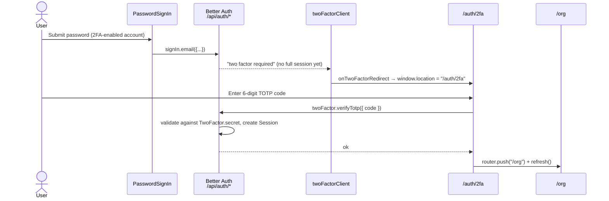

When a user has two-factor enabled, a correct password (or other first factor) is **not enough** to mint a session. Better Auth returns a "two-factor required" result, the client redirects to `/auth/2fa`, and only a valid second factor completes the sign-in.

## Server configuration

The `twoFactor()` plugin (`packages/auth/server.ts`) is configured with both a TOTP authenticator and an email-OTP fallback:

```ts
twoFactor({
  issuer: env.NEXT_PUBLIC_APP_NAME,        // shown in authenticator apps
  otpOptions: {
    async sendOTP({ user, otp }) {
      await sendTwoFactorOTPEmail({ email: user.email, otp, expiresInMinutes: OTP_EXPIRES_IN_MINUTES });
    },
    period: TWO_FACTOR_OTP_PERIOD_MINUTES,  // 5
    digits: TWO_FACTOR_DIGITS,              // 6
  },
}),
```

Per-user 2FA state is persisted in the `TwoFactor` model (`secret`, `backupCodes`) and flagged on `User.twoFactorEnabled`. The `/two-factor/*` endpoints are rate-limited to 5 requests/minute.

## Enabling 2FA

Generating the TOTP secret, showing the QR code, and issuing backup codes happens in **account settings** (`/account/security`), not on the auth pages — a user must already be signed in to turn it on. This section covers the *challenge* side: proving the second factor at sign-in.

## The redirect hook

The client never has to detect the 2FA branch manually. `twoFactorClient` (`packages/auth/client.ts`) registers a redirect callback that Better Auth invokes whenever a flow needs a second factor:

```ts
twoFactorClient({
  onTwoFactorRedirect() {
    if (typeof window !== "undefined") {
      window.location.href = "/auth/2fa";
    }
  },
})
```

So `signIn.email` (or any first factor) on a 2FA-enabled account triggers a full-page navigation to `/auth/2fa`.

## The /auth/2fa page

`two-factor-client.tsx` verifies the TOTP code and, on success, lands the user at `/org`:

```tsx
async function handleSubmit(data: TwoFactorFormValues) {
  const result = await twoFactor.verifyTotp({ code: data.code });
  if (result.error) throw new Error(result.error.message || errors.invalidVerificationCode);
  router.push(PAGE_ROUTES.ORG);
  router.refresh();
}
// renders <TwoFactorForm method="totp" ... />
```

<Callout type="warn">
The page only wires **TOTP** (`verifyTotp`, `method="totp"`). The server *also* configures an email-OTP second factor (`otpOptions.sendOTP`), but there is no UI here to request or verify an emailed 2FA code. Email 2FA is configured-but-unused by the current `/auth/2fa` page; add a `verifyOTP` path and a "send code by email" control if you want it reachable.
</Callout>

<Callout type="warn">
Unlike the other auth pages, **`/auth/2fa` is not in `AUTH_ROUTE_PREFIXES`** (`apps/web/lib/routes.ts`). The `proxy.ts` gate therefore treats it as a default-deny *protected* route rather than an auth route. Completing the 2FA step relies on Better Auth's intermediate two-factor cookie being recognized by `auth.api.getSession()` in the proxy; if it isn't, an unauthenticated visitor would be bounced to sign-in. Verify this end-to-end when changing the route gating, and consider adding `TWO_FACTOR` to `AUTH_ROUTE_PREFIXES` if you want it treated like the rest of `/auth/*`.
</Callout>

## End-to-end sequence



## Source files

- `apps/web/app/[locale]/auth/2fa/page.tsx` — server page
- `apps/web/app/[locale]/auth/2fa/components/two-factor-client.tsx` — `twoFactor.verifyTotp`
- `packages/auth/server.ts` — `twoFactor()` plugin config
- `packages/auth/client.ts` — `twoFactorClient({ onTwoFactorRedirect })`
- `apps/web/lib/routes.ts` — `AUTH_ROUTE_PREFIXES` (note: excludes `/auth/2fa`)
- `packages/database/prisma/schema.prisma` — `TwoFactor` model, `User.twoFactorEnabled`
