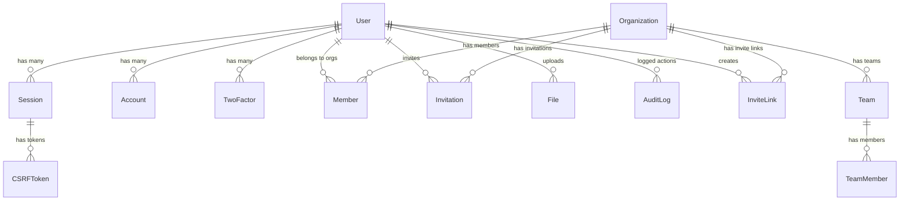

The `@repo/database` package provides a Prisma client configured for PostgreSQL (Neon) with Better Auth integration. It has 16 models in total — Better Auth core (`User`, `Session`, `Account`, `Verification`), plugin-backed (`TwoFactor`, `Organization`, `Member`, `Invitation`, `InviteLink`, `Team`, `TeamMember`, `Subscription`, `RateLimit`), and app-specific (`File`, `AuditLog`, `CSRFToken`, `WebhookEvent`). See [Database Design](/docs/database/database-design) for the full field-by-field reference.

## Entity Relationships



`Subscription`, `WebhookEvent`, and `RateLimit` are standalone tables — not tied to `User`/`Organization` via a Prisma relation (`Subscription.referenceId` is a polymorphic user-or-org ID resolved in application code).

## Quick Start

### Import the Database Client

```typescript
import { database } from '@repo/database';

// Query users
const users = await database.user.findMany();

// Create organization
const org = await database.organization.create({
  data: {
    name: 'My Team',
    slug: 'my-team',
  },
});
```

### Common Commands

```bash
# Format, generate client, and push schema
pnpm migrate

# Individual commands
cd packages/database
npx prisma generate      # Generate Prisma client
npx prisma db push       # Push schema changes
npx prisma studio        # Open Prisma Studio
npx prisma migrate dev   # Create migration
pnpm db:seed             # Run seed script
```

## Schema Location

The Prisma schema is located at:

```
packages/database/prisma/schema.prisma
```
