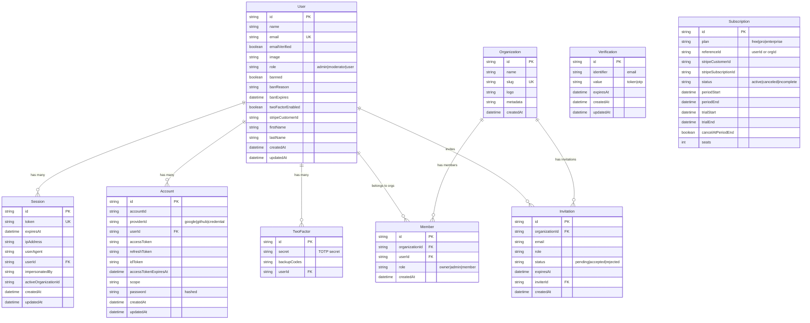

The `@repo/database` package provides a Prisma client configured for PostgreSQL (Neon) with Better Auth integration.

## Entity Relationship Diagram



## Tables Overview

### Core Auth Tables (Better Auth base)

| Table | DB Name | Purpose |
|-------|---------|---------|
| `User` | `user` | User accounts with profile data, role, ban status |
| `Session` | `session` | Active sessions with device tracking (IP, userAgent) |
| `Account` | `account` | OAuth providers + email/password credentials |
| `Verification` | `verification` | Magic links, OTPs, email verification tokens |

### Plugin Tables

| Table | DB Name | Plugin | Purpose |
|-------|---------|--------|---------|
| `TwoFactor` | `twoFactor` | `twoFactor()` | TOTP secrets and backup codes |
| `Organization` | `organization` | `organization()` | Teams/workspaces |
| `Member` | `member` | `organization()` | User-Organization membership with roles |
| `Invitation` | `invitation` | `organization()` | Pending org invites |
| `Subscription` | `subscription` | `stripe()` | Stripe subscription tracking |

## User Table Extensions

The `User` model has extra fields beyond base Better Auth:

| Field | Source | Purpose |
|-------|--------|---------|
| `role` | `admin()` plugin | RBAC role (admin/moderator/user) |
| `banned`, `banReason`, `banExpires` | `admin()` plugin | User banning support |
| `twoFactorEnabled` | `twoFactor()` plugin | 2FA status flag |
| `stripeCustomerId` | `stripe()` plugin | Stripe customer reference |
| `firstName`, `lastName` | Custom fields | Extended profile data |

## Quick Start

### Import the Database Client

```typescript
import { database } from '@repo/database';

// Query users
const users = await database.user.findMany();

// Create organization
const org = await database.organization.create({
  data: {
    name: 'My Team',
    slug: 'my-team',
  },
});
```

### Common Commands

```bash
# Format, generate client, and push schema
pnpm migrate

# Individual commands
cd packages/database
npx prisma generate      # Generate Prisma client
npx prisma db push       # Push schema changes
npx prisma studio        # Open Prisma Studio
npx prisma migrate dev   # Create migration
pnpm db:seed             # Run seed script
```

## Schema Location

The Prisma schema is located at:

```
packages/database/prisma/schema.prisma
```
