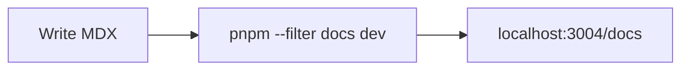

This is the starting point for your product's documentation.

## Add a page

Create an `.mdx` file under `content/docs/`. The frontmatter needs a `title`; `description` is
optional and feeds the page metadata and OG image.

```mdx title="content/docs/quickstart.mdx"
---
title: Quickstart
description: Get up and running in five minutes.
---

Your content here.
```

## Order the sidebar

Add a `meta.json` next to your pages to control the title, icon, and ordering of a folder. Icons are
[Lucide](https://lucide.dev) names.

```json title="content/docs/meta.json"
{
  "title": "Guides",
  "icon": "BookOpen",
  "pages": ["index", "quickstart"]
}
```

## Diagrams

Fenced `mermaid` code blocks render to SVG at build time.



See the [Fumadocs documentation](https://fumadocs.dev) for the full authoring reference.
