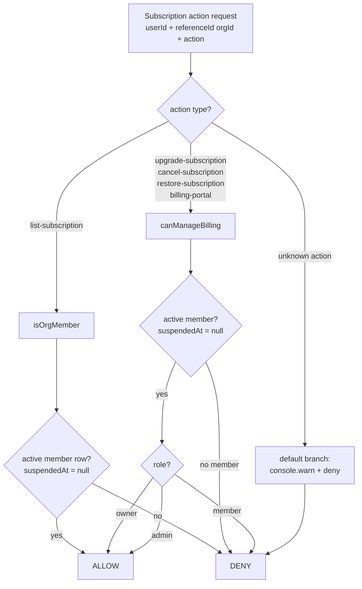
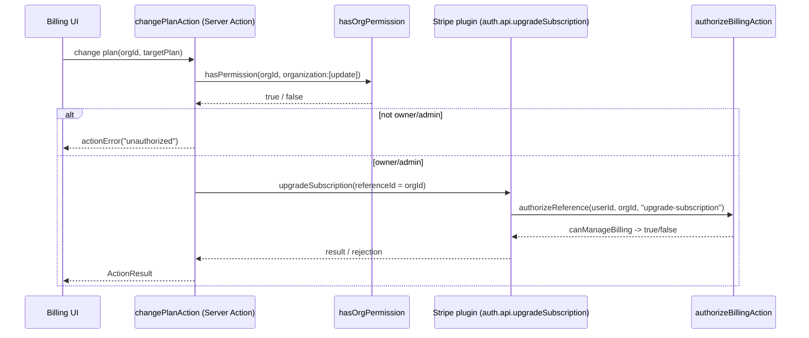

Billing in this monorepo is mounted by the `@better-auth/stripe` plugin (not hand-rolled API routes). Every subscription action the plugin exposes — listing, upgrading, cancelling, restoring, and opening the billing portal — is gated by a single authorization function, `authorizeBillingAction`, defined in `packages/auth/billing-authorize.ts`. The same gate is enforced a second time in web Server Actions via `hasOrgPermission`.

The core rule: **billing is organization-scoped, and only active org owners and admins can mutate it.** Plain members get read-only visibility into the subscription; suspended members get nothing.

## Where authorization is wired

The Stripe plugin's `subscription.authorizeReference` callback in `packages/auth/server.ts` delegates every action to `authorizeBillingAction`:

```ts
authorizeReference: ({ user, referenceId, action }) =>
  authorizeBillingAction({
    userId: user.id,
    referenceId,
    action,
  }),
```

Here `referenceId` is the organization id (the plugin is configured with `organization: { enabled: true }`, so subscriptions are per-organization). Every call into the plugin's mounted endpoints under `/api/auth/*` passes through this single decision point.

## The decision function

`authorizeBillingAction` in `packages/auth/billing-authorize.ts` is an exhaustive `switch` over the plugin's `AuthorizeReferenceAction` union. It routes each action to one of two database-backed checks:

- `isOrgMember(userId, organizationId)` — true when an active (`suspendedAt: null`) `member` row exists for the user in the org. Used only for the read action.
- `canManageBilling(userId, organizationId)` — true only when that active member's `role` is `owner` or `admin` (`ORG_ROLES.OWNER` / `ORG_ROLES.ADMIN`). Used for every mutation and the portal.

```ts
switch (action) {
  case "list-subscription":
    return await isOrgMember(userId, referenceId);
  case "upgrade-subscription":
  case "cancel-subscription":
  case "restore-subscription":
  case "billing-portal":
    return await canManageBilling(userId, referenceId);
  default: {
    const _exhaustive: never = action;
    console.warn(`[auth] Unknown subscription action denied: ${String(_exhaustive)}`);
    return false;
  }
}
```

The `default` branch assigns `action` to a `never`, so any future plugin release that adds a new action breaks the TypeScript build until a role is explicitly chosen for it. At runtime, the same branch denies the unknown action and logs a warning — a belt-and-braces guard against type/runtime drift (covered by the `"trial-extend"` test case in `packages/auth/billing-authorize.test.ts`).

### Authorization flow



## Active-member requirement

Both `isOrgMember` and `canManageBilling` query `database.member.findFirst` with `suspendedAt: null` in the `where` clause. A suspended member — even one whose `role` is `owner` — never satisfies either check, because the row is filtered out before the role is read. The tests assert this scoping explicitly (`scopes by userId, organizationId, and excludes suspended members` and `filters out suspended members in the where clause`).

## Roles vs. billing capabilities

Capabilities below are derived directly from the `switch` routing and the `canManageBilling` role check, and match the allow/deny matrix in `packages/auth/billing-authorize.test.ts`.

| Org role | View (`list-subscription`) | Upgrade | Cancel | Restore | Portal (`billing-portal`) |
| --- | --- | --- | --- | --- | --- |
| `owner` | Allow | Allow | Allow | Allow | Allow |
| `admin` | Allow | Allow | Allow | Allow | Allow |
| `member` | Allow | Deny | Deny | Deny | Deny |
| non-member | Deny | Deny | Deny | Deny | Deny |
| suspended (any role) | Deny | Deny | Deny | Deny | Deny |

Notes:
- "Upgrade", "Cancel", and "Restore" map to the `upgrade-subscription`, `cancel-subscription`, and `restore-subscription` actions respectively; all four management actions share the same `canManageBilling` gate.
- A plain `member` can see the current subscription but cannot change it or reach the Stripe portal.

## Relationship to org role permissions

The org roles themselves are defined in `packages/auth/permissions.ts` via `orgAc.newRole(...)`. Note that billing is **not** expressed as a statement on the *organization* access-control roles (`orgOwnerRole`, `orgAdminRole`, `orgMemberRole` cover `organization`, `member`, `invitation`, and `team` — there is no `billing` statement on the org roles). Billing authorization is instead enforced imperatively by `authorizeBillingAction` reading the member's `role` directly.

The `billing: ["manage", "view"]` statements in `permissions.ts` belong to the **platform-level admin** access control (`statement`, `adminRole`, `moderatorRole`, `userRole`), a separate RBAC system from org-scoped billing and not what gates the Stripe plugin actions.

## Second enforcement layer: Server Actions

Web Server Actions that mutate billing re-check authorization before calling the plugin API, so the gate holds even outside the plugin's own endpoints. In `apps/web/app/[locale]/(app)/[orgSlug]/billing/actions.ts`, `changePlanAction` calls `hasOrgPermission` before invoking `auth.api.upgradeSubscription`:

```ts
const allowed = await hasOrgPermission(validated.organizationId, {
  organization: ["update"],
});
if (!allowed) {
  return actionError("unauthorized");
}
```

`hasOrgPermission` (in `apps/web/lib/auth/auth.ts`) calls `auth.api.hasPermission` — which resolves the caller's session from the request headers via the org plugin's session middleware — and returns a `boolean`, requiring the `organization: ["update"]` capability, which only `owner` and `admin` org roles hold per `permissions.ts`. This aligns the Server Action gate with the `canManageBilling` gate: members are excluded from billing mutations at both layers. The subsequent `auth.api.upgradeSubscription` call then passes through `authorizeBillingAction` again inside the plugin.



## Source files

- `packages/auth/billing-authorize.ts` — `authorizeBillingAction`, `isOrgMember`, `canManageBilling`
- `packages/auth/billing-authorize.test.ts` — allow/deny matrix and suspended-member coverage
- `packages/auth/permissions.ts` — `ORG_ROLES`, org and admin access-control role definitions
- `packages/auth/server.ts` — `subscription.authorizeReference` wiring into the Stripe plugin
- `apps/web/app/[locale]/(app)/[orgSlug]/billing/actions.ts` — `changePlanAction`, the Server Action billing gate
- `apps/web/lib/auth/auth.ts` — `hasOrgPermission` helper
