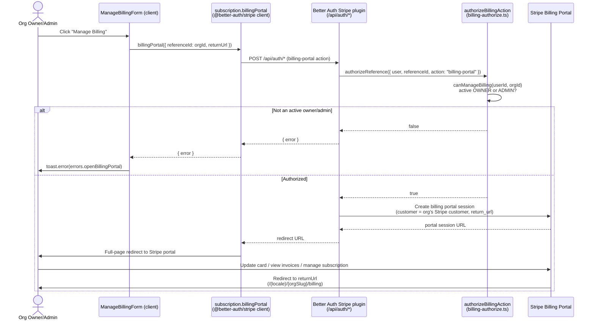

The **Manage Billing** button opens the Stripe customer portal, a Stripe-hosted page where an organization's owners and admins can update payment methods, download invoices, and manage their subscription. This flow uses the [`@better-auth/stripe`](https://www.npmjs.com/package/@better-auth/stripe) plugin's `subscription.billingPortal` client method — there is no hand-rolled API route. The portal session is created by the plugin's endpoint mounted under `/api/auth/*`.

## Entry point

The button lives in `apps/web/app/[locale]/(app)/[orgSlug]/billing/components/manage-billing-form.tsx`, rendered by the `ManageBillingForm` component. It is composed into the billing page through `BillingActions` (`apps/web/app/[locale]/(app)/[orgSlug]/billing/components/billing-actions.tsx`).

Unlike the cancel/downgrade paths in `actions.ts` (which go through `"use server"` server actions like `changePlanAction`), the portal flow runs **entirely client-side**. The component calls the `subscription` client method directly:

```tsx
const { error } = await subscription.billingPortal({
  referenceId: organizationId,
  returnUrl: `${window.location.origin}/${locale}/${organizationSlug}/billing`,
});

if (error) {
  toast.error(errors.openBillingPortal, { description: error.message });
}
// On success, subscription.billingPortal redirects the browser to Stripe.
```

`subscription` is destructured from the Better Auth client in `packages/auth/client.ts`, which registers the `stripeClient({ subscription: true })` plugin. On success the call performs a full-page browser redirect to the Stripe-hosted portal, so no success branch is needed in the component; only the error case is handled, surfacing `errors.openBillingPortal` via a `sonner` toast.

### Parameters

- **`referenceId`** — the `organizationId`. Billing is organization-scoped (`organization: { enabled: true }` in `packages/auth/server.ts`), so the portal session is bound to the org's Stripe customer rather than the individual user.
- **`returnUrl`** — `${window.location.origin}/${locale}/${organizationSlug}/billing`. After the customer finishes (or clicks "Return to" inside the Stripe portal), Stripe redirects the browser back to this locale-aware org billing page.

## Authorization

The portal request is gated server-side by `authorizeBillingAction` in `packages/auth/billing-authorize.ts`, wired into the Stripe plugin via the `authorizeReference` callback in `packages/auth/server.ts`. The `billing-portal` action falls into the same branch as subscription mutations:

```ts
case "upgrade-subscription":
case "cancel-subscription":
case "restore-subscription":
case "billing-portal":
  return await canManageBilling(userId, referenceId);
```

`canManageBilling` requires the caller to be an **active (non-suspended) member** of the organization with a role of `OWNER` or `ADMIN` (`ORG_ROLES`). Plain members can read the subscription (`list-subscription` via `isOrgMember`) but cannot open the portal. If authorization fails, the plugin returns an error and the component shows the `errors.openBillingPortal` toast.

Note that `BillingActions` also hides the entire billing actions card when `planName === PLAN_NAMES.FREE`, so the Manage Billing button is only rendered for orgs on a paid plan.

## Flow



## What the customer can do in the portal

The Stripe customer portal is Stripe-hosted; its exact capabilities depend on the Stripe Dashboard portal configuration, but typically it lets the organization:

- Update or replace the default **payment method** (card).
- View and download past **invoices** and receipts.
- See and manage the current **subscription** — including reactivating a subscription that was set to cancel. The empty-state copy in `BillingActions` points users here: *"You can reactivate it from the billing portal."*

Subscription state changes made inside the portal (cancellations, plan changes, payment updates) flow back into the app asynchronously via Stripe webhooks. Those webhooks are delivered to `/api/auth/stripe/webhook` and dispatched by the plugin's `onEvent` / `onSubscription*` hooks (`handleStripeInvoiceEvent`, `handleSubscriptionUpdate`, `handleSubscriptionDeleted`, etc.) configured in `packages/auth/server.ts`. The portal redirect itself only returns the browser to `returnUrl`; it does not directly mutate the local database.

## Source files

- `apps/web/app/[locale]/(app)/[orgSlug]/billing/components/manage-billing-form.tsx` — `ManageBillingForm`, calls `subscription.billingPortal`
- `apps/web/app/[locale]/(app)/[orgSlug]/billing/components/billing-actions.tsx` — `BillingActions`, composes the button and hides it on the free plan
- `apps/web/app/[locale]/(app)/[orgSlug]/billing/actions.ts` — sibling server actions (`changePlanAction`); the portal flow is client-side and does not use these
- `packages/auth/client.ts` — registers `stripeClient({ subscription: true })`, exports `subscription`
- `packages/auth/server.ts` — Stripe plugin config (`organization.enabled`, `subscription`, `authorizeReference`, webhook hooks)
- `packages/auth/billing-authorize.ts` — `authorizeBillingAction`, `canManageBilling`, `isOrgMember`
