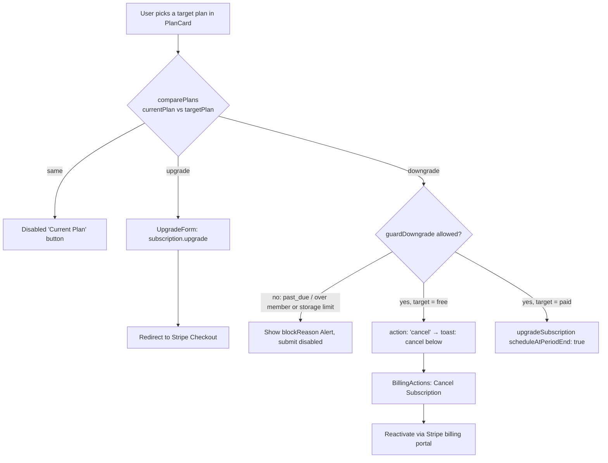
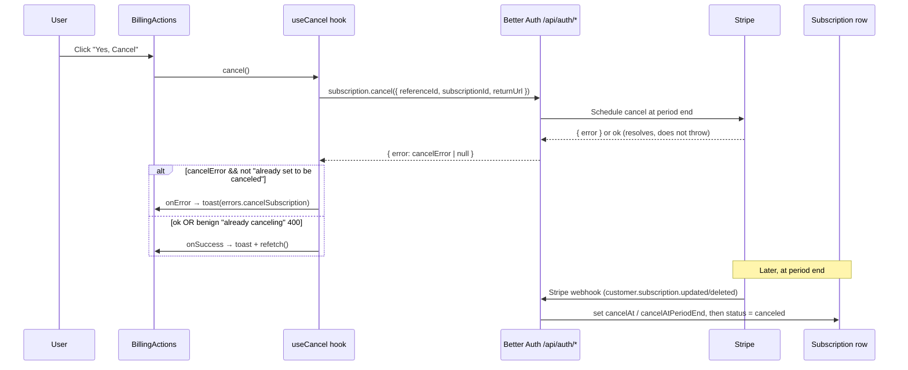
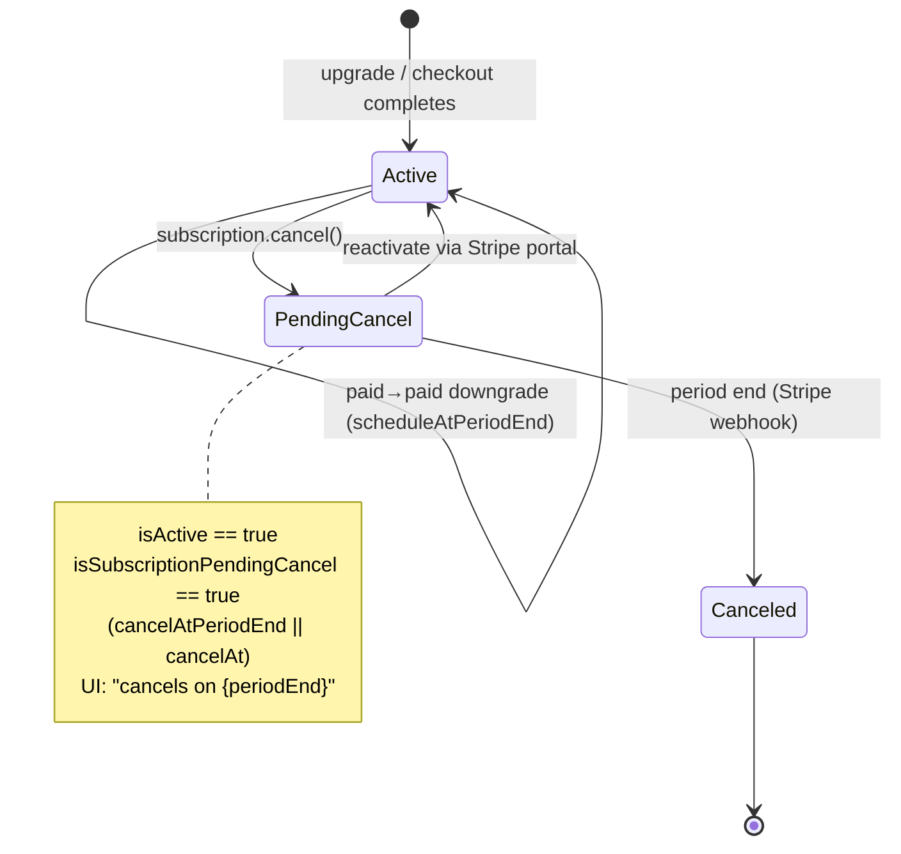

This page documents how an organization changes its subscription tier and how cancellation is modeled, surfaced, and reconciled with Stripe. All billing operations go through the `@better-auth/stripe` plugin — there are no hand-rolled `/api/organizations/*` billing routes. The client calls `subscription.upgrade()` / `subscription.cancel()` (exported from `packages/auth/client.ts`), which hit the plugin's handlers mounted under `/api/auth/*`.

## The four decisions

The billing UI reduces every tier transition to one of four outcomes, decided by comparing the current plan against the target plan with `comparePlans(currentPlan, targetPlan)` in `packages/payment/plans.ts` (which returns `"upgrade" | "downgrade" | "same"` based on `PLAN_ORDER` index):

| Decision | Trigger | Mechanism |
| --- | --- | --- |
| **Upgrade** | target is a higher tier | `subscription.upgrade()` → redirect to Stripe Checkout (`UpgradeForm`) |
| **Downgrade** (to paid) | target is lower but not `free` | `changePlanAction` → `auth.api.upgradeSubscription({ scheduleAtPeriodEnd: true })` |
| **Downgrade to free** | target is `free` | server returns `{ action: "cancel" }`; client routes the user to the Cancel flow |
| **Cancel** | user clicks "Cancel Subscription" | `subscription.cancel()` → Stripe schedules cancellation at period end |

## Upgrades

`UpgradeForm` (`upgrade-form.tsx`) is purely client-side. It calls `subscription.upgrade()` with the target `plan`, `annual` derived from the billing-interval toggle, the org `referenceId`, and `successUrl` / `cancelUrl` pointing at `/{locale}/{orgSlug}/checkout/...`. On success the plugin redirects the browser to Stripe Checkout, so there is no local success toast — only `errors.startCheckout` is surfaced on failure. Upgrades take effect immediately (Stripe proration), unlike downgrades.

`PlanCard` only renders `UpgradeForm` when `comparePlans` returns `"upgrade"` and the plan is `pro` or `enterprise`.

## Downgrades

Downgrades are a **server action**, not a client plugin call, because they must be guarded against resource over-use. `DowngradeButton` binds `changePlanAction` (in `actions.ts`) via `useActionState`. The action:

1. Validates input with `changePlanRequestSchema` (`schemas.ts`) — `organizationId`, `targetPlan` enum, optional `billingInterval` defaulting to monthly.
2. Authorizes with `checkOrgPermission(organizationId, { organization: ["update"] })`.
3. Loads the active subscription via `getActiveSubscription` and re-runs `comparePlans`; if the direction is **not** `"downgrade"` it rejects with `actionError("changePlan")` (defense in depth — the UI already filtered).
4. Runs `guardDowngrade(subscription, targetPlan, memberCount, storageMB)` from `packages/payment/guards.ts`.
5. If `targetPlan === free`, returns `{ action: "cancel" }` — downgrade to free is expressed as a **cancellation**, not a plan swap.
6. Otherwise calls `auth.api.upgradeSubscription({ plan, annual, referenceId, scheduleAtPeriodEnd: true })`. The `scheduleAtPeriodEnd: true` flag is what makes a paid→paid downgrade take effect at the end of the current period rather than immediately.

### Downgrade guard rules

`guardDowngrade` returns `{ allowed, reason, requiredPlan }` and blocks when:

- The subscription status is `past_due` or `incomplete` (Stripe retry logic does not compose cleanly with mid-flight tier changes).
- Current member count exceeds the target plan's `maxMembers`.
- Current storage (MB) exceeds the target plan's `maxStorageMB`.

When blocked, the action returns `{ success: true, data: { action: "changed", blockReason } }`. `DowngradeButton` keeps the dialog open, renders the reason in a destructive `Alert`, and disables the submit button (`disabled={isPending || !!serverBlockReason}`). `PlanCard` also pre-computes `downgradeBlockReason` so the disabled state shows before the user even opens the dialog.

On a successful downgrade, `ChangePlan.handleDowngradeSuccess` shows `"Plan changed successfully"` and calls `refetch()`. When `action === "cancel"` it instead shows `"To downgrade to Free, cancel your subscription below."` and steers the user to `BillingActions`.

## Cancellation

Cancellation lives in `BillingActions` (`billing-actions.tsx`) and the `useCancel` hook (`packages/payment/hooks.ts`). The Cancel button only renders when `isPaid && !isCanceled`. Clicking it opens an `AlertDialog`; confirming calls `cancel()`, which invokes `subscription.cancel()` with the org `referenceId`, the `stripeSubscriptionId`, and a `returnUrl` back to the billing page.

Stripe does **not** delete the subscription immediately — it schedules cancellation at period end, so the row stays `active` with a pending-cancel marker until the period boundary passes, at which point a webhook flips the status to `canceled`.

### How cancellation is surfaced in the UI

State is derived in `useSubscription`:

- `isActive` — `status === active`.
- `isCanceled` — `isActive && isSubscriptionPendingCancel(subscription)`. A canceled-but-still-active subscription is one that is scheduled to end but has not yet lapsed.

`CurrentPlan` (`current-plan.tsx`) renders a yellow warning when `isCanceled && subscription?.periodEnd`:

> "Your subscription has been canceled — You'll retain access until `{formatDate(subscription.periodEnd)}`"

The "Next billing date" row is hidden in this state (`isActive && !isCanceled`), so a canceled subscription never advertises a future charge. `BillingActions` hides the Cancel button and shows: "Your subscription has been canceled and will end at the current billing period. You can reactivate it from the billing portal."

### Reactivation

There is no dedicated "restore" action in the app. Reactivation is delegated to the Stripe customer portal, reached through `ManageBillingForm`. The cancel-state copy explicitly points users there ("reactivate it from the billing portal").

## The `cancelAt` fix (branch `fix/subscription-cancel-state`)

Commit `4875cbb` (`fix(billing): surface cancel errors and recognize cancelAt cancellation`) fixed two distinct bugs. Both are reflected in the code above.

**Bug 1 — cancel silently no-op'd.** Better Auth client methods resolve with an `{ error }` object instead of throwing. The old `useCancel` ignored it, so every click showed a success toast even when nothing happened. The fix destructures `{ error: cancelError }` from `subscription.cancel()` and throws on real failures, routing them to `onError` → `toast.error(errors.cancelSubscription, { description: error.message })`.

**Bug 2 — `cancelAt` cancellations looked active.** `isCanceled` previously checked only `cancelAtPeriodEnd`. Stripe also expresses pending cancellation via the newer `cancelAt` timestamp; a subscription scheduled that way looked active, so the Cancel button kept showing and re-triggered a 400. The fix:

- Added `cancelAt: Date | null` to the `Subscription` interface and `SubscriptionSchema` in `packages/payment/types.ts` (the Prisma column already existed).
- Added `isSubscriptionPendingCancel(subscription)` in `helpers.ts`, which returns true when `cancelAtPeriodEnd === true` **or** `cancelAt != null`, matching Better Auth's own `isPendingCancel`.
- Added `isAlreadyCancelingError(message)`, which detects the substring `"already set to be canceled"`. When local state has drifted from Stripe, re-cancelling surfaces a benign 400; `useCancel` treats it as a no-op success and falls through to `onSuccess()` so the UI reloads and re-syncs from Stripe rather than showing a spurious error.

## Source files

- `apps/web/app/[locale]/(app)/[orgSlug]/billing/actions.ts` — `changePlanAction`, downgrade guard + `scheduleAtPeriodEnd`
- `apps/web/app/[locale]/(app)/[orgSlug]/billing/schemas.ts` — `changePlanRequestSchema`
- `apps/web/app/[locale]/(app)/[orgSlug]/billing/components/change-plan.tsx` — billing-interval toggle, plan grid, downgrade success routing
- `apps/web/app/[locale]/(app)/[orgSlug]/billing/components/plan-card.tsx` — per-plan `comparePlans` direction + guard preview
- `apps/web/app/[locale]/(app)/[orgSlug]/billing/components/upgrade-form.tsx` — `subscription.upgrade()` → Checkout
- `apps/web/app/[locale]/(app)/[orgSlug]/billing/components/downgrade-button.tsx` — `useActionState`, blockReason handling
- `apps/web/app/[locale]/(app)/[orgSlug]/billing/components/billing-actions.tsx` — Cancel dialog, `useCancel`, canceled-state copy
- `apps/web/app/[locale]/(app)/[orgSlug]/billing/components/current-plan.tsx` — cancel banner, `periodEnd` messaging
- `apps/web/lib/billing/subscription-queries.ts` — `getActiveSubscription`, `getOrgMemberCount`, `getOrgStorageUsage`
- `packages/payment/hooks.ts` — `useSubscription` (`isCanceled`), `useCancel` (error surfacing)
- `packages/payment/helpers.ts` — `isSubscriptionPendingCancel`, `isAlreadyCancelingError`, `getStatusColor`, `formatDate`
- `packages/payment/guards.ts` — `guardDowngrade`
- `packages/payment/plans.ts` — `comparePlans`, `isPlanHigherTier`
- `packages/payment/types.ts` — `Subscription` (`cancelAt`, `cancelAtPeriodEnd`), `SubscriptionSchema`
- `packages/auth/client.ts` — `subscription` client export (`upgrade` / `cancel`)
