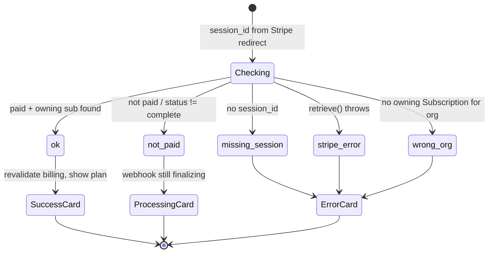
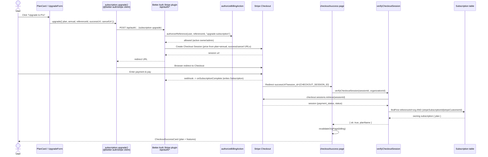

The upgrade flow takes an organization from the `free` plan to a paid plan (`pro` or `enterprise`) using Stripe Checkout. There are **no hand-rolled checkout API routes** — the browser calls `subscription.upgrade()` from the `@better-auth/stripe` client plugin, which hits the plugin-mounted endpoint under `/api/auth/*`, creates a Stripe Checkout Session, and returns a redirect URL. After payment, Stripe sends the user back to a success page that independently verifies the session before showing confirmation.

## Where the upgrade starts

The billing page at `apps/web/app/[locale]/(app)/[orgSlug]/billing/page.tsx` is gated by `validateOrgMembershipBySlug(orgSlug)` and a `PermissionGate` requiring `organization: ["update"]`, so only org owners/admins reach the upgrade UI. It renders `ChangePlan`, which renders one `PlanCard` per plan.

In `apps/web/app/[locale]/(app)/[orgSlug]/billing/components/plan-card.tsx`, `comparePlans(currentPlan, plan.name)` classifies each card as `same`, `upgrade`, or `downgrade`. Only `upgrade` cards for `pro` or `enterprise` render the `UpgradeForm`:

```tsx
{isUpgrade && (plan.name === "pro" || plan.name === "enterprise") && (
  <UpgradeForm ... />
)}
```

Downgrades use a different control (`DowngradeButton`) and a different code path (the `changePlanAction` server action / cancel flow) — they do **not** go through Stripe Checkout.

## The client call: `subscription.upgrade()`

The actual checkout is kicked off entirely client-side in `apps/web/app/[locale]/(app)/[orgSlug]/billing/components/upgrade-form.tsx`. The `subscription` object is re-exported from `packages/auth/client.ts`, where `createAuthClient` registers `stripeClient({ subscription: true })`.

```tsx
const checkoutBase = `${window.location.origin}/${locale}/${organizationSlug}/checkout`;
const { error } = await subscription.upgrade({
  plan: planName,                 // "pro" | "enterprise"
  annual: billingInterval === BILLING_INTERVALS.YEARLY,
  referenceId: organizationId,    // org-scoped subscription
  successUrl: `${checkoutBase}/success?session_id={CHECKOUT_SESSION_ID}`,
  cancelUrl: `${checkoutBase}/canceled`,
});
```

Key parameters:

- **`plan`** — the plan *name* (`pro` / `enterprise`), not a Stripe price ID. The plugin maps the name to a Stripe price using the plan catalog (see below).
- **`annual`** — boolean derived from the selected `billingInterval`. When true, the plugin uses the plan's `annualDiscountPriceId`; otherwise its `priceId`.
- **`referenceId`** — the `organizationId`. This is what makes billing **organization-scoped** rather than per-user; the resulting `Subscription` row stores this in its `referenceId` column.
- **`successUrl`** — points at `/[locale]/[orgSlug]/checkout/success` and carries the literal `{CHECKOUT_SESSION_ID}` placeholder, which Stripe substitutes with the real session id on redirect.
- **`cancelUrl`** — points at `/[locale]/[orgSlug]/checkout/canceled`.

On success `subscription.upgrade()` redirects the browser to Stripe; control does not return to the form. Only the error branch runs in-page, surfacing a toast (`errors.startCheckout`).

## Server configuration: the Stripe plugin

The `@better-auth/stripe` plugin is wired up in `packages/auth/server.ts` (full config in [Payment Overview](/docs/payment)); for checkout specifically, the relevant pieces are `subscription.plans` and `subscription.authorizeReference`:

- **Plan catalog** — `buildStripePlans(...)` in `packages/auth/plans.ts` builds the `StripePlan[]` array, attaching `priceId` (monthly) and `annualDiscountPriceId` (annual) to the `pro` and `enterprise` plan configs from the `STRIPE_*_PRICE_ID_*` env vars. The plugin uses `plan` + `annual` from the client call to pick the right price.
- **Authorization** — every subscription action is gated by `authorizeReference`, which delegates to `authorizeBillingAction` in `packages/auth/billing-authorize.ts`. For `upgrade-subscription` this calls `canManageBilling(userId, referenceId)`, allowing only active (non-suspended) org `owner`/`admin` members. This server-side check is the real security boundary — the client-side `PermissionGate` is only UX.
- The plugin mounts the checkout/portal/webhook handlers under `/api/auth/*`; the success/cancel URLs sent from the client are passed straight through to the Stripe Checkout Session.

## Returning on success: independent verification

When Stripe redirects back, the success page at `apps/web/app/[locale]/(app)/[orgSlug]/checkout/success/page.tsx` reads `session_id` from `searchParams`, re-validates org membership, and calls `verifyCheckoutSession(sessionId, orgContext.organizationId)`.

`verifyCheckoutSession` in `.../checkout/success/verify-session.ts` does **not** trust the redirect. It:

1. Returns `missing_session` if `session_id` is absent.
2. Retrieves the session via `stripe.checkout.sessions.retrieve(sessionId)` (returns `stripe_error` on failure).
3. Confirms payment: `payment_status` is `paid` or `no_payment_required` **and** `status === "complete"`, otherwise `not_paid`.
4. Calls `findOwningSubscription`, which queries the Better Auth `Subscription` table for a row whose `referenceId` matches this org **and** whose `stripeSubscriptionId` or `stripeCustomerId` matches the session. If none is found it returns `wrong_org` — this defends against a bookmarked or shared success URL from a different organization.

On `ok`, the page calls `revalidateOrgPage(orgSlug, ORG_PAGES.BILLING, locale)` so the new plan shows immediately, then renders `CheckoutSuccessCard` (`.../checkout/success/components/checkout-success-card.tsx`), which looks up `PLANS[planName]` and displays the plan's display name and feature list. The `not_paid` reason renders `CheckoutProcessingCard` (webhook still finalizing); all other reasons render `CheckoutErrorCard`.

### Verification result states



## End-to-end sequence



## Notes

- The webhook (`onSubscriptionComplete`) and the success-page redirect are **independent**. The success page does not depend on the webhook having fired to render the card — it reads the session straight from Stripe — but the `Subscription` row it joins against is written by webhook handlers in `packages/auth/stripe-hooks.ts`. If the redirect lands before the row exists, `findOwningSubscription` returns null and the page shows the `not_paid`/processing state.
- Free is never a Checkout target. `buildStripePlans` only emits `pro` and `enterprise`; downgrades to `free` are routed to the cancel flow by `changePlanAction` in `billing/actions.ts`.

## Source files

- `apps/web/app/[locale]/(app)/[orgSlug]/billing/page.tsx` — billing page, permission gate
- `apps/web/app/[locale]/(app)/[orgSlug]/billing/components/plan-card.tsx` — upgrade/downgrade classification
- `apps/web/app/[locale]/(app)/[orgSlug]/billing/components/upgrade-form.tsx` — `subscription.upgrade()` call, success/cancel URLs
- `apps/web/app/[locale]/(app)/[orgSlug]/billing/actions.ts` — `changePlanAction` (downgrade/cancel path, not Checkout)
- `apps/web/app/[locale]/(app)/[orgSlug]/billing/queries.ts` — `getBillingUsageData`
- `apps/web/app/[locale]/(app)/[orgSlug]/checkout/success/page.tsx` — success page + result rendering
- `apps/web/app/[locale]/(app)/[orgSlug]/checkout/success/verify-session.ts` — `verifyCheckoutSession`
- `apps/web/app/[locale]/(app)/[orgSlug]/checkout/success/components/checkout-success-card.tsx` — confirmation card
- `packages/auth/server.ts` — `@better-auth/stripe` plugin config, `authorizeReference`
- `packages/auth/client.ts` — `stripeClient({ subscription: true })`, `subscription` export
- `packages/auth/plans.ts` — `PLANS`, `buildStripePlans`, price-id mapping
- `packages/auth/billing-authorize.ts` — `authorizeBillingAction` / `canManageBilling`
