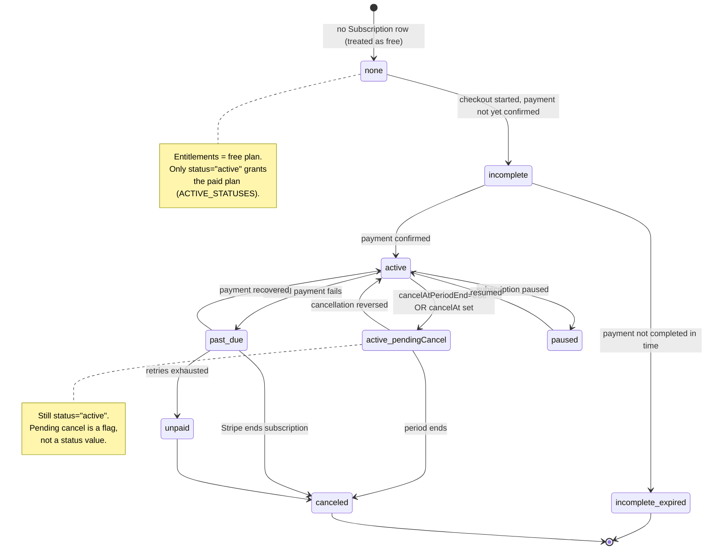

Subscriptions are managed by the `@better-auth/stripe` plugin, which mirrors Stripe's
subscription object into the local `Subscription` table. This document describes the
state model: the exact status strings the code recognizes, how an "active" subscription
is resolved, how pending cancellation is interpreted, and the helper/guard functions
that gate features by plan.

## The Subscription record

The shape consumed by the app is defined by the `Subscription` interface in
`packages/auth/types.ts` and validated at the query boundary by `SubscriptionSchema`
(a `zod` schema in the same file). The fields that drive the state model are:

- `plan` — one of `free`, `pro`, `enterprise` (enforced by `SubscriptionSchema` via `PLAN_NAMES`).
- `status` — a nullable `SubscriptionStatus` string (see below).
- `cancelAtPeriodEnd` — nullable boolean; legacy Stripe cancellation flag.
- `cancelAt` — nullable `Date`; newer Stripe cancellation timestamp.
- `periodStart` / `periodEnd` — the current billing period.
- `referenceId` — the owning entity; in this app it is the organization ID (billing is org-scoped).
- `stripeCustomerId` / `stripeSubscriptionId` — Stripe linkage used for cancel/portal calls.

## Status values

The canonical status strings live in `packages/utils/payment.ts` as `SUBSCRIPTION_STATUS`,
which the comment notes "Mirrors `Stripe.Subscription.Status` from the Stripe SDK":

- `incomplete`
- `incomplete_expired`
- `active`
- `past_due`
- `canceled`
- `unpaid`
- `paused`

Critically, the set of statuses the app treats as "active" is **narrow**:

```ts
export const ACTIVE_STATUSES = [SUBSCRIPTION_STATUS.ACTIVE] as const;
```

Only `active` counts as active. `past_due`, `unpaid`, `paused`, `incomplete`, and the
two terminal states do **not** grant plan entitlements.

## Lifecycle diagram

The diagram below uses the exact `status` strings from `SUBSCRIPTION_STATUS`. Note that a
scheduled cancellation is **not** a separate status — a subscription remains `active`
while `cancelAtPeriodEnd`/`cancelAt` is set, and only transitions to `canceled` when the
period actually ends (this is what `isSubscriptionPendingCancel` detects).



## Resolving the active subscription

`getActiveSubscription(referenceId)` in `apps/web/lib/billing/subscription-queries.ts`
is the server-side source of truth. It queries the most recent row whose status is in
`ACTIVE_STATUSES`:

```ts
const subscription = await database.subscription.findFirst({
  where: {
    referenceId,
    status: { in: ACTIVE_STATUSES as unknown as string[] },
  },
  orderBy: { id: "desc" },
});
```

Because `ACTIVE_STATUSES` contains only `active`, any subscription in `past_due`,
`unpaid`, `paused`, `incomplete`, `incomplete_expired`, or `canceled` is invisible to
this query and yields `null`.

### Plan resolution

`getCurrentPlanForReference(referenceId)` builds on `getActiveSubscription`: if there is
no active subscription it returns `PLAN_NAMES.FREE`; otherwise it returns the
subscription's `plan` (falling back to `free` if `plan` is falsy). So a `past_due` Pro
org is effectively resolved to **free** for entitlement purposes.

The pure-helper equivalent is `getCurrentPlan(subscription)` in
`packages/auth/helpers.ts`, which gates on `isSubscriptionActive(subscription)`
before reading `plan`. `isSubscriptionActive` returns `true` only when
`subscription.status` is in `ACTIVE_STATUSES`.

Note `getOrgSubscription(organizationId)` is the unfiltered counterpart — it returns the
latest row regardless of status (and throws if `SubscriptionSchema` validation fails).
It is used where the app needs to inspect the actual record (e.g. usage stats, downgrade
guards) rather than only the entitlement-granting one.

## Pending cancellation (`cancelAt` / `cancelAtPeriodEnd`)

A subscription scheduled to cancel at period end is still `active`. The detection lives
in `isSubscriptionPendingCancel(subscription)` in `packages/auth/helpers.ts`:

```ts
return (
  subscription?.cancelAtPeriodEnd === true || subscription?.cancelAt != null
);
```

Either signal counts. As the source comment explains, Stripe expresses a scheduled
cancellation via the legacy `cancelAtPeriodEnd` boolean **or** the newer `cancelAt`
timestamp; checking only the boolean would miss subscriptions canceled via `cancelAt`.
This matches Better Auth's own `isPendingCancel`.

On the client, `useSubscription` in `packages/auth/use-subscription.ts` exposes this as
`isCanceled`, which is intentionally `isActive && isSubscriptionPendingCancel(...)` — i.e.
"canceled but still active until period end." It also exposes:

- `isActive` — `status === SUBSCRIPTION_STATUS.ACTIVE`.
- `isPaid` — `isActive && planName !== free`.
- `planName` — `subscription.plan` or `free` when absent.

The hook fetches via Better Auth's `subscription.list({ query: { referenceId } })` and
takes the first element. Cancellation flows through `useCancel`, which calls
`subscription.cancel(...)`.

### The "already set to cancel" no-op

`isAlreadyCancelingError(message)` (in `helpers.ts`) detects Better Auth's benign error
containing `"already set to be canceled"`. Better Auth client methods resolve with
`{ error }` instead of throwing, so `useCancel` inspects `cancelError`: a real failure is
thrown, but the already-canceling case falls through to `onSuccess` so the UI reloads and
settles. This handles drift where local state lags Stripe.

## Feature gating by plan

Plan entitlements are defined in `PLANS` (re-exported from `@repo/auth/plans` via
`packages/auth/plans.ts`). Limits per plan come from `getPlanLimits(planName)`, backed
by each plan's `limits` (`maxMembers`, `maxStorageMB`, `prioritySupport`,
`advancedAnalytics`). The unlimited sentinel is `UNLIMITED = -1`.

### Plan comparison

`comparePlans(currentPlan, targetPlan)` returns `"upgrade" | "downgrade" | "same"` using
`PLAN_ORDER` (`free` → `pro` → `enterprise`) via `isPlanHigherTier`.

### Downgrade guard

`guardDowngrade(subscription, targetPlan, currentMemberCount, currentStorageMB)` in
`packages/auth/guards.ts` returns a `GuardResult` and enforces three rules:

1. The move must actually be a downgrade (`comparePlans(...) === "downgrade"`), else
   `allowed: false`.
2. **Billing health gate**: if `subscription.status` is `past_due` or `incomplete`, the
   downgrade is blocked — "Resolve the outstanding payment on your current plan before
   changing tiers." (Stripe's retry logic does not compose with mid-flight plan changes.)
3. **Resource fit**: if current members or storage exceed the target plan's limits
   (skipping checks where the limit is `UNLIMITED`), the downgrade is blocked with a
   message telling the user how much to shed first.

### Usage and seat gating

`calculateUsageStats(subscription, currentMembers, currentStorageMB)` in `helpers.ts`
resolves the effective plan via `getCurrentPlan` and computes member/storage usage
percentages (treating `UNLIMITED` limits as `Infinity`, percentage `0`). The server query
`getOrgUsageStats` feeds it real DB counts.

`canOrgAddMember(organizationId)` (in `subscription-queries.ts`) gates seat additions: it
sums current members **plus** pending invitations (both reserve seats) against
`getPlanLimits(plan).maxMembers`, returning `{ allowed, reason?, remaining }`. A
`maxMembers` of `-1` means unlimited.

`canUserCreateOrg(userId)` gates organization creation: it counts the user's owned orgs
and how many of them are on the free plan (only counting orgs with an `ACTIVE_STATUSES`
subscription), then delegates the pure decision to `checkOrgCreationEligibility` in
`packages/utils/payment.ts` (1 free org allowed; additional orgs require the existing
free org to upgrade; hard cap at `MAX_ORGS_PER_USER`).

## Display helpers

`getStatusDisplayText(status)` and `getStatusColor(status)` (in `helpers.ts`) map status
strings to UI text/colors. Of note for the state model: `incomplete_expired` displays as
"Expired", and `getStatusColor` groups `canceled`, `unpaid`, and `incomplete_expired` as
`red`, `past_due` as `yellow`, `active` as `green`, and everything else as `gray`.

## Source files

- `packages/utils/payment.ts` — `SUBSCRIPTION_STATUS`, `ACTIVE_STATUSES`, `PLAN_NAMES`, `PLAN_ORDER`, `UNLIMITED`, `checkOrgCreationEligibility`.
- `packages/auth/types.ts` — `Subscription` interface, `SubscriptionSchema`, `SubscriptionWithPlan`.
- `packages/auth/helpers.ts` — `isSubscriptionActive`, `isSubscriptionPendingCancel`, `isAlreadyCancelingError`, `getCurrentPlan`, `calculateUsageStats`, `getStatusDisplayText`, `getStatusColor`.
- `packages/auth/guards.ts` — `guardDowngrade`, `GuardResult`.
- `packages/auth/plans.ts` — `PLANS`, `getPlanLimits`, `comparePlans`, `isPlanHigherTier`.
- `packages/auth/use-subscription.ts` — `useSubscription`, `useCancel` (client).
- `apps/web/lib/billing/subscription-queries.ts` — `getActiveSubscription`, `getOrgSubscription`, `getCurrentPlanForReference`, `canOrgAddMember`, `canUserCreateOrg`, `getOrgUsageStats`.
