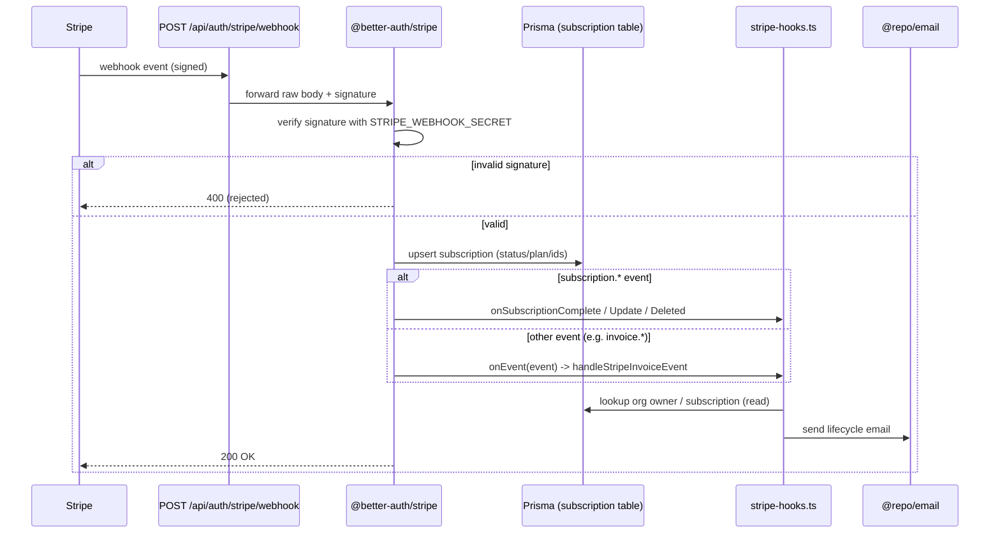

Billing webhooks are **not** handled by a hand-rolled API route. The `@better-auth/stripe` plugin mounts the webhook endpoint, verifies the Stripe signature, persists subscription state, and then dispatches into the project's own hook functions defined in `packages/auth/stripe-hooks.ts`.

## Endpoint & Signature Verification

The webhook handler is mounted by the Better Auth catch-all route. Point the Stripe Dashboard webhook at:

```
${NEXT_PUBLIC_APP_URL}/api/auth/stripe/webhook
```

Signature verification is performed entirely by the plugin using `stripeWebhookSecret`. In `packages/auth/server.ts` the Stripe plugin is only added when **both** a Stripe client and a webhook secret are present:

```ts
...(stripeClient && env.STRIPE_WEBHOOK_SECRET
  ? [
      stripe({
        stripeClient,
        stripeWebhookSecret: env.STRIPE_WEBHOOK_SECRET,
        createCustomerOnSignUp: false,
        organization: { enabled: true },
        onEvent: handleStripeInvoiceEvent,
        subscription: {
          enabled: true,
          onSubscriptionComplete: handleSubscriptionComplete,
          onSubscriptionUpdate: handleSubscriptionUpdate,
          onSubscriptionDeleted: handleSubscriptionDeleted,
          plans: buildStripePlans({ /* price IDs */ }),
          authorizeReference: ({ user, referenceId, action }) => /* ... */,
        },
      }),
    ]
  : []),
```

`STRIPE_WEBHOOK_SECRET` is declared in `packages/auth/keys.ts` as an optional `z.string().startsWith("whsec_")`. If it is unset, the plugin is omitted and no webhook endpoint is registered.

The plugin exposes two dispatch surfaces, both wired in `server.ts`:

- **`subscription.onSubscriptionComplete` / `onSubscriptionUpdate` / `onSubscriptionDeleted`** — typed subscription lifecycle callbacks. The plugin has already upserted the local `subscription` record (status, plan, `stripeSubscriptionId`, `referenceId`) before invoking these; our handlers run as **side effects**, primarily sending notification email.
- **`onEvent`** — a raw `Stripe.Event` catch-all, used here for invoice events (`handleStripeInvoiceEvent`).

## Flow



## Event Handlers

The dispatch handlers all resolve an **org email context** via `getOrgEmailContext(referenceId)`, which loads the `organization` and its `OWNER` `member` (using `ORG_ROLES.OWNER`) and builds a `dashboardUrl` of `${NEXT_PUBLIC_APP_URL}/${org.slug}/billing`. If the org or owner email is missing, the handler returns early and sends nothing.

| Dispatch source | Stripe trigger | Handler in `stripe-hooks.ts` | What it does |
| --- | --- | --- | --- |
| `subscription.onSubscriptionComplete` | First successful subscription checkout | `handleSubscriptionComplete` | Sends `sendSubscriptionStartedEmail` with the plan display name and billing interval (`getBillingInterval` compares the price ID against `STRIPE_*_PRICE_ID_ANNUAL`). |
| `subscription.onSubscriptionUpdate` | `customer.subscription.updated` | `handleSubscriptionUpdate` | Reads `event.data.previous_attributes.items`. If no item change, returns (skips status-only updates / period rollovers). Otherwise resolves the previous plan from the previous price ID via `getPlanNameFromPriceId`, compares plan positions using `PLAN_ORDER`, and sends `sendSubscriptionDowngradedEmail` when `previousIndex > newIndex`, else `sendSubscriptionUpgradedEmail`. |
| `subscription.onSubscriptionDeleted` | `customer.subscription.deleted` | `handleSubscriptionDeleted` | Computes the access cutoff from the first subscription item's `current_period_end` (Stripe v22.2+ moved this onto each `SubscriptionItem`) and sends `sendSubscriptionCancelledEmail` with `accessUntil` and a `reactivateUrl`. |
| `onEvent` (raw) | `invoice.payment_failed` | `handleStripeInvoiceEvent` → `handleInvoicePaymentFailed` | Extracts the subscription ID via `extractSubscriptionId` (reads `invoice.lines.data[0].subscription`), looks up the local `subscription` by `stripeSubscriptionId`, then sends `sendPaymentFailedEmail` with `amount_due` (formatted via `CENTS_PER_DOLLAR`), the `next_payment_attempt` retry date, and a `failureReason` derived from `last_finalization_error`. |
| `onEvent` (raw) | `invoice.paid` | `handleStripeInvoiceEvent` → `handleInvoiceRenewal` | Returns unless `invoice.billing_reason === "subscription_cycle"` (skips the first payment, which is covered by `onSubscriptionComplete`). Looks up the local subscription, derives the billing interval from `invoice.lines.data[0].pricing.price_details.price`, and sends `sendSubscriptionRenewedEmail` with `amount_paid` and the `period_end` renewal date. |

### Notes on the handler implementations

- **Plan naming.** `displayPlanName` maps internal plan keys to `PLAN_DISPLAY_NAMES[PlanName]`, falling back to the raw value.
- **Stripe v22.2+ field moves.** Several helpers exist purely to read fields that Stripe relocated: `extractSubscriptionId` (subscription now on the line item), `handleSubscriptionDeleted` (`current_period_end` now on each `SubscriptionItem`), and `handleInvoiceRenewal` (price now at `lines.data[N].pricing.price_details.price`).
- **Idempotency / safety.** Every handler returns early when its lookup (`getOrgEmailContext`, `database.subscription.findFirst`, or `extractSubscriptionId`) yields nothing, so missing data never throws inside the webhook path.
- **Database writes.** The handlers in `stripe-hooks.ts` only **read** the `subscription`, `organization`, and `member` tables. The authoritative subscription row write (status/plan/`stripeSubscriptionId`) is done by the `@better-auth/stripe` plugin itself before our hooks fire.

### Not a webhook handler

`packages/payment/hooks.ts` is a `"use client"` module exporting React hooks (`useSubscription`, `useCancel`) that call the Better Auth client (`subscription.list`, `subscription.cancel`). Despite the filename, it is unrelated to webhook ingestion and runs in the browser.

## Source files

- `packages/auth/stripe-hooks.ts` — all webhook event handlers (`handleSubscriptionComplete`, `handleSubscriptionUpdate`, `handleSubscriptionDeleted`, `handleStripeInvoiceEvent`, plus `handleInvoicePaymentFailed` / `handleInvoiceRenewal`) and helpers (`getOrgEmailContext`, `getBillingInterval`, `extractSubscriptionId`).
- `packages/auth/server.ts` — wires `stripeWebhookSecret`, `onEvent`, and the `subscription.*` callbacks into the `stripe()` plugin.
- `packages/auth/keys.ts` — declares `STRIPE_WEBHOOK_SECRET` and the `STRIPE_*_PRICE_ID_*` env vars.
- `packages/payment/hooks.ts` — client-side subscription React hooks (not webhook handling).
