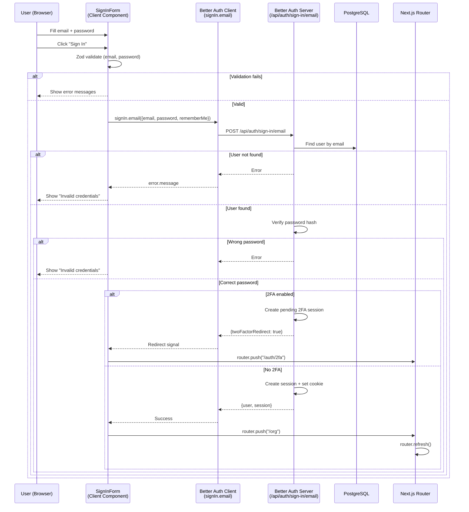
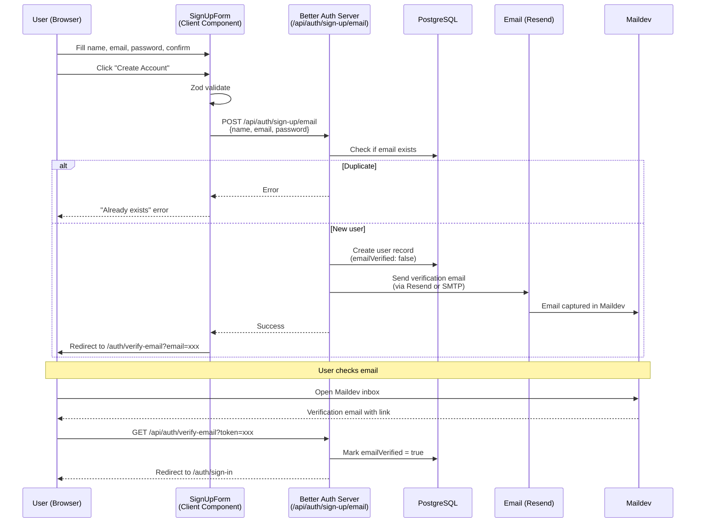

# Auth E2E Test Cases

Derived from existing specs 02-08. Covers all authentication flows testable via Playwright: sign-in, sign-up, password reset, email verification, 2FA, and magic links.

**Test approach:** Uses Maildev for email capture (verification links, reset links, magic links). Social auth (Google/GitHub) is verified at the button level only (no OAuth flow in E2E).

**Maildev requirement:** Tests that send/receive emails skip gracefully if Maildev is unavailable.

---

## Prerequisites

```bash
# Start dev server + Maildev
pnpm dev
# Maildev should be running at http://localhost:1080 (SMTP on 1025)

# Run auth E2E tests only
cd apps/web
npx playwright test e2e/auth/ --project=topics

# List tests without running
npx playwright test e2e/auth/ --project=topics --list
```

**Required setup:**
- Dev server on `http://localhost:3000`
- Maildev on `http://localhost:1080` (optional — email tests skip if unavailable)
- No auth state needed — auth tests run in `no-auth` mode (fresh browser)

---

## User Action Flows

### Sign-In — Complete User Journey

```mermaid
flowchart TD
    Start([User navigates to<br/>/auth/sign-in]) --> TabView{3 tabs available}

    TabView --> PasswordTab[Password Tab<br/>• Email input<br/>• Password input<br/>• Remember me checkbox<br/>• "Sign In" button]
    TabView --> MagicLinkTab[Magic Link Tab<br/>• Email input<br/>• "Send Magic Link" button]
    TabView --> EmailOTPTab[Email OTP Tab<br/>• Email input<br/>• "Send Code" button]

    PasswordTab --> Submit[Click "Sign In"]
    Submit --> Validate{Client-side<br/>validation}
    Validate -->|Empty fields| Error1[Show validation errors<br/>"Please enter a valid email"<br/>"Password is required"]
    Validate -->|Valid| APICall[signIn.email<br/>{email, password, rememberMe}]

    APICall --> AuthResult{Better Auth<br/>response}
    AuthResult -->|Success| Redirect[router.push /org<br/>→ router.refresh]
    AuthResult -->|Wrong password| Error2[Show error<br/>"Invalid credentials"]
    AuthResult -->|User not found| Error3[Show error<br/>"User not found"]
    AuthResult -->|2FA required| Redirect2FA[Redirect to /auth/2fa<br/>pending 2FA session]

    MagicLinkTab --> SendMagic[Click "Send Magic Link"]
    SendMagic --> MagicEmail[Email sent via Maildev<br/>Contains magic link URL]
    MagicEmail --> ClickLink[User clicks link]
    ClickLink --> MagicCallback[/auth/magic-link?token=xxx]
    MagicCallback --> MagicResult{Token valid?}
    MagicResult -->|Valid| AuthSuccess[Authenticated<br/>→ Redirect to /org]
    MagicResult -->|Expired| MagicError[Show "Link expired"<br/>+ "Back to sign in"]
    MagicResult -->|Invalid| MagicError2[Show "Invalid link"<br/>+ "Back to sign in"]

    %% Social auth
    PasswordTab --> Social{Social login}
    Social --> Google[Click "Continue with Google"<br/>→ OAuth redirect]
    Social --> GitHub[Click "Continue with GitHub"<br/>→ OAuth redirect]

    %% Links
    PasswordTab --> ForgotLink[Click "Forgot password?"<br/>→ /auth/forgot-password]
    PasswordTab --> SignUpLink[Click "Create account"<br/>→ /auth/sign-up]

    style Error1 fill:#fee2e2,stroke:#ef4444
    style Error2 fill:#fee2e2,stroke:#ef4444
    style Error3 fill:#fee2e2,stroke:#ef4444
    style MagicError fill:#fee2e2,stroke:#ef4444
    style MagicError2 fill:#fee2e2,stroke:#ef4444
    style Redirect fill:#dcfce7,stroke:#22c55e
    style AuthSuccess fill:#dcfce7,stroke:#22c55e
```

### Sign-Up — Complete User Journey

```mermaid
flowchart TD
    Start([User navigates to<br/>/auth/sign-up]) --> Form[Sign-Up Form<br/>• Name input<br/>• Email input<br/>• Password input<br/>• Confirm Password input<br/>• "Create Account" button]

    Form --> Submit[Click "Create Account"]
    Submit --> Validate{Client-side<br/>validation}

    Validate -->|Empty fields| Error1[Validation errors<br/>"Name must be at least 2 characters"<br/>"Please enter a valid email"]
    Validate -->|Password mismatch| Error2["Passwords don't match"]
    Validate -->|Weak password| Error3["At least 8 characters" etc.]
    Validate -->|Valid| APICall[POST /api/auth/sign-up/email<br/>{name, email, password}]

    APICall --> Result{API response}
    Result -->|Success| VerifyRedirect[Redirect to<br/>/auth/verify-email?email=xxx]
    Result -->|Duplicate email| Error4["Already exists" error<br/>OR redirect to verify-email]

    VerifyRedirect --> VerifyPage[Verify Email Page<br/>• Shows email address<br/>• "Resend" button<br/>• "Back to sign in" link]

    VerifyPage --> CheckEmail[User checks Maildev inbox]
    CheckEmail --> ClickVerify[Click verification link]
    ClickVerify --> Verified[✅ Email verified<br/>Account active]

    VerifyPage --> Resend[Click "Resend"]
    Resend --> Cooldown[60s cooldown timer<br/>Button disabled]
    Resend --> NewEmail[New verification email sent]

    %% Social
    Form --> Social{Social sign-up}
    Social --> Google[Continue with Google]
    Social --> GitHub[Continue with GitHub]

    Form --> SignInLink[Click "Sign in"<br/>→ /auth/sign-in]

    style Error1 fill:#fee2e2,stroke:#ef4444
    style Error2 fill:#fee2e2,stroke:#ef4444
    style Error3 fill:#fee2e2,stroke:#ef4444
    style Error4 fill:#fee2e2,stroke:#ef4444
    style Verified fill:#dcfce7,stroke:#22c55e
```

### Password Reset — Complete User Journey

```mermaid
flowchart TD
    Start([User navigates to<br/>/auth/forgot-password]) --> Form[Forgot Password Form<br/>• Email input<br/>• "Send Reset Link" button]

    Form --> Submit[Click "Send Reset Link"]
    Submit --> Validate{Validation}
    Validate -->|Empty email| Error1[Validation error]
    Validate -->|Valid email| APICall[POST /api/auth/forgot-password]

    APICall --> Success[Success message<br/>"Check your email for a reset link"<br/>No email leak for non-existent users]

    Success --> CheckEmail[User checks Maildev inbox]
    CheckEmail --> ClickReset[Click reset link<br/>/auth/reset-password?token=xxx]
    ClickReset --> ResetForm[Reset Password Form<br/>• New Password input<br/>• Confirm Password input<br/>• "Reset Password" button]

    ResetForm --> ResetSubmit[Click "Reset Password"]
    ResetSubmit --> ResetValidate{Validation}
    ResetValidate -->|Weak password| Error2[Password requirements error]
    ResetValidate -->|Mismatch| Error3["Passwords don't match"]
    ResetValidate -->|Valid| ResetAPI[POST /api/auth/reset-password<br/>{token, newPassword}]

    ResetAPI --> ResetResult{Result}
    ResetResult -->|Success| SignInRedirect[Redirect to /auth/sign-in<br/>User can sign in with new password]
    ResetResult -->|Invalid token| TokenError[Show error<br/>"Invalid or expired token"]

    %% Edge cases
    Start --> NoToken[/auth/reset-password<br/>without token param]
    NoToken --> MissingTokenError[Error: "Missing reset token"]

    Start --> InvalidToken[/auth/reset-password<br/>?token=invalid]
    InvalidToken --> BadTokenError[Error: "Invalid token"]

    style Error1 fill:#fee2e2,stroke:#ef4444
    style Error2 fill:#fee2e2,stroke:#ef4444
    style Error3 fill:#fee2e2,stroke:#ef4444
    style TokenError fill:#fee2e2,stroke:#ef4444
    style MissingTokenError fill:#fee2e2,stroke:#ef4444
    style BadTokenError fill:#fee2e2,stroke:#ef4444
    style SignInRedirect fill:#dcfce7,stroke:#22c55e
```

### Two-Factor Authentication

```mermaid
flowchart TD
    Start([User signs in with<br/>email + password]) --> Check{2FA enabled<br/>on account?}
    Check -->|No| DirectAuth[✅ Authenticated<br/>→ /org]
    Check -->|Yes| Redirect[Redirect to /auth/2fa<br/>Pending 2FA session created]

    Redirect --> TwoFAPage[2FA Page<br/>• "Two-Factor Authentication" title<br/>• "Verification Code" label<br/>• 6-digit input (numeric)<br/>• "Verify" button<br/>• "Use a backup code" link<br/>• "Back to sign in" link]

    TwoFAPage --> EnterCode[Enter 6-digit TOTP code]
    EnterCode --> SubmitCode[Click "Verify"]
    SubmitCode --> VerifyResult{Code valid?}

    VerifyResult -->|Valid| Authenticated[✅ Authenticated<br/>→ /org]
    VerifyResult -->|Invalid| CodeError[Error message<br/>"Invalid verification code"]
    VerifyResult -->|Expired| ExpiredError[Error: code expired]

    TwoFAPage --> BackupCode[Click "Use a backup code"]
    BackupCode --> BackupInput[Enter backup code]

    TwoFAPage --> BackToSignIn[Click "Back to sign in"<br/>→ /auth/sign-in]

    %% Edge case
    NoPending([Visit /auth/2fa directly<br/>without pending session]) --> NoSession[Error or redirect<br/>to /auth/sign-in]

    style DirectAuth fill:#dcfce7,stroke:#22c55e
    style Authenticated fill:#dcfce7,stroke:#22c55e
    style CodeError fill:#fee2e2,stroke:#ef4444
    style ExpiredError fill:#fee2e2,stroke:#ef4444
    style NoSession fill:#fee2e2,stroke:#ef4444
```

---

## Data Flows

### Sign-In — Data Flow



### Sign-Up + Verification — Data Flow



---

## Spec 1: sign-in.spec.ts

Migrated from: `02-sign-in.spec.ts`
**Route:** `/auth/sign-in`
**Component:** `SignInForm` (3-tab layout: Password / Magic Link / Email OTP)

---

### SI-01: Sign-in page loads with all form elements
**Priority:** HIGH

#### Steps
1. Navigate to `/en/auth/sign-in`

#### Expected
- Page heading or title "Sign In" visible
- Email input visible
- Password input visible
- "Sign In" submit button visible
- Tabs for Password, Magic Link, Email OTP visible

---

### SI-02: Empty form submission shows validation errors
**Priority:** HIGH

#### Steps
1. Navigate to sign-in page
2. Click "Sign In" without filling any fields

#### Expected
- Validation error for email (e.g., "Please enter a valid email")
- Validation error for password

---

### SI-03: Invalid email format shows error
**Priority:** MEDIUM

#### Steps
1. Enter "notanemail" in email field
2. Submit form

#### Expected
- Email validation error visible

---

### SI-04: Links to sign-up and forgot-password present
**Priority:** MEDIUM

#### Steps
1. Navigate to sign-in page

#### Expected
- "Create account" or "Sign up" link → `/auth/sign-up`
- "Forgot password?" link → `/auth/forgot-password`

---

### SI-05: Social login buttons present
**Priority:** MEDIUM

#### Steps
1. Navigate to sign-in page

#### Expected
- "Continue with Google" button visible
- "Continue with GitHub" button visible

---

### SI-06: Wrong password shows error
**Priority:** HIGH

#### Steps
1. Enter valid test user email
2. Enter wrong password
3. Submit

#### Expected
- Error message (e.g., "Invalid credentials")
- URL still contains `/auth/sign-in` (no redirect)

---

### SI-07: Non-existent user cannot sign in
**Priority:** HIGH

#### Steps
1. Enter `nonexistent-e2e@example.com`
2. Enter any password
3. Submit

#### Expected
- Error message visible
- No redirect

---

### SI-08: Successful sign-in redirects to org page
**Priority:** HIGH

#### Steps
1. Enter test user email and password
2. Submit

#### Expected
- URL changes to no longer contain `/auth/`
- User is redirected to `/org` or `/{orgSlug}`

#### Known issue (FAILING)
The redirect after sign-in may be slow. The test uses `waitForURL` with a 15s timeout — may need increase or different wait strategy.

---

### SI-09: Sign-in then sign-out flow
**Priority:** HIGH

#### Steps
1. Sign in successfully (SI-08)
2. Find and click sign-out button/link
3. Verify redirect back to sign-in or home

#### Expected
- After sign-out, URL contains `/auth/sign-in` or home page
- Session is cleared

#### Known issue (FAILING)
Depends on SI-08 redirect completing.

---

## Spec 2: sign-up.spec.ts

Migrated from: `03-sign-up.spec.ts`
**Route:** `/auth/sign-up`
**Component:** `SignUpForm`

---

### SU-01: Page loads with all form fields
**Priority:** HIGH

#### Steps
1. Navigate to `/en/auth/sign-up`

#### Expected
- "Create Account" heading visible
- Name, Email, Password, Confirm Password inputs visible

---

### SU-02: Empty form shows validation errors
**Priority:** HIGH

#### Steps
1. Submit empty form

#### Expected
- "Name must be at least 2 characters"
- "Please enter a valid email address"

---

### SU-03: Password mismatch shows error
**Priority:** HIGH

#### Steps
1. Fill valid name, email, password
2. Enter different confirm password
3. Submit

#### Expected
- "Passwords don't match" error

---

### SU-04: Link to sign-in works
**Priority:** MEDIUM

#### Steps
1. Find "Sign in" link

#### Expected
- Link visible, href matches `/auth/sign-in`

---

### SU-05: Social buttons present
**Priority:** MEDIUM

#### Expected
- "Continue with Google" and "Continue with GitHub" buttons visible

---

### SU-06: Successful sign-up redirects to verify-email
**Priority:** HIGH

#### Steps
1. Fill all fields with unique email
2. Submit

#### Expected
- URL changes to contain `/auth/verify-email`

---

### SU-07: Sign-up sends verification email to Maildev
**Priority:** HIGH (requires Maildev)

#### Steps
1. Clear Maildev inbox
2. Sign up with unique email
3. Wait for verification email

#### Expected
- Email arrives in Maildev with subject containing "verif"

---

### SU-08: Duplicate email shows error
**Priority:** HIGH

#### Steps
1. Pre-create user via API
2. Attempt sign-up with same email

#### Expected
- Error message about existing account, OR redirect to verify-email

---

### SU-09: Weak password shows validation error
**Priority:** MEDIUM

#### Steps
1. Enter "weak" as password
2. Submit

#### Expected
- Error about password requirements (length, uppercase, number)

---

## Spec 3: password-reset.spec.ts

Migrated from: `04-forgot-password.spec.ts` + `05-reset-password.spec.ts`
**Routes:** `/auth/forgot-password` → `/auth/reset-password?token=xxx`

---

### PR-01: Forgot password page loads
**Priority:** HIGH

#### Expected
- Email input and "Send Reset Link" (or similar) button visible

---

### PR-02: Empty submission shows validation error
**Priority:** MEDIUM

#### Expected
- Email validation error

---

### PR-03: Valid email shows success (no email leak)
**Priority:** HIGH

#### Steps
1. Submit a valid email
2. Also submit a non-existent email

#### Expected
- Both show same success message (prevents email enumeration)

---

### PR-04: Reset email captured in Maildev
**Priority:** HIGH (requires Maildev)

#### Steps
1. Clear Maildev inbox
2. Submit forgot-password with test user email
3. Wait for email

#### Expected
- Email arrives with subject about password reset
- Email contains a link to `/auth/reset-password?token=xxx`

---

### PR-05: Reset password page — no token shows error
**Priority:** MEDIUM

#### Steps
1. Navigate to `/auth/reset-password` (no token param)

#### Expected
- Error state (missing token)

---

### PR-06: Reset password page — invalid token shows error
**Priority:** MEDIUM

#### Steps
1. Navigate to `/auth/reset-password?token=invalid-token`

#### Expected
- Error about invalid/expired token

---

### PR-07: Reset form validates password requirements
**Priority:** MEDIUM

#### Steps
1. Navigate to reset page with a token
2. Enter weak password
3. Submit

#### Expected
- Password requirements error

---

### PR-08: Full reset flow (requires Maildev)
**Priority:** HIGH

#### Steps
1. Request password reset
2. Capture email from Maildev
3. Click reset link
4. Enter new password + confirm
5. Submit
6. Sign in with new password

#### Expected
- Entire flow completes successfully

#### Known issue (FAILING)
Sign-in redirect after reset may time out (same issue as SI-08).

---

## Spec 4: verify-email.spec.ts

Migrated from: `06-verify-email.spec.ts`
**Route:** `/auth/verify-email?email=xxx`

---

### VE-01: Renders verify email page
**Priority:** HIGH

### VE-02: Resend button visible when email param present
**Priority:** MEDIUM

### VE-03: Resend button hidden when no email param
**Priority:** LOW

### VE-04: Displays email address from query param
**Priority:** MEDIUM

### VE-05: Alternative sign-in methods shown
**Priority:** LOW

### VE-06: Back to sign-in link visible
**Priority:** MEDIUM

### VE-07: Resend email captured in Maildev
**Priority:** HIGH (requires Maildev)

### VE-08: Cooldown timer prevents immediate re-send
**Priority:** MEDIUM

### VE-09: Success message after resend
**Priority:** MEDIUM

---

## Spec 5: two-factor.spec.ts

Migrated from: `07-2fa.spec.ts`
**Route:** `/auth/2fa`
**Component:** `TwoFactorForm` (method: "totp")

---

### TF-01: 2FA page renders with heading
**Priority:** HIGH

#### Steps
1. Navigate to `/en/auth/2fa`

#### Expected
- "Two-Factor Authentication" heading/title visible
- OR error/redirect if no pending 2FA session

#### Architecture note
The 2FA page requires a pending 2FA session (created when a user with 2FA signs in). Without it, the page shows an error or redirects to sign-in. Tests for page elements (TF-01/02/03) need to handle this gracefully.

---

### TF-02: TOTP code input visible
**Priority:** HIGH

#### Steps
1. Navigate to `/en/auth/2fa`

#### Expected
- Input with `maxLength=6`, `inputMode="numeric"`, `placeholder="000000"`
- Label "Verification Code"

---

### TF-03: Verify button visible
**Priority:** HIGH

#### Expected
- Button with text "Verify"

---

### TF-04: Input has numeric attributes
**Priority:** MEDIUM

#### Expected
- `inputMode="numeric"` and `pattern="[0-9]*"`

---

### TF-05: Back to sign-in link
**Priority:** MEDIUM

#### Expected
- "Back to sign in" link → `/auth/sign-in`

---

### TF-06: Wrong code shows error
**Priority:** HIGH

#### Steps
1. Enter "000000"
2. Click Verify

#### Expected
- Error message about invalid code

---

### TF-07: No pending session shows error or redirects
**Priority:** HIGH

#### Steps
1. Navigate directly to `/en/auth/2fa` without signing in first

#### Expected
- Error message OR redirect to `/auth/sign-in`

---

## Spec 6: magic-link.spec.ts

Migrated from: `08-magic-link.spec.ts`
**Route:** `/auth/magic-link`

---

### ML-01: Default state shows "Check Your Email"
**Priority:** HIGH

### ML-02: Success info shows link sent message
**Priority:** MEDIUM

### ML-03: Try again link navigates to sign-in
**Priority:** MEDIUM

### ML-04: Expired error shows failure UI
**Priority:** HIGH

### ML-05: Back to sign-in on expired
**Priority:** MEDIUM

### ML-06: Invalid error shows failure UI
**Priority:** HIGH

### ML-07: Unknown error shows generic message
**Priority:** MEDIUM

### ML-08: Page card visible
**Priority:** LOW

### ML-09: Full magic link flow with Maildev
**Priority:** HIGH (requires Maildev)

#### Steps
1. Request magic link from sign-in page
2. Capture email from Maildev
3. Click magic link
4. Verify authenticated

### ML-10: Magic link email captured in Maildev
**Priority:** HIGH (requires Maildev)

---

## Flows NOT covered by E2E

| Flow | Reason |
|------|--------|
| Social OAuth (Google/GitHub) | Requires real OAuth provider — only buttons verified |
| 2FA setup/enrollment | Requires TOTP secret generation and authenticator app |
| 2FA with real pending session | Requires completing sign-in with 2FA-enabled account |
| Backup code usage | Requires prior 2FA enrollment to get backup codes |
| Email OTP tab | Not yet tested — similar to magic link but inline code |
| Session expiry | Requires waiting for session timeout |
| Rate limiting | No rate limiting configured |

---

## Known Issues (from test run)

1. **Sign-in redirect timeout** (SI-08, SI-09, PR-08) — After `signIn.email()` success, `router.push("/org")` completes but `waitForURL` times out. Possible SSR/hydration delay.

2. **2FA page element tests** (TF-01/02/03) — These navigate to `/auth/2fa` without a pending 2FA session, so the page redirects or shows error before elements can be found. Tests need to handle the no-session state.

3. **Pricing toggle text** (not auth — spec 01) — "Save ~17%" text exists but the toggle interaction may fail. This is a home page issue, not auth.
