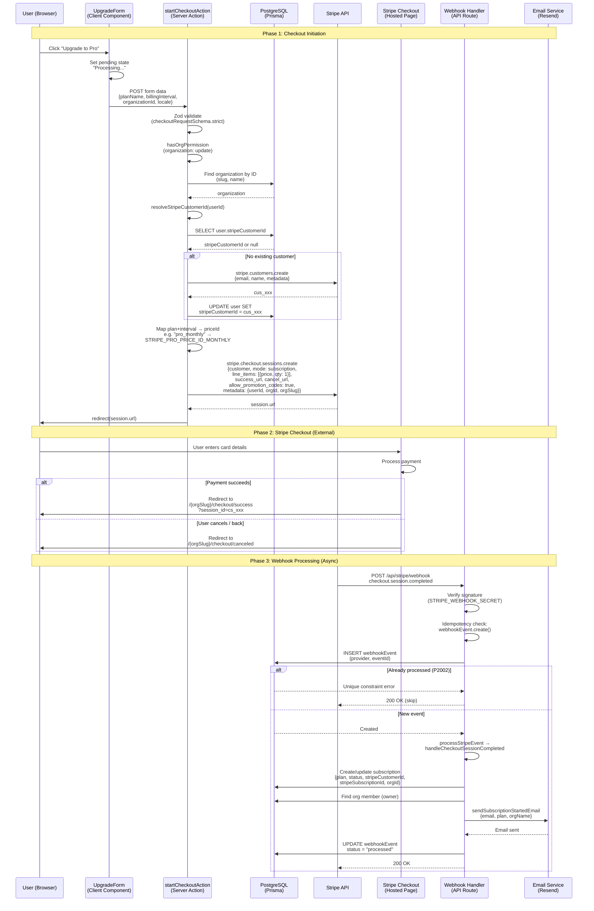
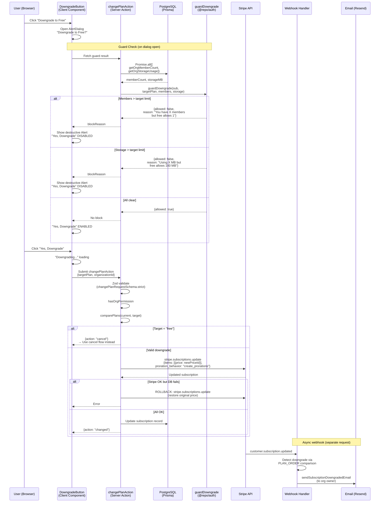
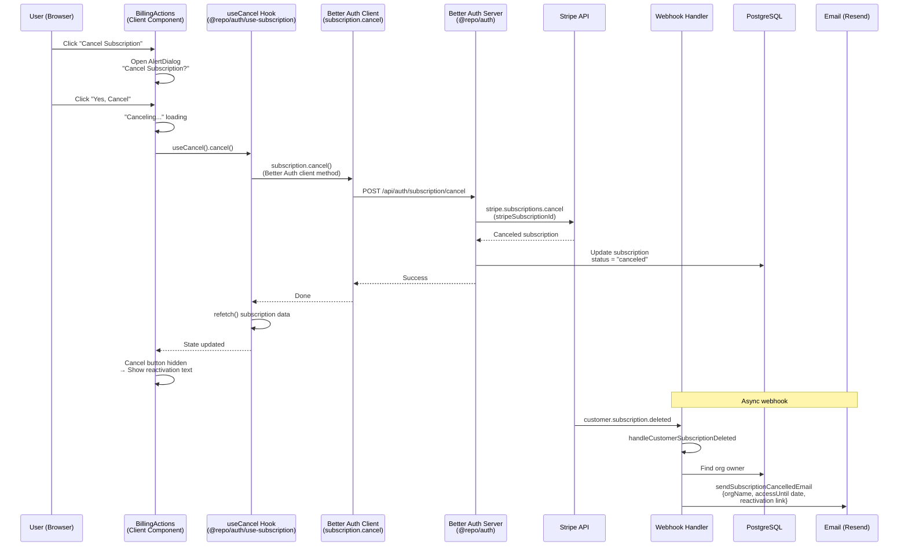
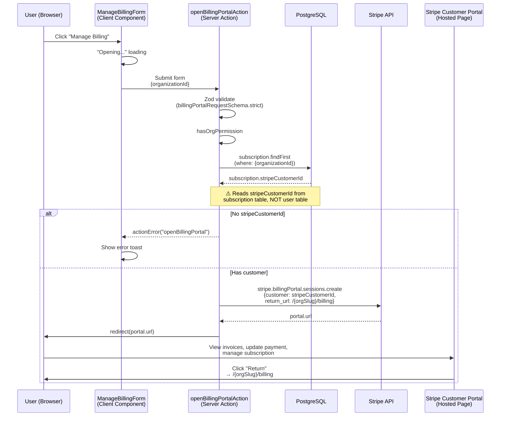
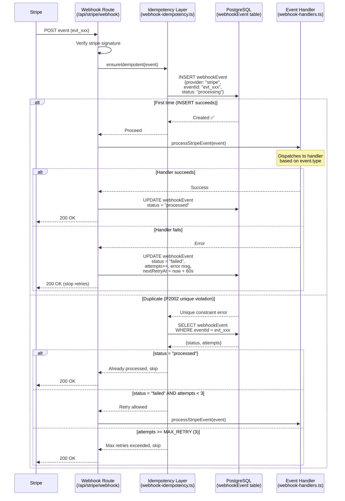

# Payment E2E Test Cases

Derived from `plan/manual-payment-testing.md`. Covers flows testable with Playwright API interception (no real Stripe).

**Test approach:** All Stripe interactions are intercepted via `page.waitForRequest()` / `page.route()`. Tests verify correct data is sent and UI states render correctly. No Stripe API keys are required.

**Test org state:** The E2E test org starts on the **Free plan** (no subscription). Tests that require a paid plan (downgrade, cancel, manage billing) skip gracefully via `test.skip()`.

---

## Prerequisites

```bash
# Start dev server
pnpm dev

# Run payment E2E tests only
cd apps/web
npx playwright test e2e/payment/ --project=topics

# List tests without running
npx playwright test e2e/payment/ --project=topics --list
```

**Required setup:**
- Auth setup: `e2e/.auth/user.json` (created by `auth.setup.ts`)
- Org setup: `e2e/.auth/org-slug.txt` (created by `org.setup.ts`)
- Dev server running on `http://localhost:3000`

---

## User Action Flows

### Billing Page — Complete User Journey

```mermaid
flowchart TD
    Start([User navigates to<br/>/{orgSlug}/billing]) --> AuthCheck{Authenticated?}
    AuthCheck -->|No| Redirect[Redirect to /auth/sign-in]
    AuthCheck -->|Yes| RBACCheck{hasOrgPermission<br/>organization: update}

    RBACCheck -->|Member role| Restricted[🔒 Access Restricted card<br/>"Only owners and admins<br/>can manage billing"]
    RBACCheck -->|Owner/Admin| LoadBilling[Load billing page]

    LoadBilling --> CurrentPlan[Current Plan card<br/>• Plan name heading<br/>• Status badge<br/>• Features list]
    LoadBilling --> ChangePlan[Change Plan card<br/>• 3 plan grid<br/>• Monthly/Annual toggle<br/>• Upgrade/Downgrade buttons]
    LoadBilling --> UsageStats[Usage card<br/>• Team members X/Y<br/>• Storage X MB / Y MB]
    LoadBilling --> BillingCheck{Plan = Free?}

    BillingCheck -->|Yes| NoBillingActions[Billing Actions hidden]
    BillingCheck -->|No| BillingActions[Billing Actions card<br/>• Manage Billing btn<br/>• Cancel Subscription btn]

    %% Upgrade flow
    ChangePlan --> ToggleInterval[Toggle Monthly ↔ Annual]
    ToggleInterval --> UpdatePrices[Prices update<br/>+ "Save X%" badge]
    ChangePlan --> ClickUpgrade[Click "Upgrade to Pro/Enterprise"]
    ClickUpgrade --> Processing["Processing..." loading state]
    Processing --> CheckoutAPI[POST /api/organizations/id/checkout]
    CheckoutAPI --> StripeRedirect[↗ Redirect to Stripe Checkout]
    StripeRedirect --> StripeComplete{User completes<br/>payment?}
    StripeComplete -->|Yes| SuccessPage[/{orgSlug}/checkout/success<br/>• "Subscription Activated!"<br/>• Session ID display<br/>• "Go to Dashboard" link]
    StripeComplete -->|No / Back| CanceledPage[/{orgSlug}/checkout/canceled<br/>• "Checkout Canceled"<br/>• "Try Again" → billing<br/>• "Contact Support" mailto]

    %% Downgrade flow
    ChangePlan --> ClickDowngrade[Click "Downgrade to ..."]
    ClickDowngrade --> DowngradeDialog[AlertDialog opens<br/>"Downgrade to Plan?"]
    DowngradeDialog --> GuardCheck{guardDowngrade<br/>checks limits}
    GuardCheck -->|Members exceed limit| Blocked[🚫 Block reason alert<br/>"Yes, Downgrade" disabled]
    GuardCheck -->|Storage exceeds limit| Blocked
    GuardCheck -->|All clear| ConfirmDowngrade[Click "Yes, Downgrade"]
    DowngradeDialog --> KeepPlan[Click "Keep Plan"<br/>→ Dialog closes, no action]
    ConfirmDowngrade --> Downgrading["Downgrading..." loading]
    Downgrading --> DowngradeTarget{Target = Free?}
    DowngradeTarget -->|Yes| CancelHint[Returns action: "cancel"<br/>→ Use cancel flow instead]
    DowngradeTarget -->|No| StripeUpdate[Stripe subscription updated<br/>→ Plan changes to target]

    %% Cancel flow
    BillingActions --> ClickCancel[Click "Cancel Subscription"]
    ClickCancel --> CancelDialog[AlertDialog opens<br/>"Cancel Subscription?"]
    CancelDialog --> ConfirmCancel[Click "Yes, Cancel"]
    CancelDialog --> KeepSub[Click "Keep Subscription"<br/>→ Dialog closes, no action]
    ConfirmCancel --> Canceling["Canceling..." loading]
    Canceling --> CancelComplete[useCancel hook →<br/>subscription.cancel via BA]

    %% Manage billing
    BillingActions --> ClickManage[Click "Manage Billing"]
    ClickManage --> Opening["Opening..." loading]
    Opening --> PortalRedirect[↗ Redirect to<br/>Stripe Customer Portal]

    %% Navigation from success/canceled
    SuccessPage --> GoDashboard[Click "Go to Dashboard"<br/>→ /{locale}/{orgSlug}]
    CanceledPage --> TryAgain[Click "Try Again"<br/>→ /{orgSlug}/billing]

    style Restricted fill:#fee2e2,stroke:#ef4444
    style Blocked fill:#fee2e2,stroke:#ef4444
    style SuccessPage fill:#dcfce7,stroke:#22c55e
    style CanceledPage fill:#fef9c3,stroke:#eab308
    style StripeRedirect fill:#e0e7ff,stroke:#6366f1
    style PortalRedirect fill:#e0e7ff,stroke:#6366f1
```

### Organization Creation — Guard Flow

```mermaid
flowchart TD
    Start([User navigates to<br/>/account/new-org]) --> AuthCheck{requireAuth}
    AuthCheck -->|Not signed in| Redirect[Redirect to sign-in]
    AuthCheck -->|Signed in| OrgCheck[canUserCreateOrg<br/>→ checkOrgCreationEligibility]

    OrgCheck --> EvalOrgs{Evaluate owned orgs}

    EvalOrgs -->|0 orgs owned| Allowed[✅ Allowed<br/>First org always permitted]
    EvalOrgs -->|Has free org| Denied1[❌ upgrade_required<br/>"Upgrade existing org<br/>to create another"]
    EvalOrgs -->|>= MAX_ORGS_PER_USER| Denied2[❌ max_reached<br/>"Organization limit reached"]
    EvalOrgs -->|All orgs paid,<br/>under limit| Allowed

    Allowed --> CreateForm[CreateOrganizationForm<br/>• Workspace Name input<br/>• Workspace URL input<br/>• "Create Workspace" button]

    Denied1 --> UpgradePrompt1[UpgradePrompt<br/>showUpgrade = true<br/>• "Upgrade Required" title<br/>• "Upgrade Plan" link → /org<br/>• "Go Back" link]

    Denied2 --> UpgradePrompt2[UpgradePrompt<br/>showUpgrade = false<br/>• "Organization Limit Reached"<br/>• "Go Back" link only]

    CreateForm --> Submit[Submit form]
    Submit --> ServerGuard{Server action also checks<br/>checkOrgCreationEligibility<br/>defense-in-depth}
    ServerGuard -->|Allowed| Created[✅ Org created<br/>→ Redirect to /{newOrgSlug}]
    ServerGuard -->|Denied| Error[❌ Error toast]

    style Allowed fill:#dcfce7,stroke:#22c55e
    style Denied1 fill:#fee2e2,stroke:#ef4444
    style Denied2 fill:#fee2e2,stroke:#ef4444
    style Created fill:#dcfce7,stroke:#22c55e
```

---

## Data Flows

### Checkout — Data Flow (Free → Paid)



### Downgrade — Data Flow



### Cancel Subscription — Data Flow



### Billing Portal — Data Flow



### Webhook Idempotency — Data Flow



---

## Spec 1: billing-page.spec.ts

Covers: billing page rendering, current plan display, plan comparison grid, usage stats, billing actions visibility.

**Route:** `/{orgSlug}/billing`
**Components tested:** `CurrentPlan`, `ChangePlan`, `UsageStats`, `BillingActions`
**Permission gate:** `hasOrgPermission(orgId, { organization: ["update"] })`

---

### BP-01: Billing page renders for authorized user
**Maps to:** Manual Flow 28
**Priority:** HIGH

#### Steps
1. Navigate to `/{orgSlug}/billing`
2. Wait for page to load

#### Expected
- Page shows billing content ("Current Plan" or "Billing" text visible)
- OR shows "Access Restricted" card (if user is member, not owner/admin)
- URL does NOT contain `/auth/sign-in` (not redirected to login)

#### What it tests
- Route `/{orgSlug}/billing` resolves correctly
- Auth middleware passes (user is authenticated)
- Server component renders without crash

---

### BP-02: Current plan card shows Free plan with status badge
**Maps to:** Manual Flow 1 (step 3)
**Priority:** HIGH

#### Steps
1. Navigate to `/{orgSlug}/billing`
2. Wait for "Current Plan" card to appear (skeleton loading disappears)

#### Expected
- Plan name heading (`<h3>`) shows "Free"
- Status badge (`[data-slot='badge']`) shows one of: "Active", "No subscription", "Trialing", "Canceled"
- For a new org on Free plan, badge should show "No subscription" or "Active"

#### What it tests
- `CurrentPlan` component fetches subscription data correctly
- `getStatusDisplayText()` returns the right status string
- Skeleton loading resolves (no infinite loading state)

#### Architecture note
The CurrentPlan component uses a React hook to fetch subscription data client-side. The plan name comes from `plan.displayName` and the status from `getStatusDisplayText(subscription)`.

---

### BP-03: Free plan shows upgrade prompt
**Maps to:** Manual Flow 1
**Priority:** MEDIUM

#### Steps
1. Navigate to `/{orgSlug}/billing`
2. Wait for "Current Plan" card to load

#### Expected
- On Free plan: a dashed-border div shows "Upgrade to unlock more features, team members, and storage"
- On paid plan: this prompt is NOT shown (replaced by plan details)

#### What it tests
- Conditional rendering in `CurrentPlan` based on `isPaid` flag
- Free plan experience encourages upgrading

---

### BP-04: Current plan shows included features list
**Maps to:** Manual Flow 1
**Priority:** LOW

#### Steps
1. Navigate to `/{orgSlug}/billing`
2. Wait for "Current Plan" card to load

#### Expected
- "Features included:" label is visible
- Feature list items are rendered below the label

#### What it tests
- `PlanConfig.features` array renders correctly in the CurrentPlan component
- For Free plan: "1 team member", "100 MB storage", "Basic features", "Community support"

---

### BP-05: Plan comparison grid shows 3 plans with prices
**Maps to:** Manual Flow 1 (step 3)
**Priority:** HIGH

#### Steps
1. Navigate to `/{orgSlug}/billing`
2. Wait for "Change Plan" card to appear

#### Expected
- Three plan headings visible: "Free", "Pro", "Enterprise" (each as `<h3>`)
- Free plan shows "Free" price text
- Paid plans show `$X/mo` price format (e.g., "$19/mo", "$49/mo")

#### What it tests
- `ChangePlan` component renders all 3 plans from `PLANS` config
- `monthlyPrice` from `packages/utils/payment.ts` displays correctly
- Plan grid layout renders without overflow or collapse

---

### BP-06: Billing toggle switches monthly/annual pricing
**Maps to:** Manual Flow 2 (steps 3-4)
**Priority:** HIGH

#### Steps
1. Navigate to `/{orgSlug}/billing`
2. Wait for "Change Plan" card to appear
3. Verify "Monthly" label is visible (default state)
4. Click the billing toggle switch (`[role='switch']` or `[data-slot='switch']`)
5. Wait for "Annual" label to become visible

#### Expected
- Before toggle: "Monthly" label visible, prices show monthly amounts
- After toggle: "Annual" label visible, "Billed annually ($X/year)" text appears for paid plans
- Toggle is interactive and changes state

#### What it tests
- `ChangePlan` component's `billingInterval` state toggles between "monthly" and "annual"
- Price display updates reactively when interval changes
- `yearlyPrice` from `PlanConfig` renders correctly (was `undefined` before fix — see Known Gaps #7)

---

### BP-07: Annual toggle shows savings badge
**Maps to:** Manual Flow 2
**Priority:** MEDIUM

#### Steps
1. Navigate to `/{orgSlug}/billing`
2. Wait for "Change Plan" card to appear
3. Click the billing toggle switch to annual

#### Expected
- A badge with "Save X%" text appears (e.g., "Save 17%")
- Badge uses `[data-slot='badge']` component

#### What it tests
- Annual savings calculation: `(monthlyPrice * 12 - yearlyPrice) / (monthlyPrice * 12) * 100`
- Badge only appears in annual mode, not monthly

---

### BP-08: Current plan button is disabled
**Maps to:** Manual Flow 1
**Priority:** MEDIUM

#### Steps
1. Navigate to `/{orgSlug}/billing`
2. Wait for "Change Plan" card to appear
3. Find the "Current Plan" button in the plan grid

#### Expected
- The button is visible with text "Current Plan"
- The button is **disabled** (cannot be clicked)

#### What it tests
- Plan card for the current plan renders a disabled button instead of upgrade/downgrade
- Prevents accidental self-plan-change

---

### BP-09: Usage stats show team members count
**Maps to:** Manual Flow 1 (step 11)
**Priority:** HIGH

#### Steps
1. Navigate to `/{orgSlug}/billing`
2. Wait for "Usage" card to appear

#### Expected
- "Team Members" label is visible
- Member count in "X / Y" format (e.g., "1 / 1" for Free plan with 1 owner)
- OR "X / Unlimited" for plans with unlimited members

#### What it tests
- `UsageStats` component fetches actual member count from the database
- `maxMembers` from `PlanConfig.limits` is displayed correctly
- Free plan: 1 member limit, Pro: 10, Enterprise: 50

---

### BP-10: Usage stats show storage info
**Maps to:** Manual Flow 1
**Priority:** MEDIUM

#### Steps
1. Navigate to `/{orgSlug}/billing`
2. Wait for "Usage" card to appear

#### Expected
- "Storage" label is visible
- Storage count in "X MB / Y MB" or "X MB / Unlimited" format

#### What it tests
- Storage usage calculation from org-scoped files
- `maxStorageMB` from `PlanConfig.limits` displayed correctly
- Free: 100 MB, Pro: 5,000 MB (5 GB), Enterprise: 50,000 MB (50 GB)

---

### BP-11: Billing actions hidden on Free plan
**Maps to:** Manual Flow 1
**Priority:** HIGH

#### Steps
1. Navigate to `/{orgSlug}/billing`
2. Wait for "Change Plan" card to fully load

#### Expected
- "Manage Billing" button does NOT exist on the page
- "Cancel Subscription" button does NOT exist on the page

#### What it tests
- `BillingActions` component returns `null` when `planName === 'free'`
- No paid-only actions leak onto the Free plan UI

#### Architecture note
The `BillingActions` component checks the current plan name and returns `null` early for free plans. This is a client-side check after fetching subscription data. The server also validates permissions in each action.

---

### BP-12: Each plan card shows feature list
**Maps to:** Manual Flow 1
**Priority:** LOW

#### Steps
1. Navigate to `/{orgSlug}/billing`
2. Wait for "Change Plan" card to appear

#### Expected
- Feature list items (`<ul> <li>`) exist within the plan grid
- Each item has a check icon (SVG) prefix

#### What it tests
- `PlanConfig.features` array renders as a list in each plan card
- CheckCircle2 icons render correctly

---

## Spec 2: checkout.spec.ts

Covers: upgrade checkout initiation (API interception), checkout success page, checkout canceled page.

**Server action tested:** `startCheckoutAction()` in `apps/web/app/[locale]/(app)/[orgSlug]/billing/actions.ts`
**Schema:** `checkoutRequestSchema` with `.strict()` — fields: `planName`, `billingInterval`, `organizationId`, `locale`
**Checkout API:** `POST /api/organizations/{id}/checkout`

---

### CO-01: Upgrade to Pro sends correct checkout POST data
**Maps to:** Manual Flow 1 (steps 4-5)
**Priority:** HIGH

#### Steps
1. Navigate to `/{orgSlug}/billing`
2. Wait for "Change Plan" card
3. Find "Upgrade to Pro" button
4. Set up request interceptor for `POST /api/organizations/*/checkout`
5. Click the upgrade button
6. Capture the intercepted request

#### Expected
- Request method: `POST`
- Request URL contains `/checkout`
- Request body contains:
  - `planName`: matches "pro"
  - `billingInterval`: "monthly" (default)
  - `locale`: present

#### What it tests
- `UpgradeForm` component submits `startCheckoutAction()` with correct data
- Form serialization includes all required fields from `checkoutRequestSchema`
- Monthly is the default billing interval

#### Architecture note
The `UpgradeForm` wraps the action in a `<form action={formAction}>` with hidden inputs for `planName`, `billingInterval`, `organizationId`, and `locale`. The server action validates with Zod, creates a Stripe Checkout session via `resolveStripeCustomerId()` + `stripe.checkout.sessions.create()`, and redirects to Stripe.

---

### CO-02: Upgrade to Enterprise sends correct checkout POST data
**Maps to:** Manual Flow 3 (steps 3-4)
**Priority:** HIGH

#### Steps
1. Navigate to `/{orgSlug}/billing`
2. Wait for "Change Plan" card
3. Find "Upgrade to Enterprise" button
4. Set up request interceptor for `POST .../checkout`
5. Click the upgrade button
6. Capture the intercepted request

#### Expected
- Request body `planName` matches "enterprise"
- All other fields present

#### What it tests
- Enterprise plan card correctly passes `planName: "enterprise"`
- Same checkout flow works for both Pro and Enterprise tiers

---

### CO-03: Annual toggle changes billingInterval to "annual"
**Maps to:** Manual Flow 2 (steps 3-6)
**Priority:** HIGH

#### Steps
1. Navigate to `/{orgSlug}/billing`
2. Wait for "Change Plan" card
3. Click the billing toggle switch to annual
4. Wait for "Save X%" badge to confirm toggle
5. Set up request interceptor for `POST .../checkout`
6. Click any "Upgrade to" button
7. Capture the intercepted request

#### Expected
- Request body `billingInterval`: "annual" (not "monthly")

#### What it tests
- `ChangePlan` component passes the toggled interval to `UpgradeForm`
- The hidden input for `billingInterval` updates when the toggle changes
- Server action receives the correct interval for Stripe price ID mapping

#### Stripe mapping
- `billingInterval: "monthly"` → `STRIPE_PRO_PRICE_ID_MONTHLY` or `STRIPE_ENTERPRISE_PRICE_ID_MONTHLY`
- `billingInterval: "annual"` → `STRIPE_PRO_PRICE_ID_ANNUAL` or `STRIPE_ENTERPRISE_PRICE_ID_ANNUAL`

---

### CO-04: Upgrade button shows "Processing..." during submit
**Maps to:** Manual Flow 1 (step 4)
**Priority:** MEDIUM

#### Steps
1. Navigate to `/{orgSlug}/billing`
2. Wait for "Change Plan" card
3. Set up request interceptor
4. Click "Upgrade to Pro" button

#### Expected
- Button text changes from "Upgrade to Pro" to "Processing..." with a Loader2 spinner
- This is the `useActionState` pending state from `UpgradeForm`

#### What it tests
- Form pending state renders correctly
- User gets visual feedback that the action is in progress
- Button is implicitly disabled during submission (prevents double-click)

---

### CO-05: Success page renders with activation title
**Maps to:** Manual Flow 1 (step 8)
**Priority:** HIGH

#### Steps
1. Navigate directly to `/{orgSlug}/checkout/success`

#### Expected
- Heading "Subscription Activated!" is visible
- Page renders without errors (no 404 or redirect)

#### What it tests
- Checkout success route exists at `apps/web/app/[locale]/(app)/[orgSlug]/checkout/success/page.tsx`
- Page is accessible without a real Stripe session (display-only, no session verification)

#### Known issue
The success page hardcodes "7-day free trial period" text, but no trial is configured in `startCheckoutAction`. This is a known UI bug (see Known Gaps #1).

---

### CO-06: Success page shows session ID when in URL
**Maps to:** Manual Flow 1 (step 8)
**Priority:** HIGH

#### Steps
1. Navigate to `/{orgSlug}/checkout/success?session_id=cs_test_abc123`

#### Expected
- "Session ID" text is visible
- The session ID value "cs_test_abc123" is displayed in a `<code>` element

#### What it tests
- URL search param `session_id` is read and displayed
- `<code>` block renders the raw session ID for debugging/support purposes
- Stripe test session IDs use `cs_test_` prefix

---

### CO-07: Success page hides session ID when absent
**Maps to:** Manual Flow 1
**Priority:** MEDIUM

#### Steps
1. Navigate to `/{orgSlug}/checkout/success` (no `session_id` param)

#### Expected
- "Session ID" text does NOT appear
- No `<code>` element on the page

#### What it tests
- Conditional rendering: session ID block only shown when `searchParams.session_id` exists
- Clean UI when navigating to success page without Stripe context

---

### CO-08: Success page shows subscription benefits list
**Maps to:** Manual Flow 1 (step 8)
**Priority:** MEDIUM

#### Steps
1. Navigate to `/{orgSlug}/checkout/success`

#### Expected
- "Access to all premium features" text visible
- "Priority support" text visible
- Benefits list (`<ul>`) has exactly 4 items
- Items include: premium features, free trial, priority support, automatic billing

#### What it tests
- Static benefits list renders correctly
- All 4 benefit items are present (hardcoded in the success page component)

---

### CO-09: "Go to Dashboard" links to org home
**Maps to:** Manual Flow 1 (step 8)
**Priority:** HIGH

#### Steps
1. Navigate to `/{orgSlug}/checkout/success`
2. Find "Go to Dashboard" link

#### Expected
- Link is visible
- `href` attribute matches `/{locale}/{orgSlug}` pattern

#### What it tests
- Navigation from success page back to the org dashboard
- Locale and org slug are correctly embedded in the link

---

### CO-10: Canceled page renders with correct messaging
**Maps to:** Manual Flow 4 (steps 3-4)
**Priority:** HIGH

#### Steps
1. Navigate to `/{orgSlug}/checkout/canceled`

#### Expected
- "Checkout Canceled" heading visible
- "canceled the checkout process...no charges were made" text visible

#### What it tests
- Checkout canceled route exists and renders
- User is reassured that no payment was taken
- No side effects from viewing this page

#### Architecture note
This page renders when Stripe redirects back after the user clicks "back" or closes the Checkout tab. The `cancel_url` in `startCheckoutAction` points to `/{orgSlug}/checkout/canceled`.

---

### CO-11: "Try Again" links back to billing page
**Maps to:** Manual Flow 4 (step 4)
**Priority:** HIGH

#### Steps
1. Navigate to `/{orgSlug}/checkout/canceled`
2. Find "Try Again" link

#### Expected
- Link is visible
- `href` attribute matches `/{orgSlug}/billing`

#### What it tests
- Retry path from checkout cancellation leads back to billing page
- User can re-attempt the upgrade

---

### CO-12: "Contact Support" has mailto link
**Maps to:** Manual Flow 4 (step 4)
**Priority:** MEDIUM

#### Steps
1. Navigate to `/{orgSlug}/checkout/canceled`
2. Find "Contact Support" link

#### Expected
- Link is visible
- `href` attribute starts with `mailto:`

#### What it tests
- Support fallback option is available when checkout fails
- Email link is functional (not a dead link)

---

### CO-13: Navigating to canceled page directly works
**Maps to:** Manual Flow 4
**Priority:** MEDIUM

#### Steps
1. Navigate to `/{orgSlug}/billing` first
2. Then navigate to `/{orgSlug}/checkout/canceled`

#### Expected
- Page renders with "Checkout Canceled" heading
- "Try Again" link is visible
- Page is independently accessible (not dependent on Stripe redirect state)

#### What it tests
- The canceled page doesn't require a prior Stripe session or referrer header
- Users can bookmark or share the URL without issues

---

### CO-14: Clicking "Try Again" navigates to billing
**Maps to:** Manual Flow 4
**Priority:** HIGH

#### Steps
1. Navigate to `/{orgSlug}/checkout/canceled`
2. Click "Try Again" link
3. Wait for URL to change

#### Expected
- URL changes to `/{orgSlug}/billing`
- Billing page content is visible

#### What it tests
- Client-side navigation from canceled page to billing
- No redirect loops or errors during navigation

---

### CO-15: Browser back from billing returns to canceled page
**Maps to:** Manual Flow 4
**Priority:** LOW

#### Steps
1. Navigate to `/{orgSlug}/checkout/canceled`
2. Click "Try Again" to go to billing page
3. Click browser back button

#### Expected
- URL returns to `/checkout/canceled`
- "Checkout Canceled" heading is visible again

#### What it tests
- Browser history is preserved through client-side navigation
- Canceled page re-renders correctly from back/forward cache

---

## Spec 3: plan-changes.spec.ts

Covers: downgrade dialog, cancel subscription, billing portal redirect.

**Server actions tested:**
- `changePlanAction()` — handles downgrades only (upgrades go through checkout)
- `openBillingPortalAction()` — redirects to Stripe Customer Portal

**Client hook tested:**
- `useCancel()` from `@repo/auth/use-subscription` — calls `subscription.cancel()` via Better Auth

**Important:** These tests require a paid subscription to interact with downgrade/cancel/manage-billing UI. The test org starts on Free plan, so most tests in this spec **skip gracefully**. They are designed to pass when run against a paid org.

---

### PC-01: Downgrade button visible for lower plans (when on paid plan)
**Maps to:** Manual Flow 6 (step 3)
**Priority:** HIGH

#### Steps
1. Navigate to `/{orgSlug}/billing`
2. Wait for "Change Plan" card
3. Look for "Downgrade to ..." button

#### Expected
- On paid plan: "Downgrade to [LowerPlanName]" button visible (e.g., "Downgrade to Free" on Pro)
- On Free plan: no downgrade button exists → test **skips**

#### What it tests
- `ChangePlan` renders `DowngradeButton` for plans below the current plan
- Button text includes the target plan's display name

#### Architecture note
`ChangePlan` compares `PLAN_ORDER` indices. For each plan below the current plan, it renders a `DowngradeButton`. For plans above, it renders `UpgradeForm`.

---

### PC-02: Downgrade button opens AlertDialog with warning
**Maps to:** Manual Flow 6 (steps 3-4)
**Priority:** HIGH

#### Steps
1. Navigate to `/{orgSlug}/billing`
2. Click "Downgrade to ..." button
3. Wait for dialog to appear

#### Expected
- AlertDialog heading: "Downgrade to [TargetPlan]?"
- Warning text: "You will lose access to features available on your current [CurrentPlan] plan."
- Two buttons: "Yes, Downgrade" and "Keep [CurrentPlanDisplayName]"

#### What it tests
- `DowngradeButton` component opens an AlertDialog on click
- Dialog content includes both the target and current plan names
- `guardDowngrade()` is called to check if downgrade is blocked (if blocked, "Yes, Downgrade" is disabled)

---

### PC-03: "Keep Plan" closes dialog without action
**Maps to:** Manual Flow 6
**Priority:** MEDIUM

#### Steps
1. Open the downgrade dialog (click "Downgrade to ...")
2. Click "Keep [Plan]" button

#### Expected
- Dialog closes
- No server action is triggered
- Billing page state is unchanged

#### What it tests
- Cancel path in the AlertDialog works correctly
- No side effects from opening and closing the dialog

---

### PC-04: Downgrade sends correct changePlanAction data
**Maps to:** Manual Flow 6 (step 5)
**Priority:** HIGH

#### Steps
1. Open the downgrade dialog
2. If "Yes, Downgrade" is enabled (not blocked by guard), click it
3. Observe the loading state

#### Expected
- If not blocked: "Downgrading..." text appears with spinner
- Server action receives `targetPlan` and `organizationId`
- If blocked: "Yes, Downgrade" button is disabled, block reason shown

#### What it tests
- `changePlanAction()` form submission with correct data
- `useActionState` pending state renders "Downgrading..."
- `guardDowngrade()` block reason disables the confirm button

#### Architecture note
`changePlanAction()` only handles **downgrades**. If the target plan is "free", it returns `{ action: "cancel" }` — signaling the UI to use the cancel flow instead. If the target plan is higher than current, it rejects the request.

---

### PC-05: Cancel subscription button visible on paid plan
**Maps to:** Manual Flow 10 (step 3)
**Priority:** HIGH

#### Steps
1. Navigate to `/{orgSlug}/billing`
2. Look for "Cancel Subscription" button

#### Expected
- On paid plan (active, not already canceled): button is visible with XCircle icon
- On Free plan: button does NOT exist → test **skips**
- On already canceled plan: button does NOT exist (replaced with reactivation text)

#### What it tests
- `BillingActions` conditional rendering: cancel button only for `isPaid && !isCanceled`

---

### PC-06: Cancel opens confirmation AlertDialog
**Maps to:** Manual Flow 10 (step 3)
**Priority:** HIGH

#### Steps
1. Click "Cancel Subscription" button
2. Wait for dialog to appear

#### Expected
- AlertDialog heading: "Cancel Subscription?"
- Warning text: "Your subscription will remain active until the end of the current billing period."
- Two buttons: "Yes, Cancel" and "Keep Subscription"

#### What it tests
- Cancel confirmation dialog renders with correct copy
- User is informed that access continues until billing period ends
- Both confirm and dismiss paths are available

---

### PC-07: "Yes, Cancel" triggers cancel flow
**Maps to:** Manual Flow 10 (steps 4-5)
**Priority:** HIGH

#### Steps
1. Open cancel confirmation dialog
2. Click "Yes, Cancel"
3. Observe loading state

#### Expected
- Button text changes to "Canceling..." with spinner
- `useCancel()` hook calls `subscription.cancel()` via Better Auth client
- After completion: subscription state refreshes, cancel button replaced with reactivation info

#### What it tests
- `useCancel()` hook from `@repo/auth/use-subscription` fires correctly
- Better Auth `subscription.cancel()` client method is called
- Loading/pending state during cancellation

#### Webhook side effect (not testable in E2E)
- `customer.subscription.deleted` → `handleCustomerSubscriptionDeleted` → `sendSubscriptionCancelledEmail`

---

### PC-08: "Keep Subscription" closes dialog
**Maps to:** Manual Flow 10
**Priority:** MEDIUM

#### Steps
1. Open cancel confirmation dialog
2. Click "Keep Subscription"

#### Expected
- Dialog closes
- No cancellation triggered
- Subscription status unchanged

#### What it tests
- Dismiss path in the cancel AlertDialog
- No side effects from opening and closing

---

### PC-09: Manage Billing button triggers portal redirect
**Maps to:** Manual Flow 11 (steps 3-4)
**Priority:** MEDIUM

#### Steps
1. Navigate to `/{orgSlug}/billing`
2. Find "Manage Billing" button (only visible on paid plans)

#### Expected
- Button is visible and enabled
- On Free plan: button does NOT exist → test **skips**

#### What it tests
- `ManageBillingForm` renders inside `BillingActions` for paid plans
- Button is clickable (not disabled)

#### Architecture note
Clicking triggers `openBillingPortalAction()` which reads `stripeCustomerId` from the **subscription** table (not `user` table), creates a Stripe Billing Portal session, and redirects to Stripe's hosted portal. There are two sources of truth for `stripeCustomerId` — see Known Gaps #3.

---

### PC-10: Manage Billing shows "Opening..." during submit
**Maps to:** Manual Flow 11
**Priority:** LOW

#### Steps
1. Click "Manage Billing" button
2. Observe loading state

#### Expected
- Button text changes from "Manage Billing" (with CreditCard icon) to "Opening..." (with Loader2 spinner)
- `useActionState` pending state is active

#### What it tests
- Form submission loading indicator
- User gets feedback that the portal session is being created

---

## Spec 4: guards.spec.ts

Covers: RBAC (billing page access control), organization creation limits, downgrade guard UI.

**Permission check:** `hasOrgPermission(orgId, { organization: ["update"] })`
**Org creation guard:** `canUserCreateOrg()` → `checkOrgCreationEligibility()` in `@repo/utils/payment`
**Downgrade guard:** `guardDowngrade()` in `@repo/auth/guards`

---

### GD-01: Non-owner sees "Access Restricted" on billing page
**Maps to:** Manual Flow 27
**Priority:** HIGH

#### Steps
1. Sign in as a user who is a **member** (not owner/admin) of an organization
2. Navigate to `/{orgSlug}/billing`

#### Expected
- "Access Restricted" card visible
- Text: "Only organization owners and admins can manage billing"
- No billing components (CurrentPlan, ChangePlan, UsageStats, BillingActions) visible

#### Status: **SKIPPED** — requires multi-user E2E setup
The current E2E infrastructure only creates one test user (the org owner). Testing the member role requires:
1. A second test user with stored auth state
2. That user added to the org with "member" role
3. A separate storage state file (e.g., `e2e/.auth/member.json`)

#### What it tests
- Server-side permission check: `hasOrgPermission(orgId, { organization: ["update"] })`
- Non-admin users cannot see billing information or trigger billing actions
- Defense-in-depth: even if the page somehow rendered, server actions also check permissions

---

### GD-02: Owner sees full billing page with all sections
**Maps to:** Manual Flow 28
**Priority:** HIGH

#### Steps
1. Navigate to `/{orgSlug}/billing` (as the org owner — default test user)

#### Expected
- "Access Restricted" text does NOT appear
- "Current Plan" section is visible
- "Change Plan" section is visible
- "Usage" section is visible

#### What it tests
- Owner role passes `hasOrgPermission(orgId, { organization: ["update"] })`
- All billing sections render for authorized users
- Positive path complements GD-01's negative path

---

### GD-03: Org creation shows UpgradePrompt when blocked
**Maps to:** Manual Flows 23-24
**Priority:** MEDIUM

#### Steps
1. Navigate to `/en/account/new-org`
2. Wait for page to load (network idle)

#### Expected
Two possible states:
- **Blocked (Free plan, 1 existing org):** "Upgrade Required" or "Organization Limit Reached" text visible instead of the creation form
- **Allowed (paid plan or first org):** "Create Workspace" button visible with name/slug inputs

#### What it tests
- `canUserCreateOrg()` → `checkOrgCreationEligibility()` correctly evaluates:
  - 0 owned orgs → always allowed (first org)
  - Any existing org on free plan → denied with `upgrade_required`
  - `ownedOrgCount >= MAX_ORGS_PER_USER` → denied with `max_reached`
- Server-side guard renders `UpgradePrompt` component instead of `CreateOrganizationForm`

#### Architecture note
The check runs in BOTH the page render (server component) AND the `createOrganizationAction` server action (defense-in-depth). Even if someone bypasses the UI gate, the server action will reject the creation.

---

### GD-04: "Upgrade Plan" link visible on UpgradePrompt
**Maps to:** Manual Flow 23 (step 6)
**Priority:** MEDIUM

#### Steps
1. Navigate to `/en/account/new-org`
2. If UpgradePrompt is shown, find "Upgrade Plan" link

#### Expected
- Link is visible (only when block code is `upgrade_required`, not `max_reached`)
- Link `href` points to `/org` (org selection page where user can upgrade existing org)

#### What it tests
- `UpgradePrompt` component's two variants:
  - `showUpgrade=true` (code `upgrade_required`): shows "Upgrade Plan" button
  - `showUpgrade=false` (code `max_reached`): shows only "Go Back" button, no upgrade path

---

### GD-05: Downgrade blocked when member count exceeds target limit
**Maps to:** Manual Flow 8
**Priority:** HIGH

#### Steps
1. Navigate to `/{orgSlug}/billing`
2. Click "Downgrade to ..." button (if visible)
3. Check for block reason alert

#### Expected
Two possible states:
- **Blocked:** Alert with `variant="destructive"` visible inside the dialog, containing text about "members" or "member". "Yes, Downgrade" button is **disabled**.
- **Not blocked:** No alert. "Yes, Downgrade" button is **enabled**.

#### On Free plan: test **skips** (no downgrade button exists)

#### What it tests
- `guardDowngrade()` checks `canAddMember()` for the target plan:
  - Current member count (including pending invitations) vs target plan's `maxMembers`
  - If `currentMembers > targetLimit`: returns `blockReason` with specific message
- `DowngradeButton` renders block reason in an `Alert` component
- "Yes, Downgrade" button is disabled when `blockReason` is present

#### Guard logic (from `packages/auth/guards.ts`)
```
guardDowngrade(subscription, targetPlan, memberCount, storageMB) {
  // Check member limit
  if (memberCount > targetLimits.maxMembers) → block
  // Check storage limit
  if (storageMB > targetLimits.maxStorageMB) → block
  // Both pass → allow
}
```

---

### GD-06: Downgrade blocked when storage exceeds target limit
**Maps to:** Manual Flow 9
**Priority:** HIGH

#### Steps
1. Navigate to `/{orgSlug}/billing`
2. Click "Downgrade to ..." button (if visible)
3. Check for block reason alert

#### Expected
Two possible states:
- **Blocked:** Alert mentions "storage" or "MB". "Yes, Downgrade" button is **disabled**.
- **Not blocked:** No alert. Button is **enabled**.

#### On Free plan: test **skips** (no downgrade button exists)

#### What it tests
- `guardDowngrade()` checks `canUseStorage()` for the target plan
- Block message includes current usage and target plan's storage limit
- Same UI pattern as GD-05 but for storage instead of members

---

## Flows NOT covered by E2E (require real Stripe)

| Flow | Category | Reason |
|------|----------|--------|
| 5 | Checkout | Promo codes require real Stripe Checkout page |
| 12-17 | Webhooks | Require Stripe CLI + real webhook events (`checkout.session.completed`, `customer.subscription.updated`, `customer.subscription.deleted`, `invoice.payment_failed`, `invoice.paid`, `trial_will_end`) |
| 18-20 | Webhooks | Idempotency and retry testing require real webhook delivery |
| 21-22 | Customer | Customer reuse requires real Stripe customer creation |
| 29-31 | Validation | Zod validation requires DevTools form manipulation (fragile in E2E) |
| 32 | Status badges | Testing Active/PastDue/Canceled/Trialing badges requires real subscription state changes |
| 33 | Storage | Upload blocking requires file upload + storage quota enforcement |
| 34-36 | Feature guards | Dead code — `requireApiAccess`, `requireSSO`, `requireCustomBranding` are never imported in `apps/web/` |

---

## Known Gaps & Notes

1. **No trial period configured** — Success page hardcodes "7-day free trial period" text, but `startCheckoutAction` does not set `trial_period_days`. Trialing status badge is unreachable via normal checkout.

2. **`sendPaymentReceiptEmail` never triggered** — Template exists in `packages/email/templates/payment-receipt.tsx` but no webhook handler calls it.

3. **Two sources of truth for `stripeCustomerId`** — Checkout stores on `user` record via `resolveStripeCustomerId()`. Billing portal reads from `subscription` table. Could diverge.

4. **Most plan-change tests skip on Free plan** — The test org starts on Free. Tests for downgrade, cancel, and manage billing skip gracefully. For full coverage, either:
   - Run against a pre-configured org with a paid subscription
   - Add a setup step that completes a real Stripe checkout before running plan-change tests

5. **RBAC member test requires second user** — GD-01 is skipped until multi-user E2E setup is implemented.

6. **`yearlyPrice` was `undefined` (FIXED)** — All plan configs referenced `PRICING.*.ANNUAL` with property name `annualPrice`, but the type uses `yearlyPrice` and the constant uses `.YEARLY`. Fixed in `packages/utils/payment.ts`.

7. **Enterprise features string was wrong (FIXED)** — Said "Up to 10 team members" but limit is 50. Fixed in `packages/utils/payment.ts`.
