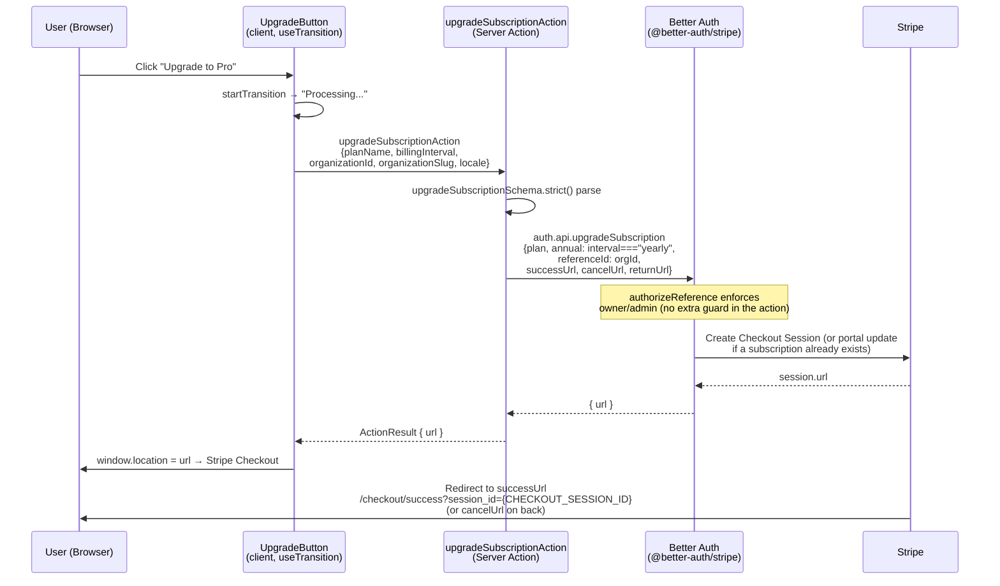
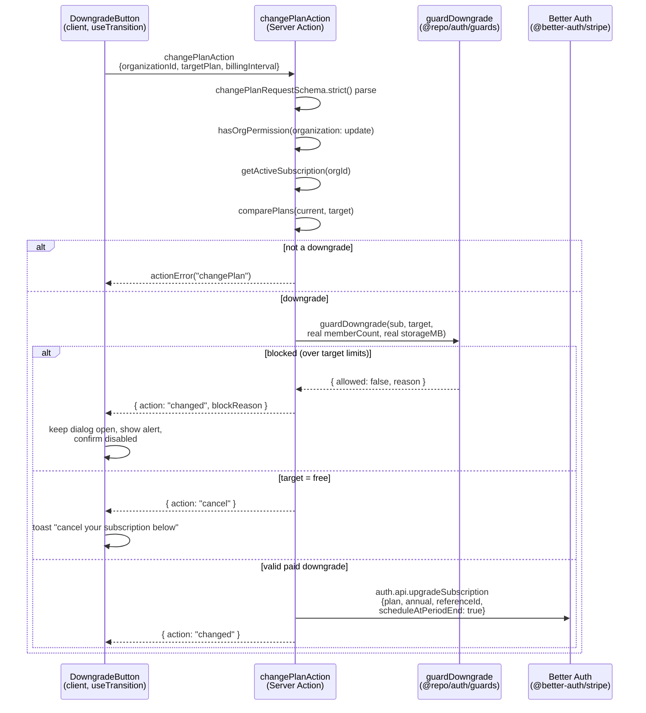
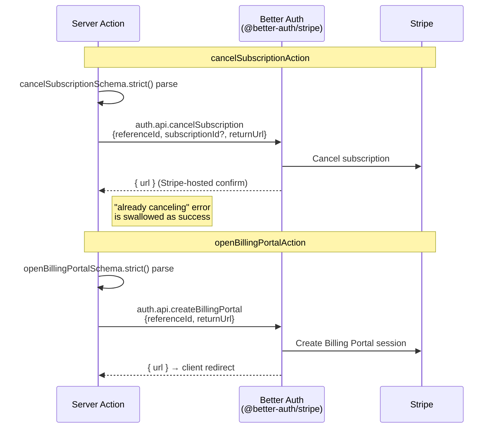
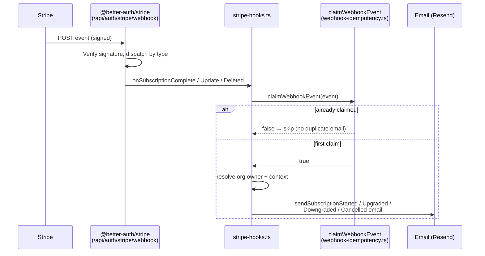

# Payment E2E Test Cases

Covers the payment/billing critical paths exercised by the Playwright specs in
`apps/web/e2e/payment/`. Billing is **Stripe through the `@better-auth/stripe`
plugin** — there is no bespoke Stripe checkout code and no dedicated webhook
route. The plugin owns checkout, the customer portal, and webhook dispatch; the
app supplies plan configs, server actions that wrap `auth.api.*`, and webhook
side-effect hooks. Subscriptions are **org-scoped** (`referenceId = organizationId`).

**Test approach:** These are deterministic critical-path tests, **not** Stripe
mocks. Nothing intercepts or stubs Stripe. The upgrade test asserts only that the
Next.js **server action fires** (POST carrying a `next-action` header). The
success-page test drives a **bogus `session_id`** so real Stripe verification
fails and the error card renders — the only success-page state assertable without
a real paid checkout. Flows that need a real subscription (completed checkout,
downgrade, cancel, portal, webhooks) are **not** covered here — see
[Flows NOT covered](#flows-not-covered-by-e2e).

**Test org state:** The E2E org starts on the **Free plan** (no subscription).
Note that cancel / manage-billing UI is **not currently rendered** — `BillingActions`
is commented out in `billing/page.tsx`, so no cancel or portal button exists on the
page regardless of plan (see [Known Gaps](#known-gaps--notes) #1).

---

## Prerequisites

```bash
# Start local infra (Postgres on 5433 + Maildev) and the app
docker compose -f docker-compose.e2e.yml up -d
pnpm --filter app dev            # or a production build, per playwright.config

# Run the payment specs (they belong to the `authenticated` project)
cd apps/web
pnpm --filter app test:e2e:app                    # --project=authenticated
npx playwright test e2e/payment/                  # same specs, direct
npx playwright test e2e/payment/ --list           # list without running
```

**Setup dependency chain** (`playwright.config.ts`): the `authenticated` project
`dependsOn` `auth-setup` → `org-setup`, so those run first and must pass or every
payment test errors before its assertions.

- `auth-setup` writes `e2e/.auth/user.json` (signed-in storage state).
- `org-setup` writes `e2e/.auth/org-slug.txt` (the test org slug).
- Payment specs `test.use({ storageState: "e2e/.auth/user.json" })`.

**Fixtures** (`e2e/fixtures/`): specs import `{ test, expect, orgPath, TEST_CONFIG }`
from `../fixtures/fixtures`. `orgPath("/billing")` resolves to `/{orgSlug}/billing`
— the default locale `en` is stripped from org routes by the middleware rewrite.

---

## User Action Flows

### Billing Page — User Journey

```mermaid
flowchart TD
    Start([User navigates to<br/>/{orgSlug}/billing]) --> AuthCheck{Authenticated?}
    AuthCheck -->|No| Redirect[Redirect to sign-in]
    AuthCheck -->|Yes| RBAC{OrgPermissionGate<br/>organization: update}

    RBAC -->|Member role| Restricted[🔒 Access Restricted card]
    RBAC -->|Owner / Admin| Load[Render billing page]

    Load --> ChangePlan[ChangePlan server component<br/>getActiveSubscription + getCurrentPlan<br/>→ ChangePlanView → 3× PlanCard]
    Load --> Usage[UsageStats server component<br/>getOrgUsageStats + getCurrentPlanForOrg]
    Load --> Note[BillingActions commented out:<br/>no Cancel or Manage Billing button]

    ChangePlan --> Toggle[Monthly ↔ Annual switch<br/>ChangePlanView state]
    ChangePlan --> PerCard{comparePlans<br/>current vs card}
    PerCard -->|same| Current[Disabled &quot;Current Plan&quot; button]
    PerCard -->|upgrade| Up[UpgradeButton]
    PerCard -->|downgrade| Down[DowngradeButton]

    Up -->|useTransition| UA[upgradeSubscriptionAction]
    UA --> API1[auth.api.upgradeSubscription<br/>plan, annual, referenceId,<br/>successUrl / cancelUrl / returnUrl]
    API1 -->|returns url| Redir[client window.location = url<br/>→ Stripe Checkout]

    Down -->|click| Dialog[AlertDialog &quot;Downgrade to X?&quot;]
    Dialog -->|useTransition| CPA[changePlanAction]
    CPA -->|target = free| CancelHint[action: &quot;cancel&quot; →<br/>toast: cancel below]
    CPA -->|blocked| Block[server blockReason →<br/>alert, confirm disabled]
    CPA -->|valid downgrade| API2[auth.api.upgradeSubscription<br/>scheduleAtPeriodEnd: true]

    Redir --> Success[/{orgSlug}/checkout/success<br/>?session_id=...]
    Redir --> Canceled[/{orgSlug}/checkout/canceled]

    style Restricted fill:#fee2e2,stroke:#ef4444
    style Block fill:#fee2e2,stroke:#ef4444
    style Success fill:#dcfce7,stroke:#22c55e
    style Canceled fill:#fef9c3,stroke:#eab308
    style Redir fill:#e0e7ff,stroke:#6366f1
```

---

## Data Flows

### Upgrade / Checkout — Data Flow (Free → Paid)

`@better-auth/stripe` creates the Checkout Session; the app never calls
`stripe.checkout.sessions.create` itself.



### Checkout Success — Server-side Verification

The success page verifies the session server-side before claiming success; it
does not trust the URL.

```mermaid
flowchart TD
    Load[/checkout/success?session_id=…] --> Verify[verifyCheckoutSession<br/>sessionId, organizationId]
    Verify -->|no session_id| Missing[reason: missing_session]
    Verify -->|stripe.retrieve throws| Err[reason: stripe_error]
    Verify -->|not paid / not complete| NotPaid[reason: not_paid]
    Verify -->|no owning Subscription row<br/>for this org| Wrong[reason: wrong_org]
    Verify -->|paid + complete + owned| Ok[ok: planName]

    Ok --> RevalidateOk[revalidateOrgPage BILLING<br/>+ CheckoutSuccessCard<br/>&quot;You're on the X plan&quot;]
    NotPaid --> Processing[CheckoutProcessingCard<br/>&quot;Finalizing your subscription&quot;]
    Missing --> ErrCard[CheckoutErrorCard<br/>&quot;Checkout could not be confirmed&quot;<br/>+ Back to Billing]
    Err --> ErrCard
    Wrong --> ErrCard

    style Ok fill:#dcfce7,stroke:#22c55e
    style NotPaid fill:#fef9c3,stroke:#eab308
    style ErrCard fill:#fee2e2,stroke:#ef4444
```

### Downgrade — Data Flow

`changePlanAction` handles **downgrades only** (upgrades go through checkout). A
paid→paid downgrade is scheduled at period end via the plugin; a downgrade to Free
returns `{ action: "cancel" }` to steer the UI to cancellation.



> **Note — client guard is a no-op.** `PlanCard` calls
> `guardDowngrade(subscription, plan.name, 0, 0)` with hardcoded zero usage, so it
> never blocks pre-emptively; the real enforcement is the server-side
> `guardDowngrade` above, surfaced as `blockReason` after the click.

### Cancel & Billing Portal — Data Flow (UI currently disabled)

Both actions exist and are wired to the plugin, but no button renders them today
(`BillingActions` is commented out). Shown for completeness.



### Webhook — Idempotent Side Effects

Stripe posts to **`/api/auth/stripe/webhook`** (mounted by the plugin on the Better
Auth catch-all `app/api/auth/[...all]/route.ts`). The plugin verifies the signature
and dispatches; the app's hooks in `packages/auth/stripe-hooks.ts` send emails,
guarded by an idempotency claim.



---

## Spec 1: billing-page.spec.ts

Covers billing page rendering, plan grid, the monthly/annual toggle, and the
current-plan button. `beforeEach` navigates to `orgPath("/billing")` and waits for
`text=Current Plan` to be visible.

**Route:** `/{orgSlug}/billing` · **Gate:** `OrgPermissionGate organization:["update"]`
**Rendered:** `ChangePlan` (→ `ChangePlanView` → `PlanCard`), `UsageStats`

> The visible "Current Plan" text comes from the `PlanCard` badge/button, not a
> `CurrentPlan` component — that component was removed in the merge-into-auth refactor.

### BP-01: Billing sections render
**Priority:** HIGH
- **Steps:** Load `/{orgSlug}/billing`.
- **Expected:** "Current Plan" (beforeEach) and "Change Plan" text both visible.
- **Verifies:** Route resolves, auth + permission gate pass, server components render.

### BP-02: Plan grid shows all three tiers with a price
**Priority:** HIGH
- **Steps:** Wait for the Change Plan card.
- **Expected:** `<h3>` headings matching `/free/i`, `/pro/i`, `/enterprise/i` visible; at least one `$<n>/mo` price visible.
- **Verifies:** `ChangePlanView` renders `getAllPlans()`; `PlanCard` price formatting.

### BP-03: Monthly/Annual toggle flips state
**Priority:** HIGH
- **Steps:** Locate `[role='switch'], [data-slot='switch']`, read `aria-checked`, click, re-read.
- **Expected:** `aria-checked` value differs after the click.
- **Verifies:** `ChangePlanView` billing-period state toggles (drives annual vs monthly pricing/checkout).

### BP-04: "Current Plan" button is disabled on Free
**Priority:** MEDIUM
- **Steps:** Find the button named `/current plan/i`.
- **Expected:** Button is disabled.
- **Verifies:** `PlanCard` renders a disabled button for the active plan instead of upgrade/downgrade.

---

## Spec 2: checkout.spec.ts

Covers upgrade initiation. It asserts the **server action fires**, not any Stripe
interaction (nothing is mocked; no redirect is followed).

**Action:** `upgradeSubscriptionAction` → `auth.api.upgradeSubscription`

### CO-01: "Upgrade to Pro" triggers the checkout server action
**Priority:** HIGH
- **Steps:** Load `/{orgSlug}/billing`; assert the `/upgrade to pro/i` button is visible; register `page.waitForRequest` matching a `POST` that carries a `next-action` header; click.
- **Expected:** A request with the `next-action` header is observed (`actionFired === true`).
- **Verifies:** `UpgradeButton` invokes `upgradeSubscriptionAction` (a Next server action) on click.
- **Not asserted:** the returned Stripe URL or any redirect — that requires real Stripe and is out of scope.

---

## Spec 3: checkout-success.spec.ts

Covers the server-side session verification on the success page. Uses a bogus
`session_id` so verification fails deterministically.

**Route:** `/{orgSlug}/checkout/success` · **Logic:** `verifyCheckoutSession(sessionId, orgId)`

### CS-01: Unverifiable session renders the error card
**Priority:** HIGH
- **Steps:** Navigate to `/{orgSlug}/checkout/success?session_id=cs_test_invalid_e2e`.
- **Expected:** Text `/checkout could not be confirmed/i` visible; a `/back to billing/i` link visible.
- **Verifies:** `verifyCheckoutSession` returns a failure (`stripe_error`, since Stripe can't retrieve the fake id) and the page renders `CheckoutErrorCard` rather than claiming success.
- **Note:** The `ok` (`CheckoutSuccessCard`, "You're on the X plan") and `not_paid` (`CheckoutProcessingCard`) states need a real paid session and are not E2E-covered.

---

## Spec 4: checkout-canceled.spec.ts

Covers the canceled page and its retry navigation.

**Route:** `/{orgSlug}/checkout/canceled`

### CC-01: Canceled page renders with a retry link
**Priority:** HIGH
- **Steps:** Navigate to `/{orgSlug}/checkout/canceled`.
- **Expected:** A `/try again/i` link is visible.
- **Verifies:** Route renders independently (no Stripe referrer/session required).

### CC-02: "Try Again" navigates back to billing
**Priority:** HIGH
- **Steps:** On the canceled page, click the `/try again/i` link; wait for the URL to match `/{orgSlug}/billing`.
- **Expected:** URL matches `/{orgSlug}/billing`.
- **Verifies:** The `Try Again` link targets the billing page so the user can re-attempt the upgrade.

---

## Flows NOT covered by E2E

| Flow | Reason |
|------|--------|
| Completed checkout → active subscription | Requires a real Stripe Checkout payment; the test org stays on Free. |
| Success page `ok` / `not_paid` states | Need a real paid/complete session owned by the org. |
| Downgrade (paid→paid) and downgrade→Free | Require an existing paid subscription; `changePlanAction` / `guardDowngrade` block reasons unreachable on Free. |
| Cancel subscription | `cancelSubscriptionAction` exists but `BillingActions` UI is commented out (no button). |
| Manage billing / customer portal | `openBillingPortalAction` exists but the UI is commented out. |
| Webhooks (`onSubscriptionComplete/Update/Deleted`) + emails | Require Stripe CLI (`stripe listen --forward-to localhost:3000/api/auth/stripe/webhook`) and real events. |
| Webhook idempotency (`claimWebhookEvent`) | Requires real duplicate webhook delivery. |
| Non-owner "Access Restricted" | Needs a second test user with `member` role + separate storage state. |
| Org-creation guard (`canUserCreateOrg`) | Covered in `e2e/account/new-org.spec.ts`, not the payment specs. |

---

## Known Gaps & Notes

1. **Cancel / manage-billing UI is disabled.** `BillingActions` is commented out in
   `billing/page.tsx`, so neither `cancelSubscriptionAction` nor
   `openBillingPortalAction` is reachable from the page, and the downgrade-to-Free
   toast ("cancel your subscription below") points at UI that isn't rendered.

2. **Client-side downgrade guard is a no-op.** `PlanCard` calls
   `guardDowngrade(subscription, plan.name, 0, 0)`; the meaningful check is the
   server-side `guardDowngrade` in `changePlanAction` using real member/storage counts.

3. **Webhook endpoint.** Point Stripe at `/api/auth/stripe/webhook` (the plugin's
   catch-all mount) — **not** the stale `API_ROUTES.STRIPE_WEBHOOK = "/api/stripe/webhook"`
   constant, which has no handler. The plugin is also **conditional**: without
   `STRIPE_WEBHOOK_SECRET` the entire Stripe plugin is skipped and billing endpoints 404.

4. **Success page trusts nothing from the URL.** `verifyCheckoutSession` re-checks
   the session with Stripe (`paid`/`complete`) and confirms an owning `Subscription`
   row for the org, defending against bookmarked/cross-org success URLs.

5. **Fixture/project drift.** Payment specs run under the `authenticated` project via
   `e2e/.auth/user.json`; there is no `topics` project. If the `auth-setup`/`org-setup`
   chain hasn't run, payment specs error before their assertions.
