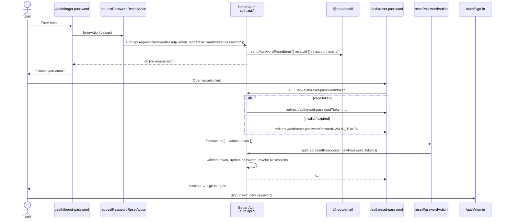

import { Callout } from 'fumadocs-ui/components/callout';

Password reset is a two-page, token-based flow. `/auth/forgot-password` requests a reset email; the emailed link hits `GET /api/auth/reset-password/:token`, which redirects to `/auth/reset-password`. Resetting **revokes every existing session**, so a leaked session can't survive a reset.

## Requesting a reset

`forgot-password/components/forgot-password-form.tsx` dispatches `requestPasswordResetAction`, which calls `auth.api.requestPasswordReset` server-side and points the eventual link at the reset page:

```tsx
// components/forgot-password-form.tsx
const [state, formAction, isPending] = useActionState(
  requestPasswordResetAction,
  initialFormState
);
// success → swap the card for <ForgotPasswordSuccess />

// actions.ts
await auth.api.requestPasswordReset({
  body: { email, redirectTo: PAGE_ROUTES.RESET_PASSWORD }, // "/auth/reset-password"
});
```

On the server, `emailAndPassword.sendResetPassword` hands the generated `url` to `@repo/email`:

```ts
sendResetPassword: async ({ user, url }) => {
  await sendPasswordResetEmail({ email: user.email, resetUrl: url });
},
```

Better Auth builds `url` as `{baseURL}/reset-password/{token}?callbackURL=/auth/reset-password` — i.e. **`GET /api/auth/reset-password/:token`**, served by `apps/web/app/api/auth/[...all]/route.ts`. That hop validates the token and redirects to `/auth/reset-password?token=…` or `?error=INVALID_TOKEN`. The email does not land on the page directly.

<Callout type="info">
`requestPasswordReset` is designed to **not reveal whether an email exists** (anti-enumeration) — it resolves successfully either way, and the UI always shows the same "check your email" confirmation.
</Callout>

## Setting a new password

The reset page is `force-dynamic` and reads the token from the query string:

The **page only checks that a token query param is present**. Garbage, expired, or already-consumed tokens still mount `ResetPasswordForm`; Better Auth validates on the GET callback and again on POST.

```tsx
// reset-password/page.tsx
export const dynamic = "force-dynamic";
const [{ locale }, { token }] = await Promise.all([params, searchParams]);

if (!token) {
  return <ResetPasswordInvalidLink />;   // "Invalid Reset Link" → /auth/forgot-password
}
return <ResetPasswordForm errors={dict.errors.action} token={token} />;
```

`reset-password/components/reset-password-form.tsx` takes the token as a required prop and carries it as a ride-along value on the dispatch:

```tsx
const [state, formAction, isPending] = useActionState(
  resetPasswordAction,
  initialFormState
);

onSubmit={form.handleSubmit((values) =>
  startTransition(() => formAction({ ...values, token }))
)}
// success → swap the card for <ResetPasswordSuccess />
```

<Callout type="warn">
`resetPasswordSchema` validates `password`/`confirmPassword` with the shared `passwordSchema`, and that is the **only** complexity enforcement in the flow — Better Auth's own check is length-only. Don't simplify it out.
</Callout>

### Sessions are revoked on reset

Because `revokeSessionsOnPasswordReset: true` is set on the auth instance, a successful reset invalidates **all** of the user's existing sessions. After resetting, the user must sign in again with the new password — there is no auto-sign-in on this path (unlike email verification).

## End-to-end sequence



Form submits are colocated server actions → `auth.api.*`. HTTP `/api/auth/*` is the surface for email links, OAuth callbacks, and the Stripe webhook — not these forms.

## Related: changing a password while signed in

`changePassword` in the account UI is `changePasswordAction` (`/account/security/actions.ts`) → `auth.api.changePassword` plus `enforceRateLimit("change-password")`. Better Auth's HTTP `/change-password` 3/min rule does **not** cover that path — `auth.api.*` bypasses HTTP rate limits. The control lives on `/account/security`, not the auth pages — a signed-in user changes their password there rather than going through the reset flow.

## Source files

- `apps/web/app/[locale]/auth/forgot-password/page.tsx` — server page
- `apps/web/app/[locale]/auth/forgot-password/components/forgot-password-form.tsx` — dispatches `requestPasswordResetAction`
- `apps/web/app/[locale]/auth/reset-password/page.tsx` — token from `searchParams`, `force-dynamic`
- `apps/web/app/[locale]/auth/reset-password/components/reset-password-form.tsx` — dispatches `resetPasswordAction` with the token ride-along
- `apps/web/app/[locale]/auth/reset-password/components/reset-password-invalid-link.tsx` — the no-token "Invalid Reset Link" screen, rendered by `page.tsx`
- `apps/web/app/[locale]/(app)/account/security/actions.ts` — `changePasswordAction` → `auth.api.changePassword` + `enforceRateLimit("change-password")`
- `packages/auth/server.ts` — `sendResetPassword`, `revokeSessionsOnPasswordReset`
