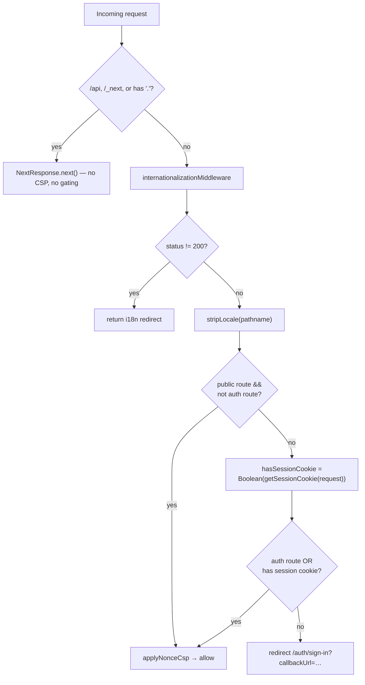

Once a flow mints a session, two layers enforce it: the edge **`middleware.ts`** gate (a cheap, cookie-only check for which page you can even reach) and the cached **server helpers** in `lib/auth/auth.ts` (session-verified, cookie-cache eligible — not a guaranteed DB read). The middleware is a fast, optimistic filter — it never talks to the database — so the authoritative check always happens server-side, not at the edge.

## Session lifetime & the cookie cache

```ts
session: {
  expiresIn: SESSION_EXPIRES_IN_DAYS * SECONDS_PER_DAY,   // 7 days
  updateAge: SESSION_UPDATE_AGE_DAYS * SECONDS_PER_DAY,   // 1 day — sliding refresh
  cookieCache: { enabled: true, maxAge: COOKIE_CACHE_MAX_AGE_MINUTES * SECONDS_PER_MINUTE }, // 5 min
},
```

- A session lives **7 days** and slides forward when used (`updateAge` of 1 day).
- The **cookie cache** stores a short-lived signed copy of the session in the cookie itself. For up to 5 minutes, `getSession` can be answered from the cookie **without a database round-trip**. A passing signature check is **not** a DB read. Call `getServerSession` / `requireAuth` **session-verified (cookie-cache eligible)** and expect up to 5 minutes of staleness. Reserve **fresh DB role** for the admin path, which re-reads `role`/`banned` from the database. The edge middleware never calls `getSession` at all — see below.
- `multiSession()` allows several concurrent device sessions per user. The `Session` row records `ipAddress`, `userAgent`, `activeOrganizationId`, and `activeTeamId`, so the active org/team travels with the session.

## The edge middleware gate

`apps/web/middleware.ts` is the single middleware entry point. It stays `middleware.ts` deliberately rather than adopting Next.js 16's `proxy.ts` convention: `proxy.ts` is Node-runtime-only, which the Cloudflare/OpenNext deploy target can't run, and a DB-backed session check at this layer would also break Vercel's Edge runtime (no TCP). So this file does a fast, **cookie-presence-only** check — no database call, no `auth.api.getSession()` — and runs in a fixed order:

1. **Skip** `/api`, `/_next`, and any path containing a `.` (static files) — these bypass the middleware entirely (no CSP, no gating). Auth endpoints under `/api/auth/*` thus enforce their own auth.
2. **i18n first** — run `internationalizationMiddleware`; if it returns a non-200 (locale redirect), return immediately. Route gating only happens once the locale is settled.
3. **Strip locale** — `stripLocale()` normalizes `/es/org`, `/fr/org`, … to `/org` so the route checks are locale-agnostic. Supported locales are `en`, `es`, `de`, `zh`, `fr`, `pt`.
4. **Gate** — match the normalized path against `AUTH_ROUTE_PREFIXES` (`startsWith`), `PUBLIC_ROUTE_EXACT` (exact `===`), and `PUBLIC_ROUTE_PREFIXES` (`startsWith`).
5. **Check the cookie** — `getSessionCookie(request)` (from `better-auth/cookies`) reads the httpOnly session cookie's presence. It doesn't verify a signature or hit the database, and it doesn't throw — a missing/invalid cookie just reads as falsy.

<Callout type="warn">
This is an **optimistic** check only: spoofing the cookie's presence gets an attacker past this redirect, nothing more. `(app)/layout.tsx` only reads the session for the impersonation banner — it is **not** a gate. Real gates live one level down: `[orgSlug]` and `account` call `requireAuth` / `getActiveOrganization`; `admin` calls `requireAdminArea`; server actions call `verifySession` (`apps/web/lib/auth/action-auth.ts`) or `auth.api.*`.
</Callout>

### Default-deny routing

The allowlists live in `apps/web/lib/routes.ts`:

```ts
export const PUBLIC_ROUTE_EXACT = [PAGE_ROUTES.HOME] as const;              // just "/"
export const PUBLIC_ROUTE_PREFIXES = [PAGE_ROUTES.INVITE] as readonly string[]; // "/invite" — must render for signed-out invitees

export const AUTH_ROUTE_PREFIXES = [
  PAGE_ROUTES.SIGN_IN, PAGE_ROUTES.SIGN_UP, PAGE_ROUTES.FORGOT_PASSWORD,
  PAGE_ROUTES.RESET_PASSWORD, PAGE_ROUTES.MAGIC_LINK, PAGE_ROUTES.VERIFY_EMAIL,
  PAGE_ROUTES.TWO_FACTOR,
] as const;
```

Anything that is **neither public nor an auth route requires a session cookie**. This is a default-deny posture: dynamic routes like `/acme/billing` are protected automatically, without anyone having to enumerate them. The middleware only enforces one redirect direction:

- **No session cookie, not an auth route**: redirect to `/auth/sign-in?callbackUrl=<original path>`.

The reverse case — a signed-in user opening `/auth/sign-in` — is **not** handled here. It's handled server-side in `apps/web/app/[locale]/auth/layout.tsx`, which calls the session-verified (cookie-cache eligible) `getServerSession()` and redirects to `/org` if a session exists. Cookie presence alone is not enough (a missing/invalid session lands on sign-in), but a just-revoked session can remain cookie-cached for up to 5 minutes.

### Decision flow



### CSP nonce

On every gated response the middleware also calls `applyNonceCsp`, which generates a per-request nonce, sets it as the `x-nonce` header (so Server Components can read it via `headers()`), and attaches a `Content-Security-Policy` header. Touch this whenever you add a top-level route group or change the allowlists.

## Cached server helpers

Server Components and server actions should read the session through `apps/web/lib/auth/auth.ts`, not by calling Better Auth directly:

```ts
// Deduplicated across layout + page + helpers within one request
export const getServerSession = cache(async () =>
  auth.api.getSession({ headers: await headers() })
);
```

- **`getServerSession()`** — wrapped in `React.cache`, so the layout, the page, and any helper share a **single** auth round-trip per request.
- **`requireAuth(returnTo?)`** — returns the session or `redirect`s to `/auth/sign-in?callbackUrl=…` (the `returnTo` argument is the value that gets URL-encoded into that param). Use it in protected pages/layouts.
- **`hasOrgPermission(orgId, permissions)`** — calls `auth.api.hasPermission(...)`, which resolves the caller's session from the request headers via the org plugin's session middleware; returns a `boolean`, true when the caller holds the requested capability. A Better Auth `APIError` (`UNAUTHORIZED` when the caller has no member row in that org) is mapped to `false`; failures that are not `APIError` propagate. The org-scoped authorization primitive, backed by the roles in `packages/auth/permissions.ts`.

The edge middleware is a coarse, cookie-only gate (is there *a* session cookie?); these helpers are the real, **session-verified (cookie-cache eligible)** check — up to 5 minutes stale. A protected page relies on the middleware only for the redirect-if-no-cookie shortcut.

- **`[orgSlug]`** — `getActiveOrganization(slug)` (`apps/web/lib/organization/queries.ts`) is the slug guard: `requireAuth` then membership lookup; missing org or non-member → `notFound()`. `validateOrganizationMembership(organizationId, userId)` is the lower-level boolean check, not the page guard.
- **`account`** — `requireAuth`.
- **`/admin`** — `requireAdminArea` (fresh DB `role`/`banned`).
- **Server actions** — `verifySession` (`apps/web/lib/auth/action-auth.ts`) or `auth.api.*` (those calls authenticate from the cookie themselves).

## Notes

- The edge middleware never calls the database — `getSessionCookie()` reads a cookie, nothing more. Session verification (`auth.api.getSession`, via `getServerSession`) only happens server-side, in layouts/pages/actions, and is cookie-cache eligible (5-minute staleness). Admin gates re-read role/ban from the DB.
- There is no fail-closed branch in the middleware, because there is nothing that can throw: a missing or invalid cookie just reads as "no session" and falls into the same redirect as an absent one. If the database itself is unreachable, that surfaces where the real check runs — `getServerSession()` in the server helpers — not in the middleware.

## Source files

- `apps/web/middleware.ts` — edge gate, redirects, CSP nonce
- `apps/web/lib/routes.ts` — `AUTH_ROUTE_PREFIXES`, `PUBLIC_ROUTE_EXACT`, `PUBLIC_ROUTE_PREFIXES`, `PAGE_ROUTES`
- `apps/web/lib/auth/auth.ts` — `getServerSession`, `requireAuth`, `hasOrgPermission`
- `apps/web/lib/auth/action-auth.ts` — `verifySession` (server-action guard)
- `apps/web/lib/auth/admin.ts` — `requireAdminArea` (fresh DB role/ban)
- `apps/web/lib/organization/queries.ts` — `getActiveOrganization`, `validateOrganizationMembership`
- `apps/web/app/[locale]/auth/layout.tsx` — session-verified redirect for signed-in users on auth routes
- `apps/web/app/[locale]/(app)/layout.tsx` — impersonation banner only (not a gate)
- `packages/auth/server.ts` — `session` config, `multiSession()`
- `packages/database/prisma/schema.prisma` — `Session` model
