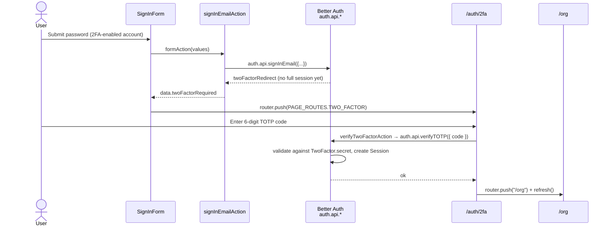

import { Callout } from 'fumadocs-ui/components/callout';

**Password** sign-in is the only first factor that is 2FA-gated. Magic link, email OTP, and OAuth mint a session with no TOTP step.

When 2FA is enabled, a correct password is not enough: `signInEmailAction` maps Better Auth's `twoFactorRedirect` to `data.twoFactorRequired`, the form navigates to `/auth/2fa`, and only TOTP or a backup code completes the sign-in. Handoff is a server action, not a client hook.

## Enabling 2FA

A signed-in user turns this on at **`/account/security`**. UI: `apps/web/app/[locale]/(app)/account/security/components/two-factor-manager.tsx`. Actions: `.../security/actions.ts`.

1. Enter current password.
2. `enable2FAAction` → `auth.api.enableTwoFactor` — returns a QR (`totpURI`) and backup codes.
3. Scan the QR. Backup codes are shown **before** verify — abandoning the dialog is recoverable.
4. `verify2FAAction` → `auth.api.verifyTOTP` — flips the factor verified. Rate limit: `enforceRateLimit("2fa")`.
5. Disable later with `disable2FAAction` (password). Enable/disable also use `enforceRateLimit("change-password")`.

There is no regenerate-backup-codes UI. Codes are issued only at enable/reconfigure and burn once at challenge.

`/admin/users/[userId]` shows Enabled/Disabled only. Staff cannot reset 2FA.

### Reconfigure lockout

"Reconfigure 2FA" reuses enable, which **deletes** the old `twoFactor` row (old TOTP + codes are already gone). Better Auth would carry `verified: true` onto the new row; `packages/auth/two-factor-hooks.ts` forces `verified: false` until in-session `verifyTOTP`. That is why the QR step must be completed.

## Server configuration

The `twoFactor()` plugin (`packages/auth/server.ts`) is configured with both a TOTP authenticator and an email-OTP fallback:

```ts
twoFactor({
  issuer: env.NEXT_PUBLIC_APP_NAME,        // shown in authenticator apps
  otpOptions: {
    async sendOTP({ user, otp }) {
      await sendTwoFactorOTPEmail({ email: user.email, otp, expiresInMinutes: OTP_EXPIRES_IN_MINUTES });
    },
    period: TWO_FACTOR_OTP_PERIOD_MINUTES,  // 5
    digits: TWO_FACTOR_DIGITS,              // 6
  },
}),
```

Per-user 2FA state is the `TwoFactor` model (`secret`, `backupCodes`, `verified`) plus `User.twoFactorEnabled`. Live limiters are `enforceRateLimit` on the **server actions** — Better Auth's HTTP `/two-factor/*` rules do not apply to `auth.api.*`.

## The server-action path

`packages/auth/client.ts` registers a bare `twoFactorClient()` — no `onTwoFactorRedirect`. Password 2FA is handled in the sign-in server action and form:

1. `signInEmailAction` (`sign-in/actions.ts`) calls `auth.api.signInEmail`. When Better Auth withholds the session it returns `twoFactorRedirect`; the action maps that to `data.twoFactorRequired`.
2. `sign-in-form.tsx` reads the flag in `useActionResult` and `router.push(PAGE_ROUTES.TWO_FACTOR)`.

A 2FA-enabled account never gets a full session from **password** sign-in — the form navigates to `/auth/2fa` instead of the post-login destination.

## The /auth/2fa page

`2fa/components/two-factor-form.tsx` dispatches `verifyTwoFactorAction` and, on success, **always** `router.push(PAGE_ROUTES.ORG)` — the original `callbackUrl` from sign-in is dropped:

```tsx
const [state, formAction, isPending] = useActionState(
  verifyTwoFactorAction,
  initialFormState
);

onSubmit={form.handleSubmit((values) =>
  startTransition(() => formAction(values))
)}

useActionResult(state, {
  onSuccess: () => {
    router.push(PAGE_ROUTES.ORG);
    router.refresh();
  },
});

// actions.ts — the verification itself runs server-side
await auth.api.verifyTOTP({ headers: await headers(), body: { code } });
```

<Callout type="warn">
The page wires **TOTP** and a **backup-code** fallback (`verifyBackupCodeAction`, reachable via "Use a backup code instead"). The server *also* configures an email-OTP second factor (`otpOptions.sendOTP`), but there is no UI here to request or verify an emailed 2FA code. Email 2FA is configured-but-unused by the current `/auth/2fa` page; add a `verifyOTP` action and a "send code by email" control if you want it reachable.
</Callout>

<Callout type="info">
`/auth/2fa` (`PAGE_ROUTES.TWO_FACTOR`) is included in `AUTH_ROUTE_PREFIXES` (`apps/web/lib/routes.ts`), so the edge `middleware.ts` gate treats it like the other auth pages: reachable without a session cookie. The redirect for a fully-authenticated user visiting it directly happens separately, in `apps/web/app/[locale]/auth/layout.tsx`, which calls the session-verified (cookie-cache eligible) `getServerSession()` (i.e. `auth.api.getSession()`) and sends them to `/org` — the edge middleware itself never calls `getSession()`, it only checks cookie presence.
</Callout>

## End-to-end sequence



## Source files

- `apps/web/app/[locale]/(app)/account/security/components/two-factor-manager.tsx` — enable / verify / disable UI
- `apps/web/app/[locale]/(app)/account/security/actions.ts` — `enable2FAAction`, `verify2FAAction`, `disable2FAAction`
- `packages/auth/two-factor-hooks.ts` — reconfigure lockout (`verified: false` on enable)
- `apps/web/app/[locale]/auth/2fa/page.tsx` — challenge page
- `apps/web/app/[locale]/auth/2fa/components/two-factor-form.tsx` — dispatches `verifyTwoFactorAction`
- `apps/web/app/[locale]/auth/2fa/actions.ts` — `verifyTwoFactorAction` → `auth.api.verifyTOTP`; `verifyBackupCodeAction` → `auth.api.verifyBackupCode`
- `apps/web/app/[locale]/auth/sign-in/actions.ts` — `signInEmailAction` maps `twoFactorRedirect` → `data.twoFactorRequired`
- `apps/web/app/[locale]/auth/sign-in/components/sign-in-form.tsx` — `router.push(PAGE_ROUTES.TWO_FACTOR)`
- `packages/auth/server.ts` — `twoFactor()` plugin config
- `packages/auth/client.ts` — `twoFactorClient()`
- `apps/web/lib/routes.ts` — `AUTH_ROUTE_PREFIXES` (includes `/auth/2fa`)
- `packages/database/prisma/schema.prisma` — `TwoFactor` model (`verified`), `User.twoFactorEnabled`
