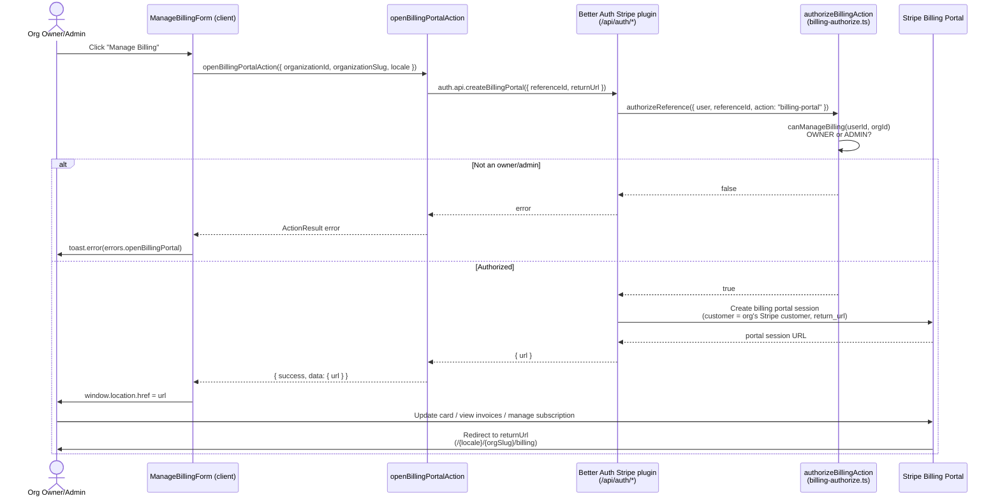

The **Manage Billing** button opens the Stripe customer portal, a Stripe-hosted page where an organization's owners and admins can update payment methods, download invoices, and manage their subscription. This flow uses the `openBillingPortalAction` server action, which wraps `auth.api.createBillingPortal`. There is no hand-rolled API route. The portal session is created by the plugin's endpoint mounted under `/api/auth/*`.

## Entry point

The button lives in `apps/web/app/[locale]/(app)/[orgSlug]/billing/components/manage-billing-form.tsx`, rendered by the `ManageBillingForm` component. It is composed into the billing page through `BillingActions` (`apps/web/app/[locale]/(app)/[orgSlug]/billing/components/billing-actions.tsx`).

The portal flow is **not** client-side `subscription.billingPortal()`. `ManageBillingForm` uses `useTransition` and calls `openBillingPortalAction`:

```ts
const result = await auth.api.createBillingPortal({
  headers: await headers(),
  body: {
    referenceId: validated.organizationId,
    returnUrl: `${orgBase}/billing`,
  },
});

return { success: true, data: { url: result?.url ?? undefined } };
```

On success the client assigns `window.location.href = result.data.url` (full-page redirect to Stripe). On failure it surfaces `errors.openBillingPortal` via a `sonner` toast.

### Parameters

- **`referenceId`** — the `organizationId`. Billing is organization-scoped (`organization: { enabled: true }` in `packages/auth/server.ts`), so the portal session is bound to the org's Stripe customer rather than the individual user.
- **`returnUrl`** — `${NEXT_PUBLIC_APP_URL}/{locale}/{organizationSlug}/billing`, built on the server. After the customer finishes (or clicks "Return to" inside the Stripe portal), Stripe redirects the browser back to this locale-aware org billing page.

## Authorization

`openBillingPortalAction` does **not** call `hasOrgPermission`. The portal request is gated server-side by `authorizeBillingAction` in `packages/auth/billing-authorize.ts`, wired into the Stripe plugin via the `authorizeReference` callback in `packages/auth/server.ts`. The `billing-portal` action falls into the same branch as subscription mutations:

```ts
case "upgrade-subscription":
case "cancel-subscription":
case "restore-subscription":
case "billing-portal":
  return await canManageBilling(userId, referenceId);
```

`canManageBilling` requires a `member` row matching `userId` + `organizationId` whose `role` is `OWNER` or `ADMIN` (`ORG_ROLES`). Plain members can read the subscription (`list-subscription` via `isOrgMember`) but cannot open the portal. The `Member` model has no `suspendedAt` field. If authorization fails, the plugin returns an error and the component shows the `errors.openBillingPortal` toast.

Note that `BillingActions` also hides the entire billing actions card when `planName === PLAN_NAMES.FREE`, so the Manage Billing button is only rendered for orgs on a paid plan.

## Flow



## What the customer can do in the portal

The Stripe customer portal is Stripe-hosted; its exact capabilities depend on the Stripe Dashboard portal configuration, but typically it lets the organization:

- Update or replace the default **payment method** (card).
- View and download past **invoices** and receipts.
- See and manage the current **subscription** — including reactivating a subscription that was set to cancel. The empty-state copy in `BillingActions` points users here: *"You can reactivate it from the billing portal."*

Subscription state changes made inside the portal (cancellations, plan changes) flow back into the app asynchronously via Stripe webhooks. Those webhooks are delivered to `/api/auth/stripe/webhook`; the plugin upserts the `Subscription` row, then dispatches `onSubscriptionUpdate` / `onSubscriptionDeleted` in `packages/auth/stripe-hooks.ts` for notification emails (see [Webhooks](./webhooks) — there is no handler for payment/invoice events). The portal redirect itself only returns the browser to `returnUrl`; it does not directly mutate the local database.

## Source files

- `apps/web/app/[locale]/(app)/[orgSlug]/billing/components/manage-billing-form.tsx` — `ManageBillingForm`, `useTransition` + `openBillingPortalAction`
- `apps/web/app/[locale]/(app)/[orgSlug]/billing/components/billing-actions.tsx` — `BillingActions`, composes the button and hides it on the free plan
- `apps/web/app/[locale]/(app)/[orgSlug]/billing/actions.ts` — `openBillingPortalAction` (and the sibling upgrade/cancel/change-plan actions)
- `packages/auth/server.ts` — Stripe plugin config (`organization.enabled`, `subscription`, `authorizeReference`, webhook hooks)
- `packages/auth/billing-authorize.ts` — `authorizeBillingAction`, `canManageBilling`, `isOrgMember`
