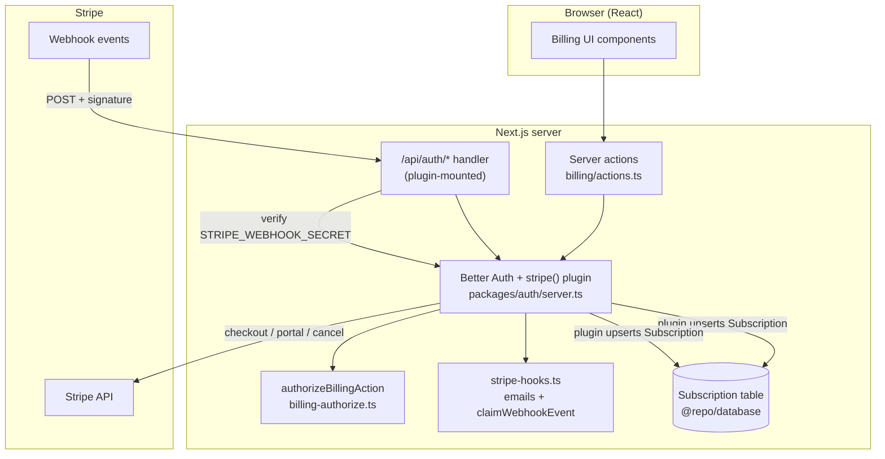

Billing in this monorepo is built on the **`@better-auth/stripe`** plugin rather than hand-rolled API routes. Checkout, the billing portal, and the Stripe webhook receiver are all mounted under `/api/auth/*` by the plugin and configured in `packages/auth/server.ts`. Plan definitions, pricing math, and subscription helpers live alongside that wiring in **`@repo/auth`**, with shared constants in **`@repo/utils/payment`**.

## Ownership: who owns what

Everything billing-related lives in **`@repo/auth`**, which spans two layers: the **plugin layer** (Better Auth + Stripe wiring) and the **data/pure-logic layer** (plan data, types, guards, and helpers). Shared constants (plan names, pricing, limits, statuses, Stripe API version) live one level deeper in **`@repo/utils/payment`** so all billing modules import the same values.

### `@better-auth/stripe` plugin (`packages/auth/server.ts`)

The Stripe plugin is conditionally added to the Better Auth `plugins` array — **only when both `stripeClient` and `STRIPE_WEBHOOK_SECRET` are configured**:

```ts
...(stripeClient && env.STRIPE_WEBHOOK_SECRET
  ? [
      stripe({
        stripeClient,
        stripeWebhookSecret: env.STRIPE_WEBHOOK_SECRET,
        createCustomerOnSignUp: false,
        organization: { enabled: true },
        subscription: {
          enabled: true,
          onSubscriptionComplete: handleSubscriptionComplete,
          onSubscriptionUpdate: handleSubscriptionUpdate,
          onSubscriptionDeleted: handleSubscriptionDeleted,
          plans: buildStripePlans({ ... }),
          authorizeReference: ({ user, referenceId, action }) =>
            authorizeBillingAction({ userId: user.id, referenceId, action }),
        },
      }),
    ]
  : [])
```

The plugin owns:

- **HTTP surface** — checkout, billing-portal, upgrade/cancel, and the webhook endpoint, all under `/api/auth/*`. The webhook lands at `${NEXT_PUBLIC_APP_URL}/api/auth/stripe/webhook`.
- **Signature verification** — incoming webhooks are verified against `STRIPE_WEBHOOK_SECRET` before any handler runs.
- **Subscription persistence** — the plugin reads and **upserts** the `Subscription` table via the Prisma adapter. That write is the local source of truth for status, plan, and Stripe ids.
- **Reference authorization** — `authorizeReference` delegates to `authorizeBillingAction` (`packages/auth/billing-authorize.ts`) so a user can only act on subscriptions for organizations they are allowed to manage.
- **Event dispatch** — after the upsert, lifecycle events are routed to the custom hooks in `packages/auth/stripe-hooks.ts`: `handleSubscriptionComplete`, `handleSubscriptionUpdate`, `handleSubscriptionDeleted`. Those hooks are **email side-effects** plus `claimWebhookEvent` (`packages/auth/webhook-idempotency.ts`); they do **not** reconcile the `Subscription` row.

Note `createCustomerOnSignUp: false` and `organization: { enabled: true }` — subscriptions are **organization-scoped**, keyed by `referenceId` (the organization id), not per-user.

The Stripe SDK instance itself lives in `packages/auth/stripe-client.ts` as `stripeClient` (null when `STRIPE_SECRET_KEY` is unset), pinned to API version `2026-06-24.dahlia` (`STRIPE_API_VERSION` in `packages/utils/payment.ts`). On the browser side, `packages/auth/client.ts` registers the matching `stripeClient()` plugin from `@better-auth/stripe/client`. The org billing page does **not** call `subscription.upgrade()` / `subscription.cancel()` / `subscription.billingPortal()` — checkout, portal, cancel, and plan changes go through the four server actions in `apps/web/app/[locale]/(app)/[orgSlug]/billing/actions.ts`.

### Data & pure-logic layer (`@repo/auth`)

Alongside the plugin wiring, `@repo/auth` exposes the data and pure-logic layer for billing. These modules do **not** talk to Stripe's network API directly — that is the plugin's job. They provide:

- **Plan catalog** — `plans.ts` defines `PLANS` and `PlanConfig` (the single source of truth) plus ordering/comparison helpers: `getPlanLimits`, `getAllPlans`, `isPlanHigherTier`, `getMonthlyFromAnnual`, `getAnnualSavingsPercent`, and `comparePlans` (returns `"upgrade" | "downgrade" | "same"`), and the Stripe plumbing `buildStripePlans` / `getPlanNameFromPriceId`.
- **Subscription helpers** — `helpers.ts` provides `isSubscriptionActive`, `isSubscriptionPendingCancel`, `isAlreadyCancelingError`, `getCurrentPlan`, `calculateUsageStats`, `formatStorage`, `getStatusDisplayText`, and `getStatusColor`, plus the `UsageStats` type. The subscription **row** shape is Prisma's: import `Subscription` from `@repo/database`. There is no hand-maintained `Subscription` interface or Zod `SubscriptionSchema` anywhere in `@repo/auth`.
- **Guards** — `guards.ts` provides `guardDowngrade` (and `GuardResult`).

## Plan tiers

Three tiers are defined in `PLANS` (`packages/auth/plans.ts`), with pricing and limits sourced from `PRICING` and `LIMITS` in `packages/utils/payment.ts`. `free` is the implicit default — `getCurrentPlan` returns `"free"` whenever there is no active subscription, and only the paid tiers are passed to Stripe via `buildStripePlans` (free has no price id).

| Plan | `name` | Monthly | Yearly | Max members | Storage | Stripe price-id env vars |
| --- | --- | --- | --- | --- | --- | --- |
| Free | `free` | $0 | $0 | 1 | 100 MB | — (no Stripe price) |
| Pro | `pro` | $19 | $190 | 10 | 5 GB (5000 MB) | `STRIPE_PRO_PRICE_ID_MONTHLY`, `STRIPE_PRO_PRICE_ID_ANNUAL` |
| Enterprise | `enterprise` | $49 | $490 | 50 | 50 GB (50000 MB) | `STRIPE_ENTERPRISE_PRICE_ID_MONTHLY`, `STRIPE_ENTERPRISE_PRICE_ID_ANNUAL` |

Pricing values are in whole dollars in `PRICING`; Stripe returns monetary amounts in the smallest currency unit (cents for USD), so use `CENTS_PER_DOLLAR` when rendering raw Stripe amounts. `pro` is flagged `highlighted: true` with a `"Most Popular"` badge. The `buildStripePlans` helper attaches each plan's monthly `priceId` and annual `annualDiscountPriceId` from the env-derived `StripePriceIds`; `getPlanNameFromPriceId` performs the reverse lookup.

### Subscription statuses

`SUBSCRIPTION_STATUS` mirrors `Stripe.Subscription.Status`: `incomplete`, `incomplete_expired`, `trialing`, `active`, `past_due`, `canceled`, `unpaid`, `paused`. Entitlement-granting statuses are:

```ts
export const ACTIVE_STATUSES = [
  SUBSCRIPTION_STATUS.ACTIVE,
  SUBSCRIPTION_STATUS.TRIALING,
  SUBSCRIPTION_STATUS.PAST_DUE,
] as const;
```

`isSubscriptionActive` treats `active`, `trialing`, and `past_due` as granting the paid plan. `unpaid`, `paused`, `incomplete`, and the terminal states do not. `paused` is a Stripe status string only — it is not entitlement-granting, and the app has no pause/resume UI. Trial support is **partial**: the Prisma `Subscription` row has `trialStart`/`trialEnd` and `ACTIVE_STATUSES` includes `trialing`, but checkout and `buildStripePlans` do not configure trials. Pending cancellation is detected by `isSubscriptionPendingCancel`, which checks **both** the legacy `cancelAtPeriodEnd` boolean and the newer `cancelAt` timestamp.

## Architecture



Outbound: the billing UI calls four server actions (`upgradeSubscriptionAction`, `openBillingPortalAction`, `cancelSubscriptionAction`, `changePlanAction`), which wrap `auth.api.*` (except `changePlanAction`, which may return early). The plugin runs `authorizeReference`, then talks to Stripe. Inbound: Stripe posts webhook events to `/api/auth/stripe/webhook`; the plugin verifies the signature, **upserts the local `Subscription` row**, then dispatches to `stripe-hooks.ts` for notification emails (gated by `claimWebhookEvent`). See [Webhooks](./webhooks).

## Doc pages in this section

| Page | What it covers |
| --- | --- |
| [Subscribe & Checkout](./subscribe-and-checkout) | Starting a paid subscription: `upgradeSubscriptionAction`, success/cancel URLs, and independent session verification. |
| [Subscription Lifecycle](./subscription-lifecycle) | The Prisma `Subscription` model, statuses, active/pending-cancel detection, and entitlement resolution. |
| [Plan Changes & Cancellation](./plan-changes-and-cancellation) | Upgrades/downgrades via `comparePlans`, the four billing actions, and scheduled cancellation (`cancelAtPeriodEnd` / `cancelAt`). |
| [Billing Portal](./billing-portal) | `openBillingPortalAction` and the Stripe-hosted customer portal. |
| [Webhooks](./webhooks) | The `/api/auth/stripe/webhook` endpoint, signature verification, plugin upsert, and `stripe-hooks.ts` email handlers. |
| [Billing Authorization](./billing-authorization) | How `authorizeReference` / `authorizeBillingAction` gates org-scoped subscription actions. |

## Source files

- `packages/auth/server.ts` — Better Auth config, `stripe()` plugin block, subscription config
- `packages/auth/plans.ts` — `PLANS`, `PlanConfig`, `buildStripePlans`, `getPlanNameFromPriceId`, plus tier math (`getPlanLimits`, `getAllPlans`, `isPlanHigherTier`, `comparePlans`, …)
- `packages/auth/stripe-client.ts` — `stripeClient` / `requireStripeClient`
- `packages/auth/client.ts` — browser `stripeClient()` plugin registration
- `packages/auth/stripe-hooks.ts` — `handleSubscriptionComplete` / `Update` / `Deleted` (emails + `claimWebhookEvent`)
- `packages/auth/webhook-idempotency.ts` — `claimWebhookEvent`, backed by the `WebhookEvent` model's `(provider, eventId)` unique constraint
- `packages/auth/keys.ts` — Stripe env var schema (`STRIPE_SECRET_KEY`, `STRIPE_WEBHOOK_SECRET`, price-id vars)
- `packages/auth/helpers.ts` — subscription state + display helpers, `UsageStats`
- `packages/auth/guards.ts` — `guardDowngrade`, `GuardResult`
- `packages/utils/payment.ts` — `PLAN_NAMES`, `PRICING`, `LIMITS`, `SUBSCRIPTION_STATUS`, `ACTIVE_STATUSES`, `STRIPE_API_VERSION`
- `apps/web/app/[locale]/(app)/[orgSlug]/billing/actions.ts` — `upgradeSubscriptionAction`, `openBillingPortalAction`, `cancelSubscriptionAction`, `changePlanAction`
- `apps/web/lib/billing/subscription-queries.ts` — `getActiveSubscription`, `getCurrentPlanForOrg`, `getOrgUsageStats`
- `apps/web/lib/billing/checkout-queries.ts` — `verifyCheckoutSession`
