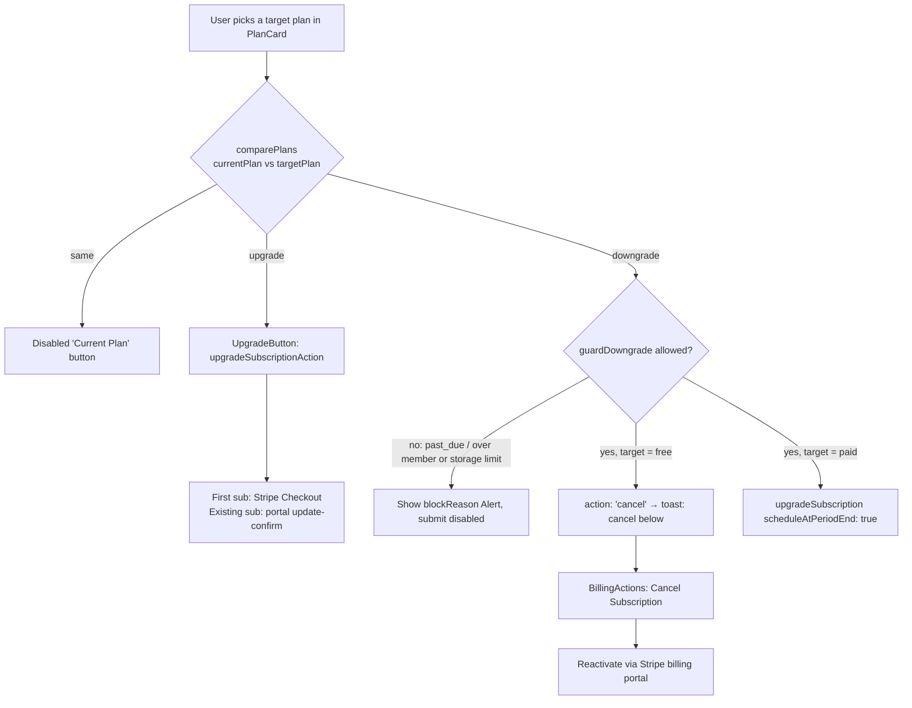
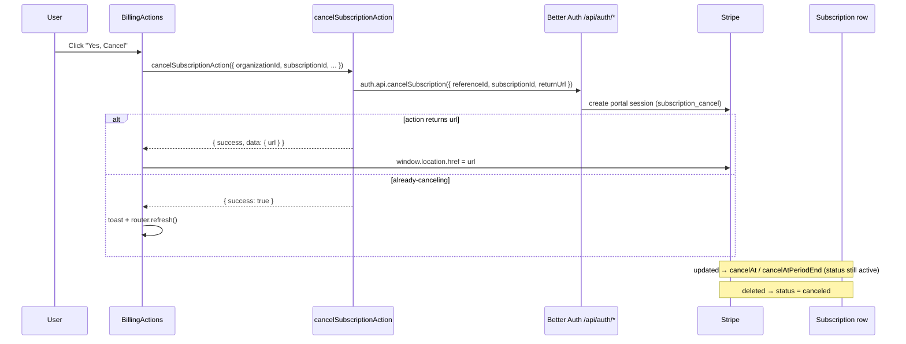
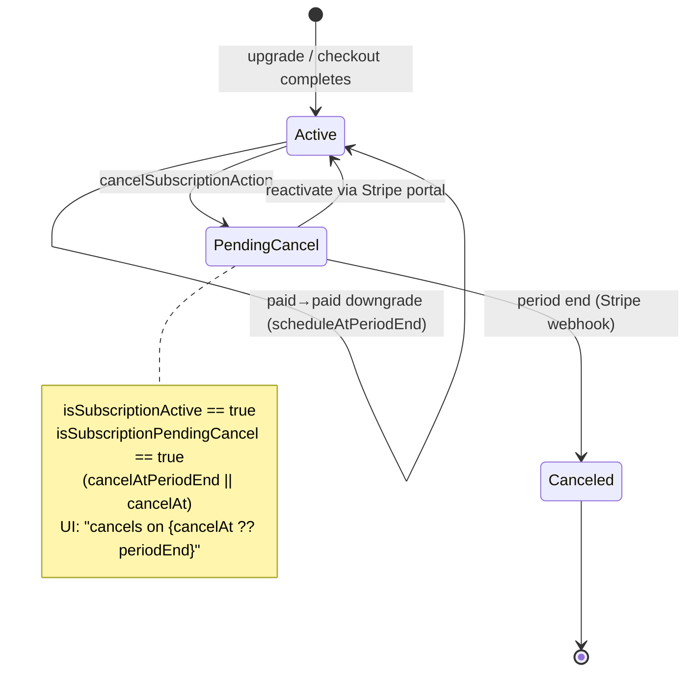

This page documents how an organization changes its subscription tier and how cancellation is modeled, surfaced, and reconciled with Stripe. All billing operations go through the `@better-auth/stripe` plugin — there are no hand-rolled `/api/organizations/*` billing routes. The org billing UI uses four **server actions** in `apps/web/app/[locale]/(app)/[orgSlug]/billing/actions.ts`. There is no `upgrade-form.tsx`, no `packages/auth/use-subscription.ts`, and no client `subscription.upgrade()` / `subscription.cancel()` in this UI.

## The four decisions

The billing UI reduces every tier transition to one of four outcomes, decided by comparing the current plan against the target plan with `comparePlans(currentPlan, targetPlan)` in `packages/auth/plans.ts` (which returns `"upgrade" | "downgrade" | "same"` based on `PLAN_ORDER` index):

| Decision | Trigger | Mechanism |
| --- | --- | --- |
| **Upgrade** | target is a higher tier | `upgradeSubscriptionAction` → `auth.api.upgradeSubscription` → Stripe Checkout (first subscription) or portal `subscription_update_confirm` (existing subscription) |
| **Downgrade** (to paid) | target is lower but not `free` | `changePlanAction` → `auth.api.upgradeSubscription({ scheduleAtPeriodEnd: true })` |
| **Downgrade to free** | target is `free` | `changePlanAction` returns `{ action: "cancel" }`; client routes the user to the Cancel flow |
| **Cancel** | user clicks "Cancel Subscription" | `cancelSubscriptionAction` → `auth.api.cancelSubscription` → Stripe Billing Portal `flow_data.type: "subscription_cancel"`. Period-end vs immediate is **portal config**, not this call. There is no immediate-cancel API in the app. |

`changePlanAction` drives cancel-vs-change **UI** (`{ action: "cancel" | "changed"; blockReason? }`). It does not redirect.

## Upgrades

`UpgradeButton` (`upgrade-button.tsx`) calls the `upgradeSubscriptionAction` server action with the target `plan`, `annual` derived from the billing-interval toggle, and the org `referenceId`. The action wraps `auth.api.upgradeSubscription` and returns a redirect URL; only `errors.startCheckout` is surfaced on failure. Which URL comes back depends on the org's subscription state:

- **No active subscription** — the plugin creates a Stripe Checkout session; `successUrl` / `cancelUrl` point at `/{locale}/{orgSlug}/checkout/...`.
- **Active subscription** (e.g. Pro → Enterprise) — the plugin skips Checkout and redirects to the Stripe customer portal's `subscription_update_confirm` flow. The `successUrl` / `cancelUrl` are ignored; the user returns via `returnUrl` (the billing page). Stripe swaps the price immediately with proration, and the local `plan` only updates when the `customer.subscription.updated` webhook lands.

Whether the prorated true-up is **charged at confirm time** is governed by the Stripe **portal configuration**, not repo code: `features.subscription_update.proration_behavior` must be `always_invoice`. With Stripe's default (`create_prorations`) the upgrade collects nothing and the proration is rolled into the next cycle's invoice. This is per-Stripe-account, API-only configuration — apply it to the default portal configuration (`POST /v1/billing_portal/configurations/:id`) on every new or live-mode account.

`PlanCard` only renders `UpgradeButton` when `comparePlans` returns `"upgrade"` and the plan is `pro` or `enterprise`.

## Downgrades

Downgrades are a **server action**, not a client plugin call, because they must be guarded against resource over-use. `DowngradeButton` calls `changePlanAction` (in `actions.ts`) via `useTransition` — not `useActionState`. The action:

1. Validates input with `changePlanRequestSchema` (`schemas.ts`) — `organizationId`, `targetPlan` enum, optional `billingInterval` defaulting to monthly.
2. Authorizes with `hasOrgPermission(organizationId, { organization: ["update"] })`. This is the only billing action that also calls `hasOrgPermission` (it does authorization-sensitive pre-work and can return early without reaching `auth.api.*`).
3. Loads the active subscription via `getActiveSubscription` and re-runs `comparePlans`; if the direction is **not** `"downgrade"` it rejects with `actionError("changePlan")` (defense in depth — the UI already filtered).
4. Runs `guardDowngrade(subscription, targetPlan, memberCount, storageMB)` from `packages/auth/guards.ts` with **real** member and storage counts.
5. If `targetPlan === free`, returns `{ action: "cancel" }` — downgrade to free is expressed as a **cancellation**, not a plan swap.
6. Otherwise calls `auth.api.upgradeSubscription({ plan, annual, referenceId, scheduleAtPeriodEnd: true })`. The `scheduleAtPeriodEnd: true` flag is what makes a paid→paid downgrade take effect at the end of the current period rather than immediately.

### Downgrade guard rules

`guardDowngrade` returns `{ allowed, reason, requiredPlan }`. See [Subscription Lifecycle § Downgrade guard](./subscription-lifecycle#downgrade-guard) for the three rules it enforces (must actually be a downgrade, billing-health gate, resource fit).

When blocked, the action returns `{ success: true, data: { action: "changed", blockReason } }`. `DowngradeButton` keeps the dialog open, renders the reason in a destructive `Alert`, and disables the submit button (`disabled={isPending || !!serverBlockReason}`).

`PlanCard` also pre-computes `downgradeBlockReason` via `guardDowngrade(subscription, plan.name, 0, 0)`. Those zeros mean **resource over-use is not previewed** on the card — only the billing-health / not-a-downgrade rules can fire before submit. Member and storage limits are enforced when `changePlanAction` runs with real counts.

On a successful downgrade, `ChangePlanView.handleDowngradeSuccess` shows `"Plan changed successfully"`. When `action === "cancel"` it instead shows `"To downgrade to Free, cancel your subscription below."` and steers the user to `BillingActions`.

## Cancellation

Cancellation lives in `BillingActions` (`billing-actions.tsx`). There is no `current-plan.tsx`. The Cancel button renders when `isPaid && !isCanceled`. Clicking it opens an `AlertDialog`; confirming calls `cancelSubscriptionAction` with the org `referenceId`, optional `stripeSubscriptionId`, locale, and slug.

The happy path returns a **portal URL**; `BillingActions` redirects there. `{ success: true }` with no URL is only `isAlreadyCancelingError`. Period-end vs immediate cancel is decided in the Stripe portal, not by `subscriptions.update` in this app.

`customer.subscription.updated` writes `cancelAt` / `cancelAtPeriodEnd` while status stays `active`. `customer.subscription.deleted` sets `status: "canceled"`.

### How cancellation is surfaced in the UI

State is derived in `BillingActions` from the Prisma `Subscription` passed in as a prop:

- pending-cancel — `isSubscriptionActive(subscription) && isSubscriptionPendingCancel(subscription)`. A canceled-but-still-active subscription is one that is scheduled to end but has not yet lapsed.
- access cutoff — `subscription.cancelAt ?? subscription.periodEnd` (Stripe may end a pending-cancel sub at `cancelAt` rather than `periodEnd`).

When pending-cancel, `BillingActions` hides the Cancel button and the "Next billing date" row, and shows: "Your subscription has been canceled and will end on `{formatDate(endsAt)}`. You can reactivate it from the billing portal."

### Reactivation

There is no dedicated "restore" action in the app. Reactivation is delegated to the Stripe customer portal, reached through `ManageBillingForm` (`openBillingPortalAction`). The cancel-state copy explicitly points users there ("reactivate it from the billing portal").

## Source files

- `apps/web/app/[locale]/(app)/[orgSlug]/billing/actions.ts` — `upgradeSubscriptionAction`, `openBillingPortalAction`, `cancelSubscriptionAction`, `changePlanAction`
- `apps/web/app/[locale]/(app)/[orgSlug]/billing/schemas.ts` — `changePlanRequestSchema`
- `apps/web/app/[locale]/(app)/[orgSlug]/billing/components/change-plan.tsx` — server wrapper; loads subscription + plans
- `apps/web/app/[locale]/(app)/[orgSlug]/billing/components/change-plan-view.tsx` — billing-interval toggle, plan grid, downgrade success toasts
- `apps/web/app/[locale]/(app)/[orgSlug]/billing/components/plan-card.tsx` — per-plan `comparePlans` direction + `guardDowngrade(..., 0, 0)` preview
- `apps/web/app/[locale]/(app)/[orgSlug]/billing/components/upgrade-button.tsx` — `useTransition` + `upgradeSubscriptionAction`
- `apps/web/app/[locale]/(app)/[orgSlug]/billing/components/downgrade-button.tsx` — `useTransition` + `changePlanAction`, blockReason handling
- `apps/web/app/[locale]/(app)/[orgSlug]/billing/components/billing-actions.tsx` — Cancel dialog, pending-cancel copy, `cancelSubscriptionAction`
- `apps/web/lib/billing/subscription-queries.ts` — `getActiveSubscription`, `getOrgMemberCount`, `getOrgStorageUsage`
- `packages/auth/helpers.ts` — `isSubscriptionPendingCancel`, `isAlreadyCancelingError`, `getStatusColor`
- `packages/auth/guards.ts` — `guardDowngrade`
- `packages/auth/plans.ts` — `comparePlans`, `isPlanHigherTier`
- `packages/database/prisma/schema.prisma` — `Subscription` (`cancelAt`, `cancelAtPeriodEnd`)
