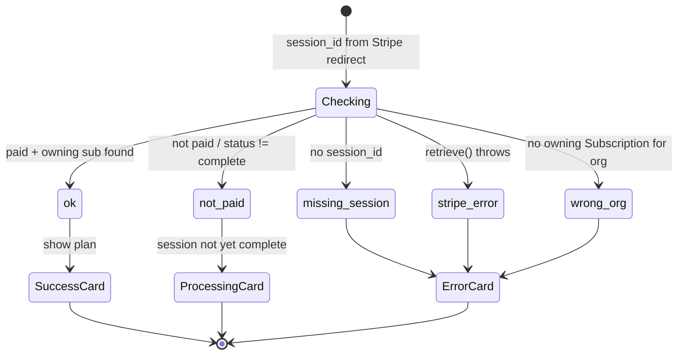
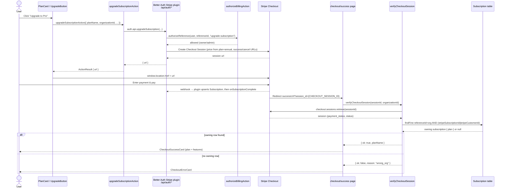

The upgrade flow takes an organization from the `free` plan to a paid plan (`pro` or `enterprise`) using Stripe Checkout. There are **no hand-rolled checkout API routes**. `UpgradeButton` calls the `upgradeSubscriptionAction` server action, which wraps `auth.api.upgradeSubscription`. The plugin creates a Stripe Checkout Session (or, for an already-subscribed org, a portal update-confirm session) and returns a redirect URL. After payment, Stripe sends the user back to a success page that independently verifies the session before showing confirmation.

## Where the upgrade starts

The billing page at `apps/web/app/[locale]/(app)/[orgSlug]/billing/page.tsx` loads org context with `getActiveOrganization(orgSlug)` and wraps the page in `OrgPermissionGate` requiring `organization: ["update"]`, so only org owners/admins reach the upgrade UI. It renders `ChangePlan`, which renders one `PlanCard` per plan.

In `apps/web/app/[locale]/(app)/[orgSlug]/billing/components/plan-card.tsx`, `comparePlans(currentPlan, plan.name)` classifies each card as `same`, `upgrade`, or `downgrade`. Only `upgrade` cards for `pro` or `enterprise` render `UpgradeButton`:

```tsx
{isUpgrade && (plan.name === "pro" || plan.name === "enterprise") && (
  <UpgradeButton ... />
)}
```

Downgrades use a different control (`DowngradeButton`) and a different code path (the `changePlanAction` server action / cancel flow) — they do **not** go through Stripe Checkout.

## The server action: `upgradeSubscriptionAction`

Checkout is kicked off from `UpgradeButton` (`upgrade-button.tsx`) with `useTransition`. There is no `upgrade-form.tsx` and no client `subscription.upgrade()` call in this UI. The button calls `upgradeSubscriptionAction` in `billing/actions.ts`:

```ts
const result = await auth.api.upgradeSubscription({
  headers: await headers(),
  body: {
    plan: validated.planName,       // "pro" | "enterprise"
    annual: validated.billingInterval === BILLING_INTERVALS.YEARLY,
    referenceId: validated.organizationId,
    successUrl: `${orgBase}/checkout/success?session_id={CHECKOUT_SESSION_ID}`,
    cancelUrl: `${orgBase}/checkout/canceled`,
    returnUrl: `${orgBase}/billing`,
  },
});

return { success: true, data: { url: result?.url ?? undefined } };
```

On success the client assigns `window.location.href = result.data.url`. Only the error branch runs in-page, surfacing a toast (`errors.startCheckout`).

Key parameters (built on the server from the action input):

- **`plan`** — the plan *name* (`pro` / `enterprise`), not a Stripe price ID. The plugin maps the name to a Stripe price using the plan catalog (see below).
- **`annual`** — boolean derived from the selected `billingInterval`. When true, the plugin uses the plan's `annualDiscountPriceId`; otherwise its `priceId`.
- **`referenceId`** — the `organizationId`. This is what makes billing **organization-scoped** rather than per-user; the resulting `Subscription` row stores this in its `referenceId` column.
- **`successUrl`** — points at `/[locale]/[orgSlug]/checkout/success` and carries the literal `{CHECKOUT_SESSION_ID}` placeholder, which Stripe substitutes with the real session id on redirect.
- **`cancelUrl`** — points at `/[locale]/[orgSlug]/checkout/canceled`.
- **`returnUrl`** — the org billing page; used when the plugin skips Checkout and sends the user through the customer portal instead (existing paid subscription).

Which URL comes back depends on the org's subscription state:

- **No active subscription** — the plugin creates a Stripe Checkout session; `successUrl` / `cancelUrl` apply.
- **Active subscription** (e.g. Pro → Enterprise) — the plugin skips Checkout and redirects to the Stripe customer portal's `subscription_update_confirm` flow. The `successUrl` / `cancelUrl` are ignored; the user returns via `returnUrl`. See [Plan Changes & Cancellation](./plan-changes-and-cancellation).

## Server configuration: the Stripe plugin

The `@better-auth/stripe` plugin is wired up in `packages/auth/server.ts` (full config in [Payment Overview](/docs/payment)); for checkout specifically, the relevant pieces are `subscription.plans` and `subscription.authorizeReference`:

- **Plan catalog** — `buildStripePlans(...)` in `packages/auth/plans.ts` builds the `StripePlan[]` array, attaching `priceId` (monthly) and `annualDiscountPriceId` (annual) to the `pro` and `enterprise` plan configs from the `STRIPE_*_PRICE_ID_*` env vars. The plugin uses `plan` + `annual` from the action to pick the right price.
- **Authorization** — `upgradeSubscriptionAction` does **not** call `hasOrgPermission`. The plugin's `authorizeReference` delegates to `authorizeBillingAction` in `packages/auth/billing-authorize.ts`. For `upgrade-subscription` this calls `canManageBilling(userId, referenceId)`, allowing only org `owner`/`admin` members (filtered by `userId` + `organizationId` + role). This server-side check is the real security boundary — the page-level `OrgPermissionGate` is only UX.
- The plugin mounts the checkout/portal/webhook handlers under `/api/auth/*`; the success/cancel URLs sent from the action are passed through to the Stripe Checkout Session.

## Returning on success: independent verification

When Stripe redirects back, the success page at `apps/web/app/[locale]/(app)/[orgSlug]/checkout/success/page.tsx` reads `session_id` from `searchParams`, loads org context via `getActiveOrganization`, and calls `verifyCheckoutSession(sessionId, orgContext.organizationId)`.

`verifyCheckoutSession` in `apps/web/lib/billing/checkout-queries.ts` does **not** trust the redirect. It:

1. Returns `missing_session` if `session_id` is absent.
2. Retrieves the session via `stripe.checkout.sessions.retrieve(sessionId)` (returns `stripe_error` on failure).
3. Confirms payment: `payment_status` is `paid` or `no_payment_required` **and** `status === "complete"`, otherwise `not_paid`.
4. Calls `findOwningSubscription`, which queries the Better Auth `Subscription` table for a row whose `referenceId` matches this org **and** whose `stripeSubscriptionId` or `stripeCustomerId` matches the session. If none is found it returns `wrong_org`.

The page does **not** call `revalidateOrgPage`. On `ok` it renders `CheckoutSuccessCard` (`.../checkout/success/components/checkout-success-card.tsx`), which looks up `PLANS[planName]` and displays the plan's display name and feature list. The `not_paid` reason renders `CheckoutProcessingCard` (session not yet paid/complete). `wrong_org`, `missing_session`, and `stripe_error` render `CheckoutErrorCard`.

A missing owning `Subscription` row is **`wrong_org` → `CheckoutErrorCard`**, not `not_paid` / processing. That covers both a bookmarked success URL from a different organization and a redirect that lands before the plugin has upserted the row.

### Verification result states



## End-to-end sequence



## Notes

- The webhook (plugin upsert, then `onSubscriptionComplete` email) and the success-page redirect are **independent**. The success page does not depend on the webhook having fired to read the Stripe session, but the `Subscription` row it joins against is written by the **plugin**, not by `stripe-hooks.ts`. If the redirect lands before the row exists, `findOwningSubscription` returns null and the page shows `CheckoutErrorCard` (`wrong_org`).
- Free is never a Checkout target. `buildStripePlans` only emits `pro` and `enterprise`; downgrades to `free` are routed to the cancel flow by `changePlanAction` in `billing/actions.ts`.

## Source files

- `apps/web/app/[locale]/(app)/[orgSlug]/billing/page.tsx` — billing page, `getActiveOrganization`, `OrgPermissionGate`
- `apps/web/app/[locale]/(app)/[orgSlug]/billing/components/plan-card.tsx` — upgrade/downgrade classification
- `apps/web/app/[locale]/(app)/[orgSlug]/billing/components/upgrade-button.tsx` — `useTransition` + `upgradeSubscriptionAction`
- `apps/web/app/[locale]/(app)/[orgSlug]/billing/actions.ts` — `upgradeSubscriptionAction`, `changePlanAction`
- `apps/web/lib/billing/checkout-queries.ts` — `verifyCheckoutSession`
- `apps/web/lib/billing/subscription-queries.ts` — `getActiveSubscription`, `getCurrentPlanForOrg`, `getOrgUsageStats`
- `apps/web/app/[locale]/(app)/[orgSlug]/checkout/success/page.tsx` — success page + result rendering
- `apps/web/app/[locale]/(app)/[orgSlug]/checkout/success/components/checkout-success-card.tsx` — confirmation card
- `apps/web/app/[locale]/(app)/[orgSlug]/checkout/success/components/checkout-error-card.tsx` — `wrong_org` / `missing_session` / `stripe_error`
- `packages/auth/server.ts` — `@better-auth/stripe` plugin config, `authorizeReference`
- `packages/auth/plans.ts` — `PLANS`, `buildStripePlans`, price-id mapping
- `packages/auth/billing-authorize.ts` — `authorizeBillingAction` / `canManageBilling`
