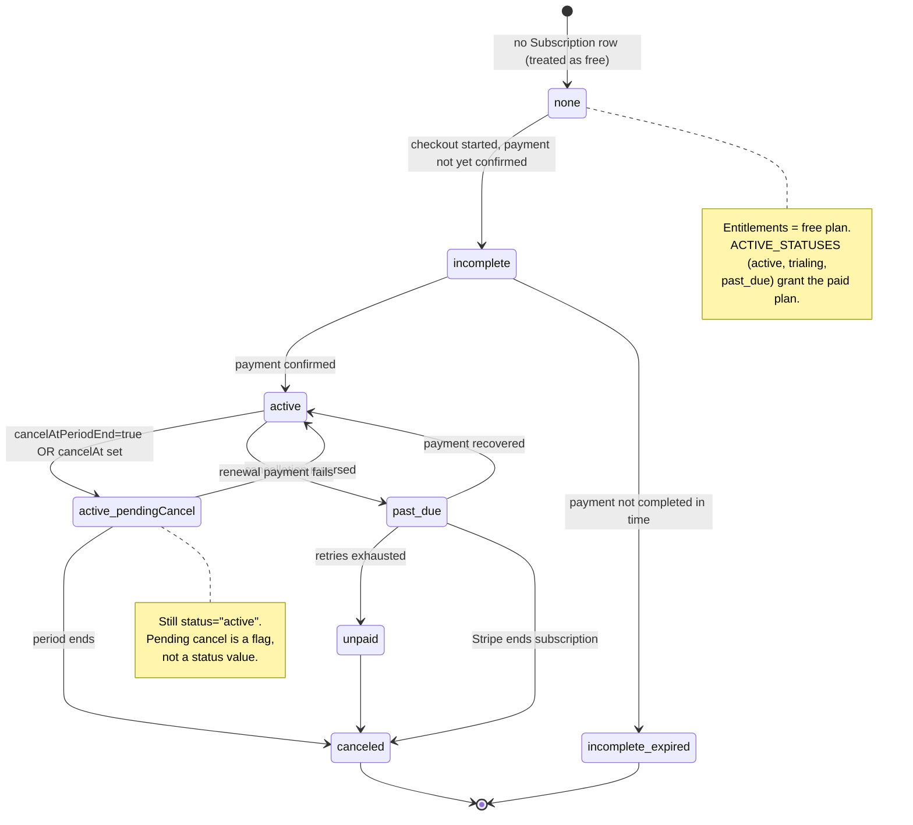

Subscriptions are managed by the `@better-auth/stripe` plugin, which mirrors Stripe's
subscription object into the local `Subscription` table. This document describes the
state model: the exact status strings the code recognizes, how an "active" subscription
is resolved, how pending cancellation is interpreted, and the helper/guard functions
that gate features by plan.

## The Subscription record

The row shape is Prisma's `Subscription` model — import it from `@repo/database`.
`packages/auth/helpers.ts` holds the one related app type, `UsageStats`; there is no
hand-maintained `Subscription` interface or Zod `SubscriptionSchema`. The fields that
drive the state model are:

- `plan` — one of `free`, `pro`, `enterprise`.
- `status` — a nullable `SubscriptionStatus` string (see below).
- `cancelAtPeriodEnd` — nullable boolean; legacy Stripe cancellation flag.
- `cancelAt` — nullable `Date`; newer Stripe cancellation timestamp.
- `periodStart` / `periodEnd` — the current billing period.
- `trialStart` / `trialEnd` — present on the schema; see [Trials](#trials).
- `referenceId` — the owning entity; in this app it is the organization ID (billing is org-scoped).
- `stripeCustomerId` / `stripeSubscriptionId` — Stripe linkage used for cancel/portal calls.

## Status values

The canonical status strings live in `packages/utils/payment.ts` as `SUBSCRIPTION_STATUS`,
which the comment notes "Mirrors `Stripe.Subscription.Status` from the Stripe SDK":

- `incomplete`
- `incomplete_expired`
- `trialing`
- `active`
- `past_due`
- `canceled`
- `unpaid`
- `paused`

The set of statuses the app treats as entitlement-granting is:

```ts
export const ACTIVE_STATUSES = [
  SUBSCRIPTION_STATUS.ACTIVE,
  SUBSCRIPTION_STATUS.TRIALING,
  SUBSCRIPTION_STATUS.PAST_DUE,
] as const;
```

`active`, `trialing`, and `past_due` grant the paid plan. `unpaid`, `paused`,
`incomplete`, `incomplete_expired`, and `canceled` do **not**. `paused` is a Stripe
status string only — it is not entitlement-granting, and the app has no pause/resume UI.

## Lifecycle diagram

The diagram below uses the exact `status` strings from `SUBSCRIPTION_STATUS`. A
scheduled cancellation is **not** a separate status — a subscription remains `active`
while `cancelAtPeriodEnd`/`cancelAt` is set, and only transitions to `canceled` when the
period actually ends (this is what `isSubscriptionPendingCancel` detects). `paused` is
omitted as a product flow (Stripe may set it; this app never starts or resumes a pause).



## Resolving the active subscription

`getActiveSubscription(referenceId)` in `apps/web/lib/billing/subscription-queries.ts`
is the server-side source of truth. It queries the most recent row whose status is in
`ACTIVE_STATUSES`:

```ts
const subscription = await database.subscription.findFirst({
  where: {
    referenceId,
    status: { in: ACTIVE_STATUSES as unknown as string[] },
  },
  orderBy: { id: "desc" },
});
```

Because `ACTIVE_STATUSES` includes `active`, `trialing`, and `past_due`, a Pro org in
`past_due` is still visible to this query and keeps Pro entitlements (Stripe's dunning
grace window). A subscription in `unpaid`, `paused`, `incomplete`,
`incomplete_expired`, or `canceled` is invisible and yields `null`.

### Plan resolution

`getCurrentPlanForOrg(organizationId)` builds on `getActiveSubscription`: if there is
no active subscription it returns `PLAN_NAMES.FREE`; otherwise it returns the
subscription's `plan` (falling back to `free` if `plan` is falsy). So a `past_due` Pro
org stays on **pro** for entitlement purposes; an `unpaid` Pro org resolves to **free**.

The pure-helper equivalent is `getCurrentPlan(subscription)` in
`packages/auth/helpers.ts`, which gates on `isSubscriptionActive(subscription)`
before reading `plan`. `isSubscriptionActive` returns `true` when
`subscription.status` is in `ACTIVE_STATUSES`.

There is no `getOrgSubscription` helper. Usage stats go through `getOrgUsageStats`
in the same `subscription-queries.ts` file (which also uses `getActiveSubscription`).

### Trials

Trial support is **partial**: the Prisma row has `trialStart`/`trialEnd`, and
`ACTIVE_STATUSES` includes `trialing`, but checkout and `buildStripePlans` do not
configure trials, so this app never starts one.

## Pending cancellation (`cancelAt` / `cancelAtPeriodEnd`)

A subscription scheduled to cancel at period end is still `active`. The detection lives
in `isSubscriptionPendingCancel(subscription)` in `packages/auth/helpers.ts`:

```ts
return (
  subscription?.cancelAtPeriodEnd === true || subscription?.cancelAt != null
);
```

Either signal counts. As the source comment explains, Stripe expresses a scheduled
cancellation via the legacy `cancelAtPeriodEnd` boolean **or** the newer `cancelAt`
timestamp; checking only the boolean would miss subscriptions canceled via `cancelAt`.
This matches Better Auth's own `isPendingCancel`.

The billing UI derives the same flags in `BillingActions` (`billing-actions.tsx`):

- pending-cancel — `isSubscriptionActive(subscription) && isSubscriptionPendingCancel(subscription)`
- paid — `getCurrentPlan(subscription) !== free`

The Cancel button only renders when the plan is paid and not already pending-cancel.
Cancellation itself is the `cancelSubscriptionAction` server action (see
[Plan Changes & Cancellation](./plan-changes-and-cancellation)).

### The "already set to cancel" no-op

`isAlreadyCancelingError(message)` (in `helpers.ts`) detects Better Auth's benign error
containing `"already set to be canceled"`. `cancelSubscriptionAction` catches that case
and returns `{ success: true }` so the UI can settle instead of toasting an error. This
handles drift where local state lags Stripe.

## Feature gating by plan

Plan entitlements are defined in `PLANS` (`packages/auth/plans.ts`). Limits per plan
come from `getPlanLimits(planName)`, backed by each plan's `limits` (`maxMembers`,
`maxStorageMB`, `prioritySupport`, `advancedAnalytics`). The unlimited sentinel is
`UNLIMITED = -1`.

### Plan comparison

`comparePlans(currentPlan, targetPlan)` returns `"upgrade" | "downgrade" | "same"` using
`PLAN_ORDER` (`free` → `pro` → `enterprise`) via `isPlanHigherTier`.

### Downgrade guard

`guardDowngrade(subscription, targetPlan, currentMemberCount, currentStorageMB)` in
`packages/auth/guards.ts` returns a `GuardResult` and enforces three rules:

1. The move must actually be a downgrade (`comparePlans(...) === "downgrade"`), else
   `allowed: false`.
2. **Billing health gate**: if `subscription.status` is `past_due` or `incomplete`, the
   downgrade is blocked — "Resolve the outstanding payment on your current plan before
   changing tiers." (Stripe's retry logic does not compose with mid-flight plan changes.)
3. **Resource fit**: if current members or storage exceed the target plan's limits
   (skipping checks where the limit is `UNLIMITED`), the downgrade is blocked with a
   message telling the user how much to shed first.

`PlanCard`'s client-side preview calls `guardDowngrade(subscription, plan.name, 0, 0)`,
so resource over-use is **not** previewed (the zeros skip the member/storage checks).
The real counts are applied in `changePlanAction` on submit.

### Usage and seat gating

`calculateUsageStats(subscription, currentMembers, currentStorageMB)` in `helpers.ts`
resolves the effective plan via `getCurrentPlan` and computes member/storage usage
percentages (treating `UNLIMITED` limits as `Infinity`, percentage `0`). The server query
`getOrgUsageStats` feeds it real DB counts.

Seat limits are enforced by Better Auth, not by the web app. The organization plugin's
`membershipLimit` callback (`packages/auth/membership-limit.ts`) resolves the org's
current plan and returns `getPlanLimits(plan).maxMembers`; Better Auth compares it against
the **current member count** when an invitation is accepted or a member is added, and
rejects with `ORGANIZATION_MEMBERSHIP_LIMIT_REACHED` once the org is full. Pending
invitations occupy no seat, so invitations can always be sent; a rejected invitation
stays pending and can be accepted later once a seat frees up. A `maxMembers` of `-1`
means unlimited.

`canUserCreateOrg(userId)` gates organization creation: it counts the user's owned orgs
and how many of them are on the free plan (only counting orgs with an `ACTIVE_STATUSES`
subscription), then delegates the pure decision to `checkOrgCreationEligibility` in
`packages/utils/payment.ts` (1 free org allowed; additional orgs require the existing
free org to upgrade; hard cap at `MAX_ORGS_PER_USER`).

## Display helpers

`getStatusDisplayText(status)` and `getStatusColor(status)` (in `helpers.ts`) map status
strings to UI text/colors. Of note for the state model: `incomplete_expired` displays as
"Expired", `trialing` as "Trial". `getStatusColor` groups `canceled`, `unpaid`, and
`incomplete_expired` as `red`, `past_due` as `yellow`, `active` and `trialing` as
`green`, and everything else as `gray`.

## Source files

- `packages/utils/payment.ts` — `SUBSCRIPTION_STATUS`, `ACTIVE_STATUSES`, `PLAN_NAMES`, `PLAN_ORDER`, `UNLIMITED`, `checkOrgCreationEligibility`.
- `packages/database/prisma/schema.prisma` — `Subscription` model (`trialStart` / `trialEnd`, `cancelAt`, `cancelAtPeriodEnd`).
- `packages/auth/helpers.ts` — `isSubscriptionActive`, `isSubscriptionPendingCancel`, `isAlreadyCancelingError`, `getCurrentPlan`, `calculateUsageStats`, `getStatusDisplayText`, `getStatusColor`, `UsageStats` (import `Subscription` from `@repo/database`).
- `packages/auth/guards.ts` — `guardDowngrade`, `GuardResult`.
- `packages/auth/plans.ts` — `PLANS`, `getPlanLimits`, `comparePlans`, `isPlanHigherTier`.
- `apps/web/lib/billing/subscription-queries.ts` — `getActiveSubscription`, `getCurrentPlanForOrg`, `canUserCreateOrg`, `getOrgUsageStats`.
- `packages/auth/membership-limit.ts` — `getOrganizationMembershipLimit`, the Better Auth `membershipLimit` callback.
- `apps/web/app/[locale]/(app)/[orgSlug]/billing/components/billing-actions.tsx` — pending-cancel UI and `cancelSubscriptionAction`.
