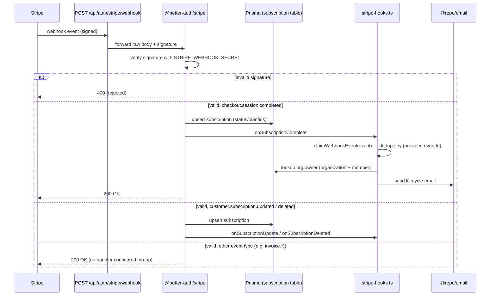

import { Callout } from 'fumadocs-ui/components/callout';

Billing webhooks are **not** handled by a hand-rolled API route. The `@better-auth/stripe` plugin mounts the webhook endpoint, verifies the Stripe signature, persists subscription state, and then dispatches into the project's own hook functions defined in `packages/auth/stripe-hooks.ts`.

## Endpoint & Signature Verification

The webhook handler is mounted by the Better Auth catch-all route. Point the Stripe Dashboard webhook at:

```
${NEXT_PUBLIC_APP_URL}/api/auth/stripe/webhook
```

Locally:

```bash
stripe listen --forward-to localhost:3000/api/auth/stripe/webhook
```

Put the CLI `whsec_` into `STRIPE_WEBHOOK_SECRET`. HTTP mount: `apps/web/app/api/auth/[...all]/route.ts`.

Signature verification is performed entirely by the plugin using `stripeWebhookSecret`. In `packages/auth/server.ts` the Stripe plugin is only added when **both** a Stripe client and a webhook secret are present:

```ts
...(stripeClient && env.STRIPE_WEBHOOK_SECRET
  ? [
      stripe({
        stripeClient,
        stripeWebhookSecret: env.STRIPE_WEBHOOK_SECRET,
        createCustomerOnSignUp: false,
        organization: { enabled: true },
        subscription: {
          enabled: true,
          onSubscriptionComplete: handleSubscriptionComplete,
          onSubscriptionUpdate: handleSubscriptionUpdate,
          onSubscriptionDeleted: handleSubscriptionDeleted,
          plans: buildStripePlans({ /* price IDs */ }),
          authorizeReference: ({ user, referenceId, action }) => /* ... */,
        },
      }),
    ]
  : []),
```

`STRIPE_WEBHOOK_SECRET` is declared in `packages/auth/keys.ts` as an optional `z.string().startsWith("whsec_")`. If it is unset, the plugin is omitted and no webhook endpoint is registered.

The plugin has exactly one dispatch surface, wired in `server.ts`:

- **`subscription.onSubscriptionComplete` / `onSubscriptionUpdate` / `onSubscriptionDeleted`** — typed subscription lifecycle callbacks. The plugin has already upserted the local `subscription` record (status, plan, `stripeSubscriptionId`, `referenceId`) before invoking these; our handlers run as **side effects**, primarily sending notification email.

<Callout type="warn">
The plugin does not configure a raw `onEvent` catch-all. Events outside the three subscription lifecycle callbacks above — notably `invoice.payment_failed` and `invoice.paid` — are **not handled at all** in this codebase today: there is no payment-failure or renewal notification email. If you need those, you'd add an `onEvent` handler to the `stripe()` config yourself.
</Callout>

## Flow



## Event Handlers

Every handler first calls `claimWebhookEvent(event)` (`packages/auth/webhook-idempotency.ts`) and returns immediately if it returns `false` — see [Idempotency](#idempotency) below. After that, the dispatch handlers resolve an **org email context** via `getOrgEmailContext(referenceId)`, which loads the `organization` and its `OWNER` `member` (using `ORG_ROLES.OWNER`) and builds a `dashboardUrl` of `${NEXT_PUBLIC_APP_URL}/${org.slug}/billing`. If the org or owner email is missing, the handler returns early and sends nothing.

| Dispatch source | Stripe trigger | Handler in `stripe-hooks.ts` | What it does |
| --- | --- | --- | --- |
| `subscription.onSubscriptionComplete` | `checkout.session.completed` | `handleSubscriptionComplete` | Sends `sendSubscriptionStartedEmail` with the plan display name and billing interval (`getBillingInterval` compares the price ID against `STRIPE_*_PRICE_ID_ANNUAL`). |
| `subscription.onSubscriptionUpdate` | `customer.subscription.updated` | `handleSubscriptionUpdate` | Reads `event.data.previous_attributes.items`. If no item change, returns (skips status-only updates / period rollovers). Otherwise resolves the previous plan from the previous price ID via `getPlanNameFromPriceId`, compares plan positions using `PLAN_ORDER`, and sends `sendSubscriptionDowngradedEmail` when `previousIndex > newIndex`, else `sendSubscriptionUpgradedEmail`. |
| `subscription.onSubscriptionDeleted` | `customer.subscription.deleted` | `handleSubscriptionDeleted` | Computes the access cutoff from the first subscription item's `current_period_end` (Stripe v22.2+ moved this onto each `SubscriptionItem`) and sends `sendSubscriptionCancelledEmail` with `accessUntil` and a `reactivateUrl`. |

<Callout type="warn">
There is no handler for `invoice.payment_failed` or `invoice.paid` — dunning/payment-failure notifications and renewal-receipt emails are not implemented. `sendPaymentReceiptEmail` exists in `@repo/email` but is not currently called from anywhere (see [Email Templates](/docs/email/templates)).
</Callout>

### Idempotency

Stripe delivers webhooks **at least once** and retries on failure, so the same `event.id` can arrive repeatedly (and concurrently) — but the `@better-auth/stripe` plugin only deduplicates the subscription-*create* path internally. Every handler above guards its own notification side effect with:

```ts
if (!(await claimWebhookEvent(args.event))) {
  return;
}
```

`claimWebhookEvent` (`packages/auth/webhook-idempotency.ts`) inserts a `WebhookEvent` row keyed by the unique `(provider, eventId)` constraint; the first insert wins, and a duplicate/concurrent insert hits the constraint and returns `false`. The claim is recorded *before* the side effect runs, so a best-effort notification that fails afterward is not retried — an accepted tradeoff for lifecycle emails specifically.

### Notes on the handler implementations

- **Plan naming.** `displayPlanName` maps internal plan keys to `PLAN_DISPLAY_NAMES[PlanName]`, falling back to the raw value.
- **Stripe v22.2+ field move.** `handleSubscriptionDeleted` reads `current_period_end` from the first item in `stripeSubscription.items.data`, since Stripe relocated this field from the `Subscription` root onto each `SubscriptionItem`.
- **Database writes.** The handlers in `stripe-hooks.ts` only **read** `organization` and `member` (aside from the `claimWebhookEvent` insert). They do not query `subscription`. The authoritative subscription row write is done by the `@better-auth/stripe` plugin before our hooks fire.

## Source files

- `packages/auth/stripe-hooks.ts` — `handleSubscriptionComplete`, `handleSubscriptionUpdate`, `handleSubscriptionDeleted`, and helpers (`getOrgEmailContext`, `getBillingInterval`, `displayPlanName`)
- `packages/auth/webhook-idempotency.ts` — `claimWebhookEvent`
- `packages/auth/server.ts` — wires `stripeWebhookSecret` and the `subscription.*` callbacks into the `stripe()` plugin
- `apps/web/app/api/auth/[...all]/route.ts` — HTTP mount (`/api/auth/stripe/webhook`)
- `packages/database/prisma/schema.prisma` — `WebhookEvent` model, `(provider, eventId)` unique constraint
